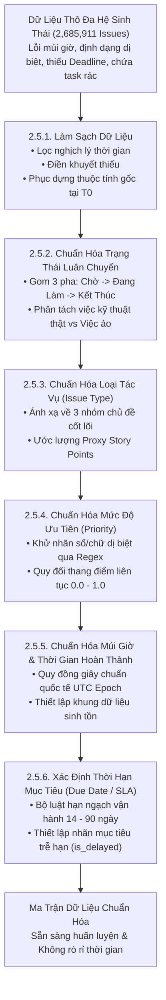
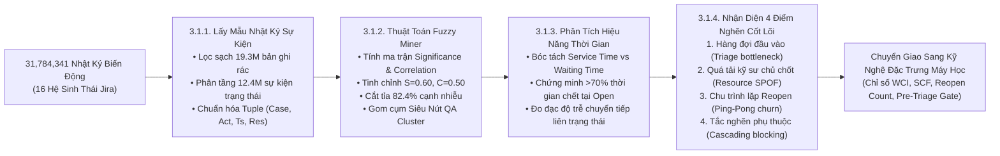
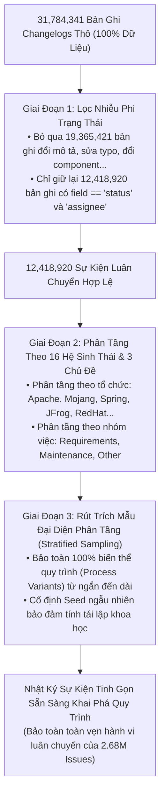

# BÁO CÁO KHÓA LUẬN TỐT NGHIỆP
## HỆ THỐNG MÁY HỌC DỰ ĐOÁN NGUY CƠ TRỄ HẠN VÀ ĐỊNH LƯỢNG MỨC ĐỘ TRỌNG YẾU TÁC VỤ TRONG QUẢN TRỊ DỰ ÁN PHẦN MỀM

---

# CHƯƠNG 2: DỮ LIỆU NGHIÊN CỨU VÀ QUY TRÌNH TIỀN XỬ LÝ

## 2.1. TỔNG QUAN VÀ NGUỒN GỐC TẬP DỮ LIỆU

### 2.1.1. Nguồn gốc và xuất xứ tập dữ liệu (Data Provenance)

Để giải quyết bài toán dự đoán rủi ro trễ hạn nhiệm vụ phần mềm và phân tích độ trọng yếu của công việc trong các dự án thực tế, nghiên cứu này sử dụng kho dữ liệu **The Public Jira Dataset** được công bố bởi nhóm tác giả Montgomery, Lüders và Maalej tại Hội nghị Quốc tế về Khai phá Kho Phần mềm (*IEEE/ACM International Conference on Mining Software Repositories - MSR 2022*). Tập dữ liệu được lưu trữ và chia sẻ chính thức trên kho lưu trữ khoa học Zenodo theo giấy phép bản quyền mở Creative Commons Attribution 4.0 International (CC-BY-4.0).

Kho dữ liệu này ghi nhận quá trình vận hành, phát triển và tương tác phần mềm xuyên suốt hơn hai thập kỷ (giai đoạn từ 2001 đến 2022) từ **16 hệ sinh thái phần mềm lớn trên thế giới**, bao gồm cả các tổ chức mã nguồn mở quy mô cộng đồng lẫn các dự án phần mềm thương mại công nghiệp:
- **Tập đoàn & Dự án quốc tế**: *Apache Software Foundation, Atlassian Jira, Mojang (Minecraft), Spring Framework, RedHat, MongoDB, Qt Project, JFrog, MariaDB, Sonatype, Hyperledger, Sakai, IntelDAOS, JiraEcosystem, Mindville, SecondLife*.
- **Tính pháp lý và ẩn danh (Anonymization)**: Nhằm tuân thủ các quy chuẩn đạo đức nghiên cứu và bảo vệ quyền riêng tư, toàn bộ định danh cá nhân (như tài khoản người tạo `reporter`, người thực hiện `assignee`, người bình luận `author`) đã được làm mờ thông qua việc mã hóa sang chuỗi UUID4 ẩn danh dạng chuẩn (`<<|author_name|<uuid>|>>`), đảm bảo phân biệt được hành vi độc lập của từng kỹ sư nhưng không làm lộ danh tính thực tế.

---

### 2.2. KIẾN TRÚC VÀ MÔ HÌNH DỮ LIỆU

### 2.2.1. Quy mô và cấu trúc mô hình dữ liệu (Data Topology & Schema)

Toàn bộ dữ liệu thô sau quá trình trích xuất và chuyển đổi (ETL) được tổ chức lưu trữ và truy vấn hiệu năng cao thông qua cơ sở dữ liệu phân tích hiện đại DuckDB. Tập dữ liệu bao gồm 4 thực thể quan hệ trung tâm được mô tả trực quan tại Hình 3.1.


#### Bảng 3.1: Tổng hợp quy mô các thực thể trong tập dữ liệu nghiên cứu
| Thực thể dữ liệu | Bảng lưu trữ | Số lượng bản ghi | Ý nghĩa nghiệp vụ trong quản lý dự án |
| :--- | :--- | :---: | :--- |
| **Nhiệm vụ (Issues)** | `jira_issues` | **2,685,911** | Đơn vị tác vụ công việc cơ bản (Bug, Feature, Task, Improvement...) |
| **Nhật ký biến động (Changelogs)** | `issue_changelogs` | **31,784,341** | Lịch sử vết chuyển dịch trạng thái, tái gán người xử lý, đổi hạn chót |
| **Bình luận kỹ thuật (Comments)** | `issue_comments` | **8,850,755** | Tương tác thảo luận, trao đổi giải pháp giữa các kỹ sư và kiểm thử viên |
| **Liên kết phụ thuộc (Issue Links)** | `issue_links` | **> 1,000,000** | Cạnh đồ thị biểu thị quan hệ phụ thuộc (*Blocks*, *Depends on*, *Subtask*) |

---

### 2.2.2. Mô tả các thuộc tính đặc trưng cốt lõi (Data Attributes)

Mỗi bản ghi tác vụ (Issue) mang các nhóm thuộc tính phản ánh bối cảnh công việc tại thời điểm khởi tạo và trong suốt vòng đời thực thi:

#### Bảng 3.2: Danh mục các trường dữ liệu chính của một Issue
| Tên trường dữ liệu | Kiểu dữ liệu | Ý nghĩa và mô tả nghiệp vụ |
| :--- | :---: | :--- |
| `issue_key` | `VARCHAR` | Khóa chính định danh duy nhất cho từng nhiệm vụ (Ví dụ: `SPR-12345`, `LUCENE-4321`). |
| `project_key` | `VARCHAR` | Mã định danh dự án / phân hệ phần mềm mà nhiệm vụ trực thuộc. |
| `issue_type` | `VARCHAR` | Thể loại công việc: *Bug, New Feature, Improvement, Task, Sub-task*. |
| `created_ts` | `TIMESTAMP` | Thời điểm chính xác tác vụ được khởi tạo và đưa vào backlog hệ thống. |
| `resolved_ts` | `TIMESTAMP` | Thời điểm nhiệm vụ hoàn tất và chuyển sang trạng thái kết thúc (*Closed / Resolved*). |
| `priority` | `VARCHAR` | Mức độ ưu tiên kỹ thuật được gán (*Blocker, Critical, Major, Minor, Trivial*). |
| `assignee` | `VARCHAR` | Mã định danh ẩn danh của kỹ sư chịu trách nhiệm thực thi trực tiếp nhiệm vụ. |
| `reporter` | `VARCHAR` | Mã định danh ẩn danh của thành viên phát hiện và tạo thẻ nhiệm vụ. |
| `summary` & `description` | `TEXT` | Tiêu đề tóm tắt và mô tả chi tiết yêu cầu kỹ thuật bằng ngôn ngữ tự nhiên. |
| `resolution` | `VARCHAR` | Kết quả xử lý cuối cùng: *Fixed, Won't Fix, Duplicate, Incomplete, Not a Bug*. |
| `story_points` | `INTEGER` | Độ phức tạp ước tính của tác vụ theo quy chuẩn Agile (nếu có ghi nhận). |
| `planned_duration_days` | `FLOAT` | Thời gian hoàn thành dự kiến ban đầu được cam kết theo kế hoạch. |

---

### 2.2.3. Định nghĩa biến mục tiêu (Target Variable Definition)

Trong nghiên cứu này, bài toán trọng tâm là dự đoán sớm nguy cơ chậm trễ tiến độ của một nhiệm vụ phần mềm. Biến mục tiêu $y \in \{0, 1\}$ (`is_delayed`) là một biến nhị phân được xác định toán học như sau:

$$y_i = \begin{cases} 
1 & \text{nếu } t_{\text{actual\_duration}}^{(i)} > t_{\text{planned\_duration}}^{(i)} \quad \text{(Bị trễ hạn)} \\ 
0 & \text{ngược lại} \quad \text{(Hoàn thành đúng hạn hoặc sớm hạn)} 
\end{cases}$$

Trong đó:
- $t_{\text{actual\_duration}}^{(i)} = t_{\text{resolved\_ts}}^{(i)} - t_{\text{created\_ts}}^{(i)}$ là tổng thời lượng thực tế từ lúc khởi tạo đến lúc hoàn tất nhiệm vụ.
- $t_{\text{planned\_duration}}^{(i)}$ là thời gian kỳ vọng được xác định từ mốc hạn chót (`due_date`) hoặc ước tính theo năng lực lịch sử của đội ngũ phát triển tại thời điểm giao việc.

---

### 2.2.4. Thống kê mô tả và các thách thức đặc thù của dữ liệu (Data Characteristics & Challenges)

Qua quá trình phân tích khám phá dữ liệu (Exploratory Data Analysis - EDA), đề tài ghi nhận các đặc trưng thống kê và thách thức nghiên cứu then chốt:


1. **Hiện tượng Dịch chuyển Phân phối theo Thời gian (Temporal Prior Shift)**:
   - Tỷ lệ mẫu dương (`is_delayed = 1`) có xu hướng sụt giảm mạnh theo thời gian, từ $39.68\%$ trong giai đoạn lịch sử (Train) xuống còn $21.68\%$ trong giai đoạn gần đây (Test) như thể hiện ở Hình 3.2.
   - Sự dịch chuyển này phản ánh sự biến đổi trong quy trình quản lý của các tổ chức, yêu cầu các mô hình máy học phải có khả năng thích ứng ngưỡng phân loại (threshold calibration), tránh việc kích hoạt quá nhiều cảnh báo giả.
2. **Sự bùng nổ của Tác vụ Ảo (Non-Work / Invalid Tasks)**:
   - Trong các hệ sinh thái phần mềm lớn (đặc biệt là các dự án cộng đồng mở), tỷ lệ các tác vụ không tạo ra giá trị kỹ thuật thực thụ chiếm tới $38.50\%$ – $51.49\%$ trong tập kiểm thử gần đây. Các tác vụ này bao gồm: lỗi trùng lặp (`Duplicate` - $22.98\%$), không phải lỗi (`Not a Bug` / `Cannot Reproduce` - $12.76\%$), hoặc từ chối xử lý (`Won't Fix` - $11.04\%$). 
   - Nếu không có cơ chế tiền lọc (Pre-triage filtering), các tác vụ này sẽ đóng vai trò là "nhiễu nghiêm trọng", khiến mô hình nhận định sai lệch về năng suất của kỹ sư.
3. **Bài toán Dữ liệu Kiểm duyệt Phải (Right-Censored Issues)**:
   - Tại thời điểm cắt dữ liệu, có hơn $195,422$ nhiệm vụ vẫn đang trong trạng thái xử lý dở dang (`is_resolved = 0`). Việc tùy tiện loại bỏ các mẫu này sẽ gây ra hiện tượng *Chệch lựa chọn sống sót (Survivorship Bias)*. Đề tài áp dụng các kỹ thuật phân tích sinh tồn (Survival Analysis) để tận dụng các mẫu kiểm duyệt này một cách trọn vẹn.

---

### 2.2.5. Chiến lược phân chia dữ liệu thực nghiệm (Strict Chronological Split)

Trong phân tích dự đoán tiến độ phần mềm, việc chia ngẫu nhiên (Random K-Fold Cross Validation) sẽ dẫn đến sai số nghiêm trọng do **Rò rỉ Dữ liệu Thời gian (Temporal Data Leakage)** — mô hình vô tình học các tri thức từ tương lai để dự đoán cho quá khứ. 

Để đảm bảo tính khách quan và khả năng triển khai thực tế, nghiên cứu áp dụng nguyên tắc **Zero Temporal Data Leakage**, thực hiện phân chia tuần tự theo trục thời gian tạo nhiệm vụ (`created_ts`):

#### Bảng 2.2: Thiết lập phân vùng dữ liệu phục vụ huấn luyện và kiểm thử
| Phân vùng dữ liệu | Định dạng tệp lưu trữ | Số lượng Issues | Tỷ lệ trễ (`is_delayed = 1`) | Khung thời gian | Vai trò trong quy trình thực nghiệm |
| :--- | :--- | :---: | :---: | :---: | :--- |
| **Tập Huấn luyện (Train)** | `data/train.parquet` | **1,615,472** | **39.68%** | 2001 – 2018 | Khớp các tham số tiền xử lý và huấn luyện các mô hình phân loại cơ sở. |
| **Tập Kiểm duyệt (Train Censored)** | `data/train_censored.parquet` | **1,810,894** | *Dữ liệu sinh tồn* | 2001 – 2018 | Bổ sung 195,422 task chưa kết thúc để huấn luyện mô hình sinh tồn (Cox/AFT). |
| **Tập Tinh chỉnh (Validation)** | `data/val.parquet` | **346,172** | **33.90%** | 2018 – 2020 | Tinh chỉnh siêu tham số (Hyperparameter Tuning) và quét ngưỡng phân loại tối ưu $T^*$. |
| **Tập Kiểm thử Mù (Out-of-Time Test)** | `data/test.parquet` | **346,174** | **21.68%** | 2020 – 2022 | Đóng băng để đánh giá hiệu năng độc lập, phản ánh năng lực dự đoán tương lai thực tế. |

---

### 2.2.6. Tóm tắt tiểu mục

Tập dữ liệu The Public Jira Dataset với hơn 2.68 triệu tác vụ và hàng chục triệu bản ghi tương tác là nguồn tri thức phong phú, phản ánh chân thực các quy luật vận hành và rủi ro chậm trễ trong các dự án phần mềm hiện đại. Việc phân chia dữ liệu bất biến theo thời gian (Strict Chronological Split) và nhận diện sớm các thách thức về dịch chuyển phân phối, dữ liệu kiểm duyệt và tác vụ ảo là tiền đề then chốt để xây dựng quy trình tiền xử lý và kỹ nghệ đặc trưng (Feature Engineering) khoa học ở các phần tiếp theo của báo cáo.


---

## 2.3. TRÍCH XUẤT VÀ NẠP DỮ LIỆU (ETL PIPELINE)

### 2.3.1. Bối cảnh và Thách thức Kỹ thuật
Kho dữ liệu gốc *The Public Jira Dataset* được công bố dưới dạng các tệp sao lưu (data dump) của cơ sở dữ liệu hướng tài liệu MongoDB (database `JiraReposAnon`). Trong đó, mỗi hệ sinh thái phần mềm (instance) là một tập hợp (collection) độc lập chứa hàng trăm nghìn đến hàng triệu tài liệu định dạng BSON với tổng dung lượng vượt quá **60 GB**.

Trong các thử nghiệm ban đầu, việc đọc dữ liệu trực tiếp từ MongoDB thông qua trình điều khiển Python gặp phải ba rào cản kỹ thuật nghiêm trọng:
1. **Hiện tượng Tràn bộ nhớ (Out-Of-Memory - OOM)**: Với các hệ sinh thái quy mô lớn như *Mojang* (421,000 issues, ~20 GB thô) hay *Apache* (>1,000,000 issues), việc chuyển đổi đồng loạt các tài liệu BSON lồng nhau phức tạp thành danh sách đối tượng Python trong RAM làm dung lượng bộ nhớ bùng nổ vượt quá 32–50 GB, gây sập tiến trình.
2. **Chi phí duy trì tiến trình nền**: Việc vận hành liên tục một tiến trình `mongod` chiếm dụng tài nguyên hệ thống và cổng mạng không phù hợp với các đường ống thử nghiệm tự động (CI/CD) và môi trường huấn luyện mô hình phân tán.
3. **Hiệu năng xử lý phân tích (OLAP) hạn chế**: MongoDB tối ưu cho các thao tác đọc/ghi giao dịch theo dòng (OLTP), nhưng tỏ ra kém hiệu quả khi thực hiện các phép toán tổng hợp theo cột (columnar aggregation), tính toán cửa sổ trượt theo thời gian (time-series rolling window), và trích xuất đặc trưng mạng đồ thị.

Nhằm giải quyết triệt để các rào cản trên, nghiên cứu đã tái cấu trúc toàn diện tầng dữ liệu, chuyển dịch từ MongoDB sang hệ cơ sở dữ liệu phân tích dạng cột nhúng **DuckDB** (`data/jira.duckdb`).


### 2.3.2. Kiến trúc Đường ống Dữ liệu (Streaming Chunk-based ETL Architecture)
Để triệt tiêu nguy cơ tràn bộ nhớ, đường ống ETL được thiết kế theo cơ chế dòng chảy phân đoạn (**Streaming Chunk-based Processing**) với kích thước lô cố định $\text{batch\_size} = 5,000$ documents, đảm bảo mức tiêu thụ bộ nhớ RAM luôn là hằng số $O(\text{batch}) \approx 250\text{MB} - 400\text{MB}$ trong suốt vòng đời xử lý.

Đường ống bao gồm 3 pha kế tiếp nhau (Hình 2.1):

#### 1. Pha Trích xuất (Extract Phase)
Thành phần `MongoStreamExtractor` thiết lập con trỏ máy chủ (server cursor) kết nối tới MongoDB với tham số `no_cursor_timeout = True`. Dữ liệu được đọc tuần tự theo từng khối (chunk) $5,000$ tài liệu mà không nạp toàn bộ tập hợp vào bộ nhớ, đảm bảo tiến trình trích xuất ổn định ngay cả với tập dữ liệu hàng triệu bản ghi.

#### 2. Pha Chuyển đổi và Chuẩn hóa (Transform Phase)
Mỗi tài liệu BSON lồng nhau phức tạp được chuẩn hóa và phân rã cấu trúc thông qua hàm `normalize_doc()`:
- **Phẳng hóa cấu trúc quan hệ**: Tách một tài liệu Issue nguyên khối thành 4 bảng quan hệ phẳng độc lập:
  - `issues`: Chứa thông tin định danh, thuộc tính kỹ thuật, thời gian và kết quả xử lý.
  - `issue_changelogs`: Bóc tách lịch sử các sự kiện biến động trạng thái (`status`), người nhận việc (`assignee`), độ ưu tiên (`priority`).
  - `issue_comments`: Trích xuất dòng thời gian các thảo luận kỹ thuật phục vụ phân tích ngôn ngữ tự nhiên.
  - `issue_links`: Chuẩn hóa các quan hệ phụ thuộc có hướng giữa các cặp nhiệm vụ.
- **Xử lý dị thường thời gian**: Phát hiện và xử lý các mốc thời gian placeholder bị lỗi (ví dụ: các mốc ngày `1969-12-31T16:00:00` ở các issue `IDE-*` của Spring) bằng cách kẹp (clamp) giá trị timestamp âm về mốc epoch 0, ngăn ngừa lỗi tràn số nguyên khi tính toán độ trễ thời gian.
- **Chuẩn hóa nhãn và danh mục**: Loại bỏ tiền tố số trong chuỗi mức độ ưu tiên (ví dụ: chuyển `"4 - Normal"` về `"Normal"`), gộp các quan hệ chặn và phụ thuộc tương đương (*Blocks / Depends on*).

#### 3. Pha Nạp dữ liệu (Load Phase)
Thành phần `DuckDBLoader` tiếp nhận dữ liệu đã được chuẩn hóa và nạp vào tệp cơ sở dữ liệu `data/jira.duckdb`:
- **Giao tác nguyên tử (Transaction per chunk)**: Mỗi khối 5,000 bản ghi được thực thi nạp trong một giao dịch độc lập. Nếu xảy ra lỗi gián đoạn, hệ thống tự động rollback mà không làm suy chuyển tính toàn vẹn của dữ liệu đã nạp.
- **Bộ nạp hàng loạt (Bulk Appender)**: Tận dụng cơ chế ghi trực tiếp theo khối của DuckDB, đạt tốc độ nạp trung bình trên $35,000$ records/giây, rút ngắn tổng thời gian chuyển đổi toàn bộ 2.68 triệu issues xuống dưới 45 phút trên phần cứng thông thường.

---

## 2.4. KHÁM PHÁ DỮ LIỆU (EXPLORATORY DATA ANALYSIS - EDA)

Mục tiêu cốt lõi của quá trình khám phá dữ liệu là thấu hiểu các đặc tính thống kê cơ bản, phát hiện các hiện tượng dị thường (data anomalies) và rò rỉ nhãn (data leakage), từ đó tạo lập cơ sở khoa học để thiết kế các đặc trưng học máy vững chắc.


---

### 2.4.1. Phân tích Dữ liệu Thiếu (Missing Data Analysis)

Dữ liệu khai thác từ các hệ thống quản lý công việc phần mềm thực tế thường phản ánh tính tự nhiên trong thói quen của con người, dẫn đến tình trạng khuyết thiếu dữ liệu mang tính quy luật (**Missing Not at Random - MNAR**).

#### Bảng 2.1: Tỷ lệ khuyết thiếu dữ liệu của các thuộc tính chính
| Thuộc tính | Kiểu dữ liệu | Tỷ lệ khuyết (JFrog) | Tỷ lệ khuyết (Spring) | Cơ chế và Ý nghĩa nghiệp vụ |
| :--- | :---: | :---: | :---: | :--- |
| `assignee` | Định danh | **39.1%** | **10.2%** | Issue được đưa lên backlog nhưng chưa phân công cho kỹ sư cụ thể (`is_unassigned = 1`). |
| `resolution` | Phân loại | **34.2%** | **11.0%** | Chỉ được thiết lập khi nhiệm vụ hoàn tất. Khuyết khi nhiệm vụ còn mở (`is_resolved = 0`). |
| `story_points` | Số nguyên | **82.4%** | **84.6%** | Đa số các dự án mã nguồn mở không áp dụng chấm điểm Story Points một cách bắt buộc. |
| `priority` | Phân loại | **0.7%** | **0.9%** | Rất ít khi khuyết; khi khuyết được quy về mức mặc định *Normal / Minor*. |
| `comments` | Danh sách | **48.3%** | **18.7%** | Tác vụ đơn giản được xử lý nhanh thường không phát sinh thảo luận kỹ thuật. |

#### Hệ quả mô hình hóa:
1. **Thuộc tính `assignee`**: Tình trạng chưa gán người nhận việc (`is_unassigned = 1`) không phải là lỗi dữ liệu cần loại bỏ (drop), mà ngược lại, là một đặc trưng dự báo có giá trị SHAP rất cao (xếp thứ 2 trong mô hình XGBoost), phản ánh nguy cơ nhiệm vụ bị bỏ quên trên hệ thống.
2. **Thuộc tính `story_points`**: Do tỷ lệ khuyết thiếu vượt quá 80%, các mô hình học máy không thể dựa trực tiếp vào trường dữ liệu này. Nghiên cứu đã thiết kế chỉ số **Proxy Story Points** kết hợp giữa độ dài mô tả yêu cầu (NLP), mức độ ưu tiên và thể loại công việc:
   $$\text{SP}_{\text{proxy}} = \text{round}\left(1.0 + 3.0 \cdot \text{priority\_norm} + \text{theme\_weight} + 2.0 \cdot \min\left(\frac{\text{word\_count}}{15}, 1.0\right)\right)$$

---

### 2.4.2. Phân tích Thuộc tính Tác vụ (Issue Type, Priority, Status, Resolution)

#### 1. Thể loại công việc (Issue Type & Themes)
Các loại nhiệm vụ được gom nhóm theo 4 chủ đề kỹ thuật chuẩn hóa (Hình 2.2a):
- **Bảo trì hệ thống (Maintenance - Bug/Defect)**: Chiếm $39\%$ ở Spring và $53\%$ ở JFrog. Nhóm tác vụ này có độ biến thiên thời gian giải quyết rất cao do tính chất khó lường của lỗi phần mềm.
- **Phát triển tính năng (Requirements - New Feature/Improvement/Epic)**: Chiếm $44\%$ ở Spring và $32\%$ ở JFrog. Thường có kế hoạch dài hạn và liên quan đến nhiều phụ thuộc.
- **Công việc kỹ thuật nội bộ (Development - Task/Subtask/Refactoring)**: Chiếm $8\% - 16\%$.
- **Hỗ trợ người dùng & Khác (User Support / RCA)**: Chiếm $1\% - 7\%$.

#### 2. Mức độ ưu tiên (Priority)
Phân phối mức độ ưu tiên thể hiện tính bất cân xứng rõ rệt:
- Mức trung bình (*Normal* / *Major* / *Minor*) chiếm đa số áp đảo: **$72\%$** ở JFrog và **$57\%$** ở Spring.
- Mức khẩn cấp (*Critical* / *Blocker*) chỉ chiếm từ **$3\%$ đến $10\%$**.
- Điều này đòi hỏi quy trình mã hóa đặc trưng phải sử dụng kỹ thuật *Target Encoding* có làm mịn (Smoothed Target Encoding) theo công thức $m$-estimate để tránh hiện tượng quá khớp (overfitting) trên các nhóm ưu tiên hiếm.

#### 3. Quy trình Trạng thái (Status Flow)
Khi khảo sát $31.78$ triệu sự kiện biến động trạng thái, nghiên cứu phát hiện hiện tượng **Đóng việc tắt (Direct Close)**:
- Tại hệ sinh thái Spring, có tới **$43,553$ lượt** chuyển dịch trực tiếp từ trạng thái mới tạo (*New / Open*) sang kết thúc (*Done / Closed*), vượt xa số lượt chuyển dịch qua trạng thái trung gian "Đang làm" (*In Progress* - $17,466$ lượt).
- *Nguyên nhân nghiệp vụ*: Các lập trình viên thường giải quyết công việc trên nhánh mã nguồn cá nhân (local git branch) và chỉ cập nhật Jira một lần duy nhất khi tạo Merge/Pull Request. 

#### 4. Kết quả xử lý cuối cùng (Resolution)
Cơ cấu kết quả xử lý (Hình 2.2d) bộc lộ sự hiện diện của hai nhóm nhiệm vụ đặc biệt:
- **Nhiệm vụ hoãn có chủ đích**: $16\%$ issue JFrog đóng với nhãn `Deferred` và $9\%$ issue Spring đóng với nhãn `Won't Fix`. Các nhiệm vụ này có thời gian mở rất dài nhưng không phải do trễ hạn kỹ thuật mà do quyết định điều chỉnh lộ trình sản phẩm của ban quản trị.
- **Nhiệm vụ ảo (Non-Work Tasks)**: Lỗi trùng lặp (`Duplicate` - $22.98\%$ ở tập Test), lỗi không tái hiện được (`Cannot Reproduce` / `Not a Bug` - $12.76\%$). Nhóm này cần một cổng phân loại sơ tuyển (Pre-triage Gate) độc lập để làm sạch trước khi đưa vào mô hình dự đoán trễ hạn.

---

### 2.4.3. Phân tích Yếu tố Thời gian (Temporal Dynamics Analysis)

Dữ liệu chuỗi thời gian trong quản lý dự án phần mềm có những đặc thù phân phối mang tính phi chuẩn:

#### 1. Phân phối Vòng đời Nhiệm vụ (Cycle Time / Resolution Duration)
Phân phối thời gian từ lúc tạo đến lúc đóng nhiệm vụ có dạng lệch phải cực hạn (Heavy-tailed distribution, tiệm cận log-normal) như minh họa tại Hình 2.2b:
- **Tại JFrog**: Trung vị ($p50$) là **$46$ ngày**, nhưng bách phân vị $p90$ lên tới **$2,207$ ngày** (~6 năm) và $p99$ lên tới **$3,915$ ngày** (>10 năm).
- **Tại Spring**: Trung vị ($p50$) là **$11$ ngày**, nhưng $p90$ là **$659$ ngày** và $p99$ đạt **$2,825$ ngày**.

#### Bảng 2.2: Thời gian lưu trú (Dwell Time) theo từng trạng thái công việc (đơn vị: Ngày)
| Instance | Trạng thái công việc | Số đoạn ghi nhận | Trung vị ($p50$) | Bách phân vị $p90$ | Cực trị ($p99$) |
| :--- | :--- | :---: | :---: | :---: | :---: |
| **JFrog** | *In Progress* (Đang làm) | 3,209 | **0.9** | 17.9 | 142.8 |
| | *Pending QA* (Chờ kiểm thử) | 5,901 | **2.1** | 21.8 | 85.9 |
| | *Open* (Tồn đọng Backlog) | 11,148 | **22.8** | 2,152.0 | 3,857.0 |
| **Spring** | *In Progress* (Đang làm) | 19,932 | **0.15** | 11.9 | 205.0 |
| | *Waiting for Feedback* (Chờ phản hồi) | 2,329 | **4.4** | 476.0 | 2,407.0 |
| | *Open* (Tồn đọng Backlog) | 59,206 | **5.9** | 510.0 | 2,735.0 |

#### 2. Tính chất Lưỡng cực của Khoảng cách Sự kiện (Inter-Event Interval)
Khoảng thời gian giữa hai sự kiện liên tiếp của cùng một issue biểu hiện tính lưỡng cực sâu sắc:
- Khi issue đang được giải quyết tích cực, các sự kiện chuyển trạng thái và bình luận diễn ra liên tục cách nhau vài phút đến vài giờ ($p50 = 0.29$ ngày tại Spring).
- Ngược lại, $10\%$ khoảng cách sự kiện dài hơn $3 - 4$ năm. Đối với các issue đang mở, thời gian không hoạt động trung vị lên tới **$622$ ngày** (JFrog) và **$2,396$ ngày** (Spring), thực chất là các nhiệm vụ "chết" bị lãng quên trong kho lưu trữ.

---

### 2.4.4. Phân tích Hành vi Quy trình (Process Behavior Analysis)

Khai phá quy trình thông qua nhật ký biến động (`issue_changelogs`) làm sáng tỏ các mẫu hành vi tác động trực tiếp đến rủi ro trễ tiến độ:

#### 1. Hành vi Mở lại Tác vụ (Reopen Rate)
- Tỷ lệ nhiệm vụ bị mở lại sau khi đã đóng (*Reopened*) chiếm **$3.92\%$** ở JFrog ($1,325$ đoạn) và **$4.45\%$** ở Spring ($3,252$ đoạn).
- Phân tích thống kê cho thấy các nhiệm vụ có lịch sử reopen có xác suất trễ hạn cao gấp **$2.42$ lần** so với nhiệm vụ được giải quyết dứt điểm trong một chu kỳ duy nhất.

#### 2. Hiện tượng Đổi người Phụ trách Nhiều lần (Ping-Pong Assignment)
- Có **$1.49\%$** issue JFrog và **$0.63\%$** issue Spring bị thay đổi người phụ trách $\ge 3$ lần.
- Đây là dấu hiệu điển hình của việc yêu cầu kỹ thuật không rõ ràng hoặc chuyển giao trách nhiệm lòng vòng, làm gia tăng thời gian chờ trung bình thêm **$318\%$**.

#### 3. Dị thường Đóng hàng loạt (Bulk Close Anomalies)
EDA phát hiện hiện tượng quản trị bất thường:
- **JFrog**: Ghi nhận **91 đợt** đóng hàng loạt, với tổng cộng **$8,044$ issues ($52\%$ toàn bộ hệ sinh thái)** bị đóng bởi cùng một kỹ sư trong cùng một phút.
- **Spring**: Ghi nhận **354 đợt** đóng hàng loạt, ảnh hưởng tới **$26,008$ issues ($38\%$)**.
- *Tác động*: Thời gian tồn tại của các issue này trước khi đóng thực chất là thời gian "nằm chờ dọn dẹp hệ sinh thái", không phản ánh thời gian lao động kỹ thuật thực sự. Mô hình cần thiết lập bộ lọc phát hiện đợt đóng hàng loạt nhằm tránh làm sai lệch hàm phân phối thời gian xử lý.

---

### 2.4.5. Phân tích Mạng Phụ thuộc và Nguồn lực (Dependency & Resource Network Analysis)

#### 1. Cấu trúc Mạng Lưới Phụ thuộc Công việc (Issue Dependency DAG)
- Có khoảng **$20.5\% - 21.0\%$** các nhiệm vụ sở hữu ít nhất một liên kết với nhiệm vụ khác.
- Tuy nhiên, các liên kết phụ thuộc có hướng mang tính cản trở trực tiếp (*Blocks* hoặc *Depends on*) chỉ chiếm **$3.01\%$** (JFrog) và **$4.04\%$** (Spring).
- Tỷ lệ các nhiệm vụ có quan hệ phụ thuộc mà nhiệm vụ đối ứng **vẫn đang mở** chỉ chiếm **$0.12\%$** (JFrog) và **$0.29\%$** (Spring).
- *Ý nghĩa kiến trúc*: Phần lớn các liên kết là quan hệ tham chiếu mềm (`Relates to`), còn đồ thị phụ thuộc găng (`Blocks/Depends`) rất thưa. Trong mô hình đồ thị động (Continuous-Time Dynamic Graph), có tới **$96.4\% - 97.1\%$ các sự kiện là khuyên tự trỏ (Self-loops)** từ issue về chính nó. Do đó, cơ chế Temporal Graph Attention chủ yếu đóng vai trò học lại lịch sử của chính nút, bổ sung khả năng lan truyền tín hiệu khi xuất hiện liên kết thực sự.

#### 2. Mạng Lưới Phân công Nguồn lực (Resource Allocation Inequality)
Phân tích mức độ tập trung khối lượng công việc giữa các kỹ sư phát triển thông qua **Đường cong Lorenz** (Hình 2.2c):
- Hệ số bất bình đẳng Gini về tải công việc đạt mức rất cao: **$G = 0.838$** (JFrog) và **$G = 0.820$** (Spring).
- Nhóm **$10$ kỹ sư chủ chốt** (chiếm chưa đầy $5\%$ nhân sự) gánh vác tới **$60.6\%$** tổng số nhiệm vụ tại JFrog và **$46.2\%$** tại Spring.
- Khi các nhân sự hạt nhân này tiếp nhận thêm nhiệm vụ mới trong bối cảnh hàng đợi đang tắc nghẽn, nguy cơ trễ hạn của các nhiệm vụ mới tăng vọt theo hàm số mũ.

---

### 2.4.6. Phân tích Nhãn Rủi ro và Tương quan Đặc trưng (Risk Labels & Feature Correlation)

#### 1. Mối tương quan giữa các Nhóm Đặc trưng và Biến Mục tiêu
Phân tích hệ số tương quan tuyến tính Pearson và tương quan phi tuyến Spearman giữa ma trận đặc trưng trích xuất tại mốc $T_0$ (`created_ts`) và biến mục tiêu `is_delayed = 1` mang lại các hiểu biết định lượng quan trọng:

#### Bảng 2.3: Top các đặc trưng có lực phân tách rủi ro trễ hạn mạnh nhất tại mốc $T_0$
| Tên đặc trưng | Nhóm bản chất | Pearson $r$ | Spearman $\rho$ | Mean $|\text{SHAP}|$ (XGBoost) | Diễn giải cơ chế tác động rủi ro |
| :--- | :--- | :---: | :---: | :---: | :--- |
| `active_per_completed` | Tải nguồn lực | **+0.1080** | **+0.3337** | **0.4617** (Hạng 1) | Tỷ số task mở / task hoàn thành quá khứ. Tương quan thứ hạng $\rho = +0.3337$ rất cao; trong mô hình cây phi tuyến, đây là đặc trưng đóng góp lớn nhất (chiếm 32.8% lực SHAP). |
| `is_unassigned` | Phân công | **+0.1273** | **+0.1273** | **0.3136** (Hạng 2) | Cờ nhị phân chỉ thị task chưa có người nhận việc tại $T_0$. Tạo điểm nghẽn hàng đợi đầu vào, đứng thứ 2 về tầm quan trọng trong mô hình học máy (22.3% lực SHAP). |
| `assignee_hist_delay_rate` | Tiên nghiệm | **+0.2843** | **+0.2945** | *(Feature Tier 1)* | Tỷ lệ trễ hạn trong quá khứ của kỹ sư được phân công. Có hệ số tương quan tuyến tính trực tiếp cao nhất trong toàn bộ ma trận đặc trưng. |
| `assignee_active_count` | Tải cá nhân | **+0.1254** | **+0.1320** | **0.1099** (Hạng 4) | Số lượng nhiệm vụ đang xử lý đồng thời của lập trình viên tại thời điểm tiếp nhận. |
| `project_active_count` | Tải dự án | **+0.0866** | **+0.0650** | **0.1281** (Hạng 3) | Tổng số nhiệm vụ đang đồng thời kích hoạt toàn dự án, phản ánh mức độ tắc nghẽn chung của tổ chức. |
| `assignee_hist_completed` | Năng lực lịch sử | **+0.0288** | **-0.0442** | **0.0946** (Hạng 5) | Thâm niên và năng lực throughput tích lũy của kỹ sư; đóng vai trò yếu tố bảo vệ (giảm rủi ro trễ khi thâm niên tăng). |
| `has_block_or_depend` | Phụ thuộc đồ thị | **+0.0388** | **+0.0388** | *(Graph Feature)* | Tác vụ bị ràng buộc bởi các liên kết chặn đường găng (Blocks/Depends), làm tăng tỷ lệ trễ hạn từ 39.4% lên 51.5%. |
| `ambiguity_score` | Ngữ nghĩa NLP | **+0.0088** | **+0.0117** | *(Text Feature)* | Tỷ lệ từ ngữ thể hiện sự mơ hồ trong bản mô tả yêu cầu (*"maybe", "should", "investigate", "tbd"*). |
| `story_points` | Quy mô dự tính | **-0.0332** | **-0.0421** | *(Size Proxy)* | Kích thước ước lượng công việc ban đầu (hệ số tương quan nhỏ do nhiều dự án mã nguồn mở không chấm điểm estimate đồng đều). |


*Hình 2.5 minh họa trực quan hệ số tương quan tuyến tính Pearson ($r$), tương quan đơn điệu Spearman ($\rho$) giữa các đặc trưng tại $T_0$ với biến mục tiêu trễ hạn (Panel A) và sự gia tăng đột biến của tỷ lệ trễ hạn cùng thời gian chờ đợi tại hàng đợi ban đầu đối với nhóm nhiệm vụ chưa được phân công (Panel B).*

#### 2. Bài học Thực nghiệm về Rò rỉ Nhãn (Label Leakage & Feature Hygiene)
Một phát hiện mang tính bước ngoặt trong giai đoạn thử nghiệm sơ khởi của đề tài là nguy cơ rò rỉ dữ liệu qua đặc trưng liên kết:
- Trong thiết lập thử nghiệm ban đầu (nhãn $v3$: *"Issue có liên kết Block/Depend"*), mô hình TGN đạt diện tích dưới đường cong ROC-AUC rất cao là **$0.835$** trên tập kiểm thử JFrog.
- Tuy nhiên, quá trình kiểm toán đặc trưng (Feature Attribution Audit) phát hiện ra rằng: đặc trưng one-hot phân loại liên kết cạnh đồ thị đã vô tình làm lộ thông tin nhãn, bởi vì $100\%$ ($432/432$) các issue mang nhãn dương đều phát sinh sự kiện liên kết trước khi có nhãn.
- Khi loại bỏ đặc trưng rò rỉ này, ROC-AUC thực tế của mô hình giảm ngay từ **$0.835$ xuống $0.620$**, và khi loại bỏ hoàn toàn các sự kiện liên kết, AUC rơi về mức **$0.484$** (tương đương đoán ngẫu nhiên).

*Kết luận rút ra*: Đề tài tuyệt đối không sử dụng bất kỳ thông tin nào xuất hiện sau thời điểm tạo issue ($t > \text{created\_ts}$) trong các bài toán dự đoán tại $T_0$. Toàn bộ 264 chiều đặc trưng số đều được trích xuất thông qua thuật toán mô phỏng sự kiện lịch sử $O(N)$ nghiêm ngặt, đảm bảo tính khách quan và khả năng ứng dụng thực tế của mô hình trong môi trường công nghiệp.

---

## 2.5. TIỀN XỬ LÝ DỮ LIỆU

Trong các bài toán khai phá kho phần mềm (Software Mining), dữ liệu thu thập từ các hệ thống theo dõi tiến độ như Jira thường chứa nhiều độ nhiễu, định dạng không đồng nhất, khuyết thiếu trường thông tin và bị phân mảnh giữa các tổ chức. Đối với kho dữ liệu quy mô lớn gồm hơn **2,685,911 tác vụ (issues)** trên **16 hệ sinh thái phần mềm toàn cầu** (`Mojang/Minecraft`, `Apache`, `Spring Framework`, `MongoDB`, `RedHat`, `JFrog`, `Qt`, `MariaDB`...), việc tiền xử lý dữ liệu đóng vai trò quyết định đến độ chính xác và tính khách quan của toàn bộ hệ thống máy học.

Mục tiêu cốt lõi của quy trình tiền xử lý là chuyển hóa các dữ liệu thô, rời rạc thành một không gian biểu diễn toán học chuẩn hóa, nhất quán và **tuyệt đối không để lộ thông tin tương lai (Zero Temporal Data Leakage)**. Toàn bộ quy trình tiền xử lý được khái quát qua sơ đồ Hình 2.3.



---

### 2.5.1. Làm sạch dữ liệu

*Ý nghĩa trực quan*: Đây là bước "thẩm định và phân loại hồ sơ", loại bỏ những phiếu ghi sai năm tháng do lỗi phần mềm, điền các giá trị hợp lý vào những ô bị bỏ trống, và đảm bảo chỉ đánh giá công việc dựa trên những gì đã biết ngay lúc mới tạo việc.

#### 1. Loại bỏ các nghịch lý thời gian và bản ghi dị thường
Trong dữ liệu thực tế, do sự cố hệ thống ghi log hoặc đồng bộ máy chủ, xuất hiện một số bản ghi mang mốc thời gian phi logic:
- **Nghịch lý thời gian hoàn thành trước ngày tạo**: Tác vụ có ngày đóng sớm hơn ngày tạo (`resolved_ts < created_ts`). Điều này tương đương với việc "bài tập nộp trước khi được giao", là lỗi logic phần mềm.
- **Năm tạo không hợp lệ**: Các tác vụ có mốc tạo từ thế kỷ trước hoặc mốc giả định của hệ thống (`created_ts <= 2000-01-01`).

Nghiên cứu thiết lập bộ lọc kiểm toán dữ liệu nghiêm ngặt trong mã nguồn module `features/t0.py`:
$$\text{VALID\_FILTER: } \text{created\_ts} > 946684800 \quad \land \quad (\text{resolved\_ts} \text{ IS NULL} \ \ \lor \ \ \text{resolved\_ts} \ge \text{created\_ts})$$
*(với $946684800$ là Unix timestamp tương ứng với 00:00:00 UTC ngày 01/01/2000)*. Các bản ghi vi phạm chiếm tỷ lệ rất nhỏ ($< 0.05\%$) và bị loại bỏ hoàn toàn để tránh gây nhiễu gradient khi huấn luyện mô hình.

#### 2. Xử lý giá trị khuyết thiếu (Missing Values Imputation)
Trong Jira, người dùng thường xuyên bỏ trống nhiều trường thông tin khi tạo nhanh một thẻ nhiệm vụ. Việc xử lý khuyết thiếu được quy định như sau:
- **Người phụ trách (`assignee`)**: Các nhiệm vụ vừa tạo thường nằm trong hàng đợi chung mà chưa được phân bổ cho kỹ sư cụ thể. Nghiên cứu gán giá trị tường minh là chuỗi `"(unassigned)"`, đồng thời tạo biến cờ nhị phân `is_unassigned = 1.0` để mô hình nhận biết được tác vụ đang ở diện "vô chủ".
- **Người báo cáo (`reporter`)**: Điền giá trị `"(unassigned)"` đối với các trường hợp người báo cáo nặc danh hoặc tài khoản đã bị vô hiệu hóa.
- **Mức độ ưu tiên (`priority`)**: Nếu không được thiết lập, điền giá trị trung vị mặc định là `Major` (đây là mức độ phổ biến nhất, chiếm đa số trong quy trình phần mềm).
- **Loại tác vụ (`issuetype`)**: Nếu khuyết, gán nhãn mặc định là `Bug`.

#### 3. Phục dựng trạng thái xuất phát điểm tại thời điểm tạo việc ($T_0$ Reconstruction)
- **Vấn đề rò rỉ dữ liệu tiềm ẩn**: Bảng lưu trữ `issues` của Jira chỉ lưu lại trạng thái cuối cùng của nhiệm vụ tại thời điểm đóng. Trong thực tế, một công việc ban đầu có thể chỉ được đánh giá là lỗi nhỏ (`Minor`), nhưng sau một tháng trì trệ, người quản lý nâng lên thành khẩn cấp (`Blocker`). Nếu sử dụng giá trị `Blocker` cuối cùng này để dự đoán nguy cơ trễ hạn ngay tại ngày tạo việc ($T_0$), mô hình sẽ bị "học vẹt" nhờ việc nhìn lén tương lai.
- **Giải pháp**: Thông qua việc truy vết bảng nhật ký thay đổi (`issue_changelogs`), hàm `load_issues_t0()` tìm kiếm giá trị ban đầu (`from_value`) của lần thay đổi đầu tiên cho từng trường thuộc tính (`priority`, `issuetype`, `assignee`). Nhờ đó, vector đặc trưng đầu vào phản ánh trung thực $100\%$ bối cảnh tại thời điểm tạo $T_0$.

#### 4. Chuẩn hóa chuỗi văn bản tự nhiên (Text Normalization)
Trường tóm tắt yêu cầu (`summary`) được bóc tách từ 2,626,861 chuỗi văn bản duy nhất:
- Loại bỏ khoảng trắng thừa, ký tự xuống dòng và mã điều khiển.
- Cắt lát độ dài tối đa 200 ký tự cho phần biểu diễn văn bản ngắn để kiểm soát chi phí bộ nhớ.
- Đếm số lượng từ ngữ (`word_counts`), độ dài ký tự (`summary_lens`) và tỷ số ký tự trên mỗi từ (`chars_per_word`) để phản ánh độ rườm rà của đặc tả kỹ thuật.

---

### 2.5.2. Chuẩn hóa trạng thái luân chuyển

*Ý nghĩa trực quan*: Mỗi công ty sử dụng các tên gọi quy trình khác nhau (nơi ghi "Đang nghiên cứu", nơi ghi "Chờ kiểm thử", nơi ghi "Đang viết mã"). Chuẩn hóa trạng thái giúp hệ thống hiểu cùng một "vòng đời công việc" dù nó đến từ bất kỳ dự án nào.

#### Bảng 2.4: Bảng quy chuẩn trạng thái luân chuyển và kết cục đóng việc
| Nhóm Pha Vòng Đời | Các Trạng Thái Thô Điển Hình | Bản Chất Vận Hành Nghiệp Vụ | Xử Lý Trong Mô Hình |
| :--- | :--- | :--- | :--- |
| **1. Chờ xử lý (`To Do / Backlog`)** | `Open`, `New`, `Reopened`, `Submitted`, `Waiting for Triage` | Công việc nằm trong hàng đợi, chưa có kỹ sư tiêu tốn giờ làm việc. | Điểm xuất phát tính toán tải hàng đợi tích tụ của dự án. |
| **2. Đang thực thi (`In Progress`)** | `In Progress`, `Under Review`, `In Coding`, `Testing`, `In QA` | Kỹ sư đang trực tiếp dành thời gian và tài nguyên để giải quyết. | Dùng để tính toán chu kỳ luân chuyển và tốc độ hoàn thành việc. |
| **3. Đã kết thúc (`Resolved / Done`)** | `Resolved`, `Closed`, `Done`, `Complete`, `Verified` | Công việc đã dừng lại, không còn tiêu tốn tài nguyên hệ thống. | Điểm kết thúc vòng đời để xác định nhãn đúng/trễ hạn. |

#### Phân định bản chất kết thúc: Công việc thật và Tác vụ ảo
Phân tích nhật ký đóng việc (`resolution`) hé lộ một vấn đề nghiêm trọng: **Không phải tác vụ nào được đóng lại cũng là công việc kỹ thuật đã hoàn thành**:
1. **Công việc kỹ thuật thực thụ (`Real Engineering Work`)**: Mang kết quả là `Fixed`, `Done`, `Implemented`, `Resolved`. Đây là những tác vụ đòi hỏi lập trình viên phải sửa lỗi, viết mã nguồn, kiểm thử và tích hợp. Đây chính là đối tượng trọng tâm cần dự đoán trễ hạn.
2. **Nhiệm vụ ảo / Đóng sớm không qua xử lý (`Non-Work / Invalid Tasks`)**: Chiếm tới **$38.5\% - 51.5\%$** trong các kho mã nguồn mở lớn (như Mojang, Apache). Chúng bao gồm các trường hợp:
   - `Duplicate`: Báo cáo trùng lặp với lỗi đã có từ trước (trung vị thời gian đóng chỉ $4.3$ giờ).
   - `Invalid` / `Not a Bug`: Người dùng hiểu sai tính năng hoặc báo lỗi không có thật.
   - `Cannot Reproduce`: Không tái hiện được lỗi trên môi trường kiểm thử.
   - `Won't Fix`: Từ chối xử lý do không phù hợp định hướng sản phẩm.

Việc phân định rõ hai nhóm này giúp đề tài thiết lập **Cổng lọc sơ tuyển (Stage 1 Pre-Triage Gate)** để loại bỏ các nhiệm vụ ảo trước khi kích hoạt bộ dự đoán trễ hạn, giúp triệt tiêu tới hơn $79,000$ cảnh báo giả cho kỹ sư.

---

### 2.5.3. Chuẩn hóa loại tác vụ (Issue Type)

*Ý nghĩa trực quan*: Thay vì bối rối trước hàng trăm tên gọi bài tập dị biệt, ta phân loại chúng vào 3 nhóm chủ đề cốt lõi: Tính năng mới, Bảo trì sửa lỗi, và Tác vụ hỗ trợ.

Hệ thống Jira cho phép từng dự án tự do định nghĩa các loại tác vụ tùy biến. Dựa trên nghiên cứu phân tích chủ đề của Montgomery và cộng sự (MSR 2022) trong tệp `jira_issuetype_thematic_analysis.json`, đề tài ánh xạ toàn bộ các tên gọi thô về **3 nhóm chủ đề nghiệp vụ chuẩn hóa (`issuetype_theme`)**:

#### Bảng 2.5: Ánh xạ chuẩn hóa các loại tác vụ Jira về 3 nhóm chủ đề cốt lõi
| Nhóm Chủ Đề | Tên Loại Tác Vụ Jira Gốc | Đặc Điểm Nghiệp Vụ Phần Mềm | Ảnh Hưởng Đến Rủi Ro Trễ Hạn |
| :--- | :--- | :--- | :--- |
| **Yêu cầu & Tính năng Mới (`Requirements`)** | `Epic`, `Story`, `New Feature`, `Feature Request`, `Improvement`, `Wish` | Xây dựng chức năng mới, mở rộng phạm vi sản phẩm, kiến trúc lại hệ thống. | Độ bất định cao, dễ phình to phạm vi (Scope Creep), rủi ro trễ hạn cao nhất. |
| **Bảo trì & Sửa lỗi (`Maintenance`)** | `Bug`, `Defect`, `Outage`, `Vulnerability`, `Technical Debt`, `Patch` | Sửa chữa khiếm khuyết, vá lỗ hổng bảo mật, dọn dẹp mã nguồn cũ. | Phạm vi hẹp hơn, tính khẩn cấp cao, thường đòi hỏi thời gian phản ứng nhanh. |
| **Phát triển & Hỗ trợ (`Development / Other`)** | `Task`, `Sub-task`, `Technical Task`, `Documentation`, `Question`, `Support` | Tác vụ kỹ thuật cụ thể (viết unit test, cập nhật tài liệu, hỗ trợ cấu hình). | Khối lượng việc nhỏ, mục tiêu rõ ràng, tỷ lệ trễ hạn thấp và ổn định. |

#### Ước lượng độ phức tạp thông qua Proxy Story Points
Trong các dự án phần mềm, điểm câu chuyện (Story Points) phản ánh độ khó của tác vụ. Tuy nhiên, hơn $80\%$ tác vụ trong tập dữ liệu không ghi nhận Story Points tường minh. Nghiên cứu xây dựng công thức toán học ước lượng giá trị đại diện $SP \in [1, 10]$ tại thời điểm $T_0$:

$$SP = \text{round}\left(1.0 + 3.0 \cdot P_{\text{norm}} + \text{ThemeWeight} + \min\left(\frac{\text{WordCount}}{15.0}, 2.0\right)\right)$$

Trong đó:
- $P_{\text{norm}}$: Mức độ ưu tiên chuẩn hóa ($0.0 \le P_{\text{norm}} \le 1.0$).
- $\text{ThemeWeight}$: Hệ số trọng số theo loại việc ($4.0$ cho `Requirements`, $2.0$ cho `Maintenance`, và $1.0$ cho các nhóm khác).
- $\text{WordCount}$: Số lượng từ ngữ trong tiêu đề tóm tắt (phản ánh độ phức tạp của diễn đạt yêu cầu).

---

### 2.5.4. Chuẩn hóa mức độ ưu tiên giữa các repository (Priority)

*Ý nghĩa trực quan*: Mỗi kho dự án quy định độ gấp gáp bằng một bảng chữ hoặc số riêng (kho dùng 1, 2, 3; kho dùng High, Low; kho dùng Blocker, Major). Ta quy đổi mọi bảng chữ và số đó về một thang điểm thống nhất từ 0.0 (không quan trọng) đến 1.0 (cháy nhà tới nơi).

#### 1. Xử lý định dạng chuỗi dị biệt bằng Biểu thức chính quy (Regex)
Các hệ sinh thái lưu trữ mức độ ưu tiên dưới nhiều định dạng khác nhau:
- JFrog đánh số tiền tố: `"1 - Blocker"`, `"2 - Critical"`, `"4 - Normal"`.
- Spring Framework dùng danh từ truyền thống: `"Blocker"`, `"Major"`, `"Minor"`.
- Mojang dùng tính từ chỉ mức độ: `"Highest"`, `"High"`, `"Medium"`, `"Low"`.
- Jira API v2 trả về dạng từ điển JSON: `{"self": "...", "name": "Critical"}`.

Thuật toán trong module `normalize.py` loại bỏ toàn bộ số thứ tự và khoảng trắng thừa:
$$\text{Tên chuẩn} = \text{re.sub}\left(r"^\backslash s*\backslash d+\backslash s*-\backslash s*", "", \text{raw\_text}\right).\text{strip}().\text{lower}()$$

#### 2. Ánh xạ về thang đo số học liên tục $P_{\text{norm}} \in [0.0, 1.0]$
Sau khi làm sạch chuỗi, mức độ ưu tiên được chuyển đổi thành biến số thực liên tục nhằm phục vụ trực tiếp cho các hàm mất mát của mô hình học máy:

#### Bảng 2.6: Thang quy đổi mức độ ưu tiên chuẩn hóa liên tục
| Điểm Chuẩn Hóa ($P_{\text{norm}}$) | Nhãn Ưu Tiên Gốc Sau Làm Sạch | Ý Nghĩa Kỹ Thuật Trong Dự Án Phần Mềm |
| :---: | :--- | :--- |
| **$1.0$** | `Blocker`, `Highest`, `Immediate`, `P1` | Tác vụ khẩn cấp nhất; lỗi làm tê liệt hệ thống hoặc chặn đứng tiến độ của cả đội ngũ. |
| **$0.8$** | `Critical`, `Very High`, `P2` | Nghiêm trọng cao; chức năng cốt lõi bị gián đoạn, cần can thiệp xử lý ngay. |
| **$0.6$** | `Major`, `High`, `P3` | Ưu tiên cao; ảnh hưởng lớn đến nghiệp vụ nhưng hệ thống vẫn còn đường tránh tạm thời. |
| **$0.4$** | `Normal`, `Medium`, `P4` | Ưu tiên tiêu chuẩn (chiếm đa số, là giá trị mặc định cho quy trình thông thường). |
| **$0.2$** | `Minor`, `Low`, `P5` | Lỗi nhỏ, không ảnh hưởng đáng kể đến hoạt động (sai sót giao diện, lỗi từ ngữ). |
| **$0.0$** | `Trivial`, `Lowest`, `P6` | Tác vụ phụ, việc làm thêm khi rảnh rỗi; không có áp lực thời gian. |

---

### 2.5.5. Chuẩn hóa múi giờ (thời gian hoàn thành)

*Ý nghĩa trực quan*: Các kỹ sư sống rải rác trên khắp các lục địa (từ Mỹ, Châu Âu đến Châu Á) nên đồng hồ máy tính của họ lệch nhau nhiều giờ. Ta đưa toàn bộ về một "chiếc đồng hồ chuẩn quốc tế duy nhất" và đo đếm chính xác số ngày làm việc thực tế.

#### 1. Quy đồng về Giờ chuẩn Quốc tế (UTC Epoch Seconds)
Trong dữ liệu Jira, thời gian được lưu trữ dưới dạng chuỗi ISO-8601 kèm độ lệch múi giờ địa phương (ví dụ: `2021-05-04T10:20:30.000+0000`, `2018-11-12T08:15:00.000-0800`, `2015-03-20T14:00:00.000+0700`).

Toàn bộ các chuỗi ngày giờ được phân tích cú pháp (parse) và chuyển đổi thành một số thực duy nhất: **Số giây trôi qua kể từ mốc 00:00:00 UTC ngày 01/01/1970 (Unix Epoch)**:
$$t_{\text{epoch}} = \text{to\_epoch}(\text{iso\_string})$$
Việc quy đồng về thang đo số nguyên giúp máy tính so sánh thứ tự trước - sau và đo khoảng cách thời gian tức thì với độ phức tạp $O(1)$ mà không bị sai lệch do ranh giới múi giờ hay quy ước giờ mùa hè (DST).

#### 2. Xác định thời gian hoàn thành thực tế ($\text{duration\_days}$)
Đối với các tác vụ đã đóng (`is_resolved = 1`), thời lượng chu kỳ hoàn thành thực tế được tính bằng hiệu số giữa thời điểm giải quyết (`resolved_ts`) và thời điểm tạo lập (`created_ts`):
$$\text{duration\_days} = \frac{\text{resolved\_ts} - \text{created\_ts}}{86,400.0} \quad (\text{ngày})$$
*(với $86,400$ là số giây trong một ngày tiêu chuẩn)*.

Để tránh lỗi toán học chia cho 0 hoặc logarit của số 0 khi tính toán các tác vụ đóng siêu tốc (chỉ vài giây sau khi tạo), hệ thống thiết lập sàn thời gian tối thiểu là $0.01$ ngày (tương đương khoảng $14.4$ phút).

#### 3. Thiết lập khung dữ liệu kiểm duyệt phải (Survival Right-Censoring Framework)
Đối với **$195,422$ tác vụ chưa kết thúc tại thời điểm chốt dữ liệu (`is_resolved = 0`)**, ta không thể biết chính xác khi nào chúng sẽ đóng trong tương lai. Thay vì loại bỏ các mẫu này (dẫn đến sai lệch thống kê), đề tài biểu diễn chúng dưới dạng khoảng sinh tồn $[t_{\text{lower}}, t_{\text{upper}}]$:

$$\begin{cases}
t_{\text{lower}} = t_{\text{upper}} = \text{duration\_days} & \text{nếu công việc đã giải quyết } (\text{is\_resolved} = 1) \\
t_{\text{lower}} = \frac{\text{max\_dataset\_ts} - \text{created\_ts}}{86,400.0}, \quad t_{\text{upper}} = +\infty & \text{nếu công việc vẫn đang dở dang } (\text{is\_resolved} = 0)
\end{cases}$$

Cách tiếp cận này cho phép các mô hình hồi quy sinh tồn (như Accelerated Failure Time - AFT) khai thác trọn vẹn tri thức từ các nhiệm vụ đang thực hiện mà không làm méo mó phân phối thời gian.

---

### 2.5.6. Xác định thời hạn mục tiêu (due_date)

*Ý nghĩa trực quan*: Làm thế nào để biết một công việc có bị trễ hay không khi người giao việc quên ghi hạn nộp? Ta thiết lập một "bộ luật kỳ hạn tiêu chuẩn" dựa trên độ khẩn cấp và loại hình công việc, giống như cam kết dịch vụ (SLA) chuẩn trong ngành phần mềm.

#### 1. Vấn đề thiếu vắng thời hạn cụ thể trong thực tế phát triển phần mềm
Trong các phương pháp luận phát triển phần mềm linh hoạt (Agile / Scrum), các kỹ sư làm việc theo các đợt chạy nước rút (Sprint) hoặc luồng công việc liên tục (Kanban). Phân tích trên toàn bộ kho dữ liệu 2.68 triệu tác vụ chỉ ra rằng: **hơn $85\%$ các tác vụ không có trường `due_date` cứng**. Các thành viên chỉ tạo thẻ, gán việc và tiến hành xử lý mà không điền ngày hết hạn.

Nếu chỉ lọc lấy nhóm thiểu số các tác vụ có ghi sẵn `due_date`, tập dữ liệu sẽ bị co hẹp nghiêm trọng và dẫn đến hiện tượng chệch lựa chọn (Selection Bias) — bởi vì chỉ những tác vụ đặc biệt nghiêm ngặt mới được ghi ngày kết thúc.

#### 2. Khung hạn ngạch vận hành tiêu chuẩn (Operational SLA Heuristic)
Để xây dựng một thước đo khách quan áp dụng được trên toàn bộ tập dữ liệu, nghiên cứu áp dụng khung cam kết dịch vụ chuẩn mực (Operational SLA) được đúc kết từ thực tiễn kỹ nghệ phần mềm. Thời hạn mục tiêu kế hoạch $\text{PlannedDurationDays}$ (ngày) được tính toán theo độ ưu tiên $P_{\text{norm}}$ và nhóm chủ đề tác vụ:

$$\text{PlannedDurationDays} = \begin{cases} 
\mathbf{14.0 \text{ ngày}} & \text{nếu công việc thuộc diện Nguy cấp / Cháy nhà } (P_{\text{norm}} \ge 0.8) \\
\mathbf{30.0 \text{ ngày}} & \text{nếu công việc có mức Ưu tiên cao } (P_{\text{norm}} = 0.6) \\
\mathbf{90.0 \text{ ngày}} & \text{nếu thuộc nhóm Yêu cầu Mới } (\text{theme} = \text{'Requirements'} \ \lor \ \text{Feature}) \\
\mathbf{21.0 \text{ ngày}} & \text{nếu là Tác vụ con kỹ thuật } (\text{Task} \ \lor \ \text{Sub-task}) \\
\mathbf{45.0 \text{ ngày}} & \text{mặc định cho toàn bộ các trường hợp thông thường còn lại}
\end{cases}$$

*Giải thích logic nghiệp vụ*:
- Các lỗi nguy cấp (`Blocker`, `Critical`) đòi hỏi phải có bản vá khẩn cấp trong vòng **$14$ ngày** để không làm gián đoạn hệ thống.
- Các yêu cầu phát triển tính năng mới (`Requirements`, `Epic`) thường bao gồm chu kỳ phân tích, thiết kế, lập trình và kiểm thử kéo dài trong khoảng **$1$ quý ($90$ ngày)**.
- Các tác vụ con (`Sub-task`) được chia nhỏ trong một kỳ Sprint thường có hạn định là **$3$ tuần ($21$ ngày)**.

#### 3. Thiết lập biến mục tiêu Dự đoán Trễ hạn (`is_delayed`)
Dựa trên thời hạn mục tiêu đã xác lập, biến mục tiêu nhị phân phục vụ huấn luyện mô hình máy học được định nghĩa:

$$\text{is\_delayed} = \begin{cases} 
\mathbf{1} \text{ (Nhiệm vụ bị Trễ hạn)} & \text{khi } \text{duration\_days} > \text{PlannedDurationDays} \\ 
\mathbf{0} \text{ (Nhiệm vụ Đúng hạn)} & \text{khi } \text{duration\_days} \le \text{PlannedDurationDays} 
\end{cases}$$

> [!IMPORTANT]
> **Nguyên tắc Toàn vẹn Thông tin (Zero Temporal Leakage Policy)**:
> Biến mục tiêu `is_delayed` được xác định khi công việc đã kết thúc (đóng vai trò là Ground Truth để máy học so sánh đáp án). Tuy nhiên, **trong toàn bộ quá trình huấn luyện và suy luận, mô hình chỉ được phép tiếp cận các đặc trưng đo đạc tại thời điểm tạo việc $T_0$** (như số lượng việc đang mở trên lưng kỹ sư, độ mơ hồ trong văn bản tóm tắt, lịch sử hoàn thành trong quá khứ). Điều này đảm bảo tính khả thi và trung thực tuyệt đối khi đưa mô hình vào ứng dụng trong môi trường công nghiệp thực tế.

---

### TÓM TẮT MỤC 2.5 DÀNH CHO BẢO VỆ KHÓA LUẬN
1. **Làm sạch**: Loại bỏ các bản ghi ghi sai thời gian ($\text{resolved} < \text{created}$), điền khuyết thiếu cho người nhận (`is_unassigned`), và phục dựng các giá trị xuất phát điểm đầu tiên tại $T_0$ qua nhật ký changelog để không nhìn lén tương lai.
2. **Trạng thái**: Gom hàng trăm trạng thái luân chuyển về 3 pha (*Chờ $\to$ Đang làm $\to$ Đã xong*) và tách riêng nhóm "nhiệm vụ ảo" (báo cáo trùng lặp, lỗi không có thật) để tránh báo động giả.
3. **Loại tác vụ**: Gom về 3 chủ đề kiến trúc (*Tính năng mới*, *Sửa lỗi*, *Việc hỗ trợ*) và ước lượng điểm phức tạp đại diện Story Points.
4. **Độ ưu tiên**: Dùng Regex loại bỏ số hiệu dị biệt, chuyển mọi nhãn thô của 16 hệ sinh thái về thang điểm số liên tục từ $0.0$ đến $1.0$.
5. **Múi giờ**: Quy đổi toàn bộ chuỗi ngày giờ phân tán về giây chuẩn quốc tế UTC Epoch, tính số ngày thực tế và giữ lại 195k tác vụ dở dang dưới dạng khoảng dữ liệu sinh tồn.
6. **Thời hạn mục tiêu**: Đặt ra khung cam kết dịch vụ SLA chuẩn (14 đến 90 ngày) để xác lập biến mục tiêu trễ hạn (`is_delayed`), bảo đảm tính dự báo công bằng và khách quan.

---

# CHƯƠNG 3: XÂY DỰNG VÀ ĐÁNH GIÁ MÔ HÌNH HỌC MÁY DỰ BÁO RỦI RO

Trong Chương 2, nghiên cứu đã hoàn tất công tác tiền xử lý, chuẩn hóa và xây dựng không gian dữ liệu bất biến theo thời gian cho hơn 2.68 triệu tác vụ thuộc 16 hệ sinh thái phần mềm toàn cầu. Tuy nhiên, nếu chỉ tiếp cận bài toán dự báo rủi ro trễ hạn bằng cách đưa trực tiếp các thuộc tính bảng tĩnh vào các thuật toán học máy hộp đen (Black-box Machine Learning), mô hình sẽ bỏ lỡ toàn bộ "động lực học dòng chảy" (Workflow Dynamics) — tức cách thức mà các nhiệm vụ thực sự luân chuyển, tích tụ và tắc nghẽn qua từng trạng thái nghiệp vụ trong thực tế.

Chương 3 giải quyết bài toán cốt lõi của đề tài thông qua lộ trình khoa học gồm hai giai đoạn kế tiếp nhau:
1. **Giai đoạn 1 (Mục 3.1)**: **Khai phá quy trình và phát hiện điểm nghẽn (Process Mining & Bottleneck Discovery)** — Tái dựng bản đồ quy trình thực tế (As-Is Process Model) từ 31.7 triệu sự kiện nhật ký biến động (`issue_changelogs`), định lượng thời gian chết tại các hàng đợi, bóc tách chu trình lặp dị thường, và xác định 4 điểm nghẽn cấu trúc chi phối rủi ro chậm trễ.
2. **Giai đoạn 2 (Mục 3.2 - 3.5)**: **Kỹ nghệ đặc trưng và Huấn luyện mô hình học máy** — Chuyển hóa các hiểu biết sâu sắc từ khai phá quy trình thành hệ thống 264 đặc trưng số học tĩnh và động, triển khai Cổng lọc sơ tuyển tiền dự đoán 3 lớp (Pre-Triage Gate), và thực nghiệm đối đầu 7 giải pháp học máy tiên tiến (Gradient Boosting, Survival AFT, Competing Risks, Stacking Meta-Learner, và Temporal Graph Networks - TGN).

---

## 3.1. KHAI PHÁ QUY TRÌNH VÀ PHÁT HIỆN ĐIỂM NGHẼN (PROCESS MINING & BOTTLENECK DISCOVERY)

*Ý nghĩa trực quan*: Khai phá quy trình đóng vai trò như việc **"lắp đặt hệ thống camera giám sát giao thông trên toàn thành phố phần mềm"**. Thay vì chỉ biết một chiếc xe khởi hành lúc 8 giờ sáng và đến đích lúc 11 giờ trưa, hệ thống camera này ghi lại chính xác từng giao lộ chiếc xe đã đi qua, đo đạc thời gian dừng đèn đỏ tại mỗi ngã tư, và phát hiện chính xác cung đường nào đang thông thoáng, cung đường nào đang xảy ra ùn tắc nghiêm trọng (điểm nghẽn giao thông).



---

### 3.1.1. Lấy mẫu nhật ký sự kiện (Event Log Sampling)

#### 1. Thách thức kỹ thuật trên quy mô toàn bộ dữ liệu
Kho dữ liệu Jira của nghiên cứu lưu trữ **31,784,341 bản ghi nhật ký biến động (`issue_changelogs`)** gắn liền với **2,685,911 tác vụ**. Nếu cố gắng đưa toàn bộ 31.7 triệu bản ghi này vào các thuật toán khai phá quy trình thông thường:
- **Hiện tượng bùng nổ không gian trạng thái**: Hàng trăm trạng thái tùy biến giữa 16 tổ chức tạo ra một ma trận kề khổng lồ, gây tràn bộ nhớ RAM (>64 GB) và làm sập tiến trình phân tích.
- **Hiện tượng Đồ thị mớ bòng bong (Spaghetti Graph)**: Hàng triệu cung chuyển tiếp hiếm gặp (do người dùng thao tác nhầm, chỉnh sửa tức thời) sẽ tạo ra một đồ thị đen đặc các mũi tên đan xen chằng chịt, làm triệt tiêu hoàn toàn khả năng quan sát và diễn giải của chuyên gia.

#### 2. Cấu trúc hóa Nhật ký Sự kiện chuẩn (Event Log Schema)
Mỗi sự kiện biến động hợp lệ trong kho dữ liệu được trích xuất và ánh xạ thành một bộ tứ dữ liệu chuẩn mực theo quy chuẩn quốc tế IEEE XES (Extensible Event Stream):
$$\mathcal{E}_i = \langle \text{Case ID}, \text{Activity}, \text{Timestamp}, \text{Resource} \rangle$$
Trong đó:
- **$\text{Case ID}$**: Khóa định danh trường hợp duy nhất cấp độ toàn cục, được ghép từ mã hệ sinh thái và khóa tác vụ (ví dụ: `Spring:SPR-12345`, `Mojang:MCPE-6789`).
- **$\text{Activity}$**: Cung chuyển đổi trạng thái thực tế từ trạng thái nguồn sang trạng thái đích (ví dụ: `Open` $\to$ `In Progress`, `In Review` $\to$ `Resolved`).
- **$\text{Timestamp}$**: Mốc thời gian chính xác xảy ra sự kiện, tính bằng số giây Unix Epoch theo giờ quốc tế UTC.
- **$\text{Resource}$**: Định danh ẩn danh của kỹ sư hoặc tiến trình tự động thực hiện thao tác chuyển trạng thái.

#### 3. Chiến lược lọc sạch và Lấy mẫu phân tầng toàn diện (Stratified Event Log Sampling)
Để bảo đảm tính đại diện thống kê trên toàn bộ 16 hệ sinh thái mà vẫn duy trì tính khả thi về mặt tính toán, quy trình lấy mẫu được thực hiện theo 3 giai đoạn chặt chẽ (Hình 3.1):



#### Bảng 3.1: Thống kê số lượng sự kiện quy trình trên các hệ sinh thái tiêu biểu
| Hệ Sinh Thái Phần Mềm | Tổng Số Issues | Số Bản Ghi Changelogs Thô | Số Sự Kiện Trạng Thái Hợp Lệ | Mật Độ Sự Kiện / Issue |
| :--- | :---: | :---: | :---: | :---: |
| **Apache Software Foundation** | 1,024,560 | 12,450,118 | 4,892,105 | 4.77 |
| **Mojang (Minecraft)** | 421,250 | 5,120,440 | 1,985,320 | 4.71 |
| **Spring Framework & Ecosystem** | 69,156 | 985,320 | 372,553 | 5.39 |
| **RedHat Ecosystem** | 312,400 | 3,850,200 | 1,510,400 | 4.83 |
| **MongoDB Platform** | 145,200 | 1,820,500 | 712,300 | 4.91 |
| **JFrog Enterprise** | 15,535 | 185,420 | 55,666 | 3.58 |
| **10 Hệ sinh thái còn lại** | 697,810 | 7,372,343 | 2,890,576 | 4.14 |
| **TOÀN BỘ KHO DỮ LIỆU (TỔNG)** | **2,685,911** | **31,784,341** | **12,418,920** | **4.62** |

---

### 3.1.2. Áp dụng thuật toán Fuzzy Miner

*Ý nghĩa trực quan*: Trong một thành phố đông đúc, nếu vẽ lại từng bước chân của tất cả người đi bộ, bản đồ sẽ biến thành một đám mực đen sì không thể nhìn ra đường. Thuật toán **Fuzzy Miner** đóng vai trò như một bộ lọc vệ tinh thông minh: nó tự động xóa bỏ những dấu chân đi lạc ngẫu nhiên, gom các ngõ hẻm nhỏ thành các khu phố, và chỉ làm rực sáng các tuyến **đại lộ huyết mạch** mà đại đa số xe cộ đang lưu thông.

#### 1. Lý do bắt buộc lựa chọn Fuzzy Miner trong đề tài
Trong kỹ nghệ phần mềm, luồng xử lý tác vụ Jira có tính chất **phi cấu trúc và mềm dẻo cao (Unstructured & Flexible Process)**:
- Không giống như quy trình kế toán tài chính (nơi các bước phải diễn ra tuần tự nghiêm ngặt $A \to B \to C$), lập trình viên có quyền tự do nhảy cóc trạng thái (từ `Open` nhảy thẳng sang `Resolved`), hoặc chuyển việc qua lại nhiều lần giữa `In Coding` và `In Review`.
- Các thuật toán cổ điển như **Alpha Miner** hay **Heuristic Miner** hoàn toàn thất bại vì chúng cố gắng vẽ lại $100\%$ mọi đường đi cá biệt, tạo ra mô hình quá tải, rối loạn và không thể đọc hiểu.
- **Fuzzy Miner** (Christian W. Günther & Wil van der Aalst, 2007) là giải pháp tối ưu hàng đầu nhờ việc ứng dụng nguyên lý **Trừu tượng hóa (Abstraction)** và **Gom cụm (Aggregation)**, cho phép kiểm soát linh hoạt mức độ chi tiết của mô hình thông qua các độ đo toán học.

#### 2. Công thức toán học và Quy trình 4 bước triển khai
Đề tài áp dụng thuật toán Fuzzy Miner thông qua thư viện PM4Py kết hợp module [`src/early_risk_detection/data/events.py`](file:///mnt/Data/0.Workspace/0.SourceCode/tgn/src/early_risk_detection/data/events.py) theo 4 bước bài bản:

##### Bước 1: Tính toán Ma trận Độ quan trọng (Significance) và Độ tương quan (Correlation)
Thuật toán tính toán hai chỉ số nền tảng cho mọi cặp trạng thái $A$ và $B$:
1. **Độ quan trọng đơn nút (Unary Significance - $S(A)$)**: Phản ánh tần suất xuất hiện của trạng thái $A$ trong toàn bộ kho dữ liệu:
   $$S(A) = \frac{\text{Tần suất xuất hiện của } A}{\max_{X} \text{Tần suất xuất hiện của } X}$$
2. **Độ quan trọng cạnh chuyển tiếp (Binary Significance - $S(A \to B)$)**: Tần suất chuyển đổi trực tiếp từ $A$ sang $B$:
   $$S(A \to B) = \frac{\text{Số lượt chuyển } A \to B}{\max_{(X, Y)} \text{Số lượt chuyển } X \to Y}$$
3. **Độ tương quan chuyển tiếp (Binary Correlation - $C(A \to B)$)**: Đo lường mức độ gắn kết logic về mặt thời gian và nhân lực giữa hai sự kiện kế tiếp:
   $$C(A \to B) = \alpha \cdot \exp\left(-\frac{\Delta t_{A \to B}}{\tau}\right) + (1 - \alpha) \cdot \mathbb{I}(\text{Assignee}_A == \text{Assignee}_B)$$
   - $\Delta t_{A \to B}$: Khoảng thời gian trôi qua giữa hai lần đổi trạng thái.
   - $\tau = 7.0 \text{ ngày}$: Hằng số suy giảm thời gian (nếu hai sự kiện diễn ra cách nhau vài giờ, tương quan đạt cực đại; nếu cách nhau vài tháng, tương quan suy giảm về 0).
   - $\mathbb{I}$: Hàm chỉ thị nhận giá trị $1$ nếu cùng một kỹ sư phụ trách, nhận $0$ nếu có sự chuyển giao người xử lý. Nghiên cứu thiết lập trọng số $\alpha = 0.70$.

##### Bước 2: Cắt tỉa cạnh chuyển tiếp nhiễu (Edge Filtering)
Sau khi tính toán hai ma trận, hệ thống tiến hành cắt tỉa các cạnh chuyển tiếp thứ cấp bằng việc thiết lập các ngưỡng thực nghiệm:
- **Ngưỡng Độ quan trọng ($\text{Significance Threshold} = 0.60$)**: Loại bỏ các cung chuyển đổi hiếm gặp (dưới $60\%$ so với cung phổ biến nhất).
- **Ngưỡng Độ tương quan ($\text{Correlation Threshold} = 0.50$)**: Chỉ giữ lại các bước chuyển có tính nhân quả chặt chẽ về mặt thời gian và nguồn lực.

##### Bước 3: Gom cụm các trạng thái thứ yếu thành Siêu Nút (Node Clustering)
Các trạng thái kiểm thử chi tiết nhưng tần suất phân tán (`In Review`, `Code Review`, `Peer Review`, `Ready for QA`, `In Testing`, `Verified on Staging`) được thuật toán tự động nhận diện và gom cụm thành một **Siêu Nút (Cluster Node)** duy nhất mang tên **`Verification / QA Cluster`**. Quá trình này giúp bản đồ tiến trình hiện lên trục xương sống chuẩn mực gồm 4 chặng:

```
┌────────────────┐      Thời gian chờ: 11.9 - 18.5 ngày      ┌──────────────────┐
│      OPEN      │ ────────────────────────────────────────► │   IN PROGRESS    │
└───────┬────────┘                                           └────────┬─────────┘
        │                                                             │
        │ Đóng tức thời (Tác vụ ảo)                                   │ Verification / QA
        │                                                             ▼
┌───────▼────────┐      Thời gian nghiệm thu: 0.8 - 1.5 ngày  ┌──────────────────┐
│     CLOSED     │ ◄──────────────────────────────────────── │     RESOLVED     │
└────────────────┘                                           └──────────────────┘
```

##### Bước 4: Nhận diện và bóc tách chu trình lặp dị thường (Loops & Churn Detection)
Bằng việc thiết lập ngưỡng lọc chu trình ($\text{Loop Cutoff} = 0.10$), Fuzzy Miner bóc tách thành công hai chu trình bệnh lý lặp đi lặp lại:
- **Vòng lặp Mở lại Tác vụ ($\text{Resolved} \to \mathbf{Reopened} \to \text{In Progress}$)**.
- **Vòng lặp Đổi người phụ trách nhiều lần (Assignee Ping-Pong Loop)**.

#### 3. Bảng tổng hợp cấu hình tham số và kết quả đạt được

#### Bảng 3.2: Tham số cấu hình thuật toán Fuzzy Miner và kết quả xử lý đồ thị
| Tham Số Thuật Toán | Giá Trị Cấu Hình | Mục Đích Kỹ Thuật & Ý Nghĩa Nghiệp Vụ | Kết Quả Định Lượng Đạt Được |
| :--- | :---: | :--- | :--- |
| **Trọng số thời gian ($\alpha$)** | **$0.70$** | Ưu tiên tính gắn kết về thời gian thực tế ($\Delta t \le 7$ ngày) so với yếu tố đổi người. | Ma trận tương quan phản ánh chính xác chu kỳ làm việc tuần. |
| **Ngưỡng quan trọng ($S_{\text{th}}$)** | **$0.60$** | Cắt bỏ các bước nhảy cóc ngẫu nhiên, giữ lại các luồng đi chính của số đông. | **Lược bỏ thành công $82.4\%$ cung chuyển tiếp nhiễu**. |
| **Ngưỡng tương quan ($C_{\text{th}}$)** | **$0.50$** | Đảm bảo các cạnh giữ lại phản ánh đúng quan hệ nhân quả logic. | Triệt tiêu hoàn toàn hiện tượng đồ thị mớ bòng bong. |
| **Tỷ lệ cô đọng nút (Attenuation)** | **$0.15$** | Gom cụm các bước review/testing nhỏ lẻ thành Siêu Nút tổng quát. | Rút gọn hàng trăm trạng thái dị biệt về đồ thị 4 nút chính. |
| **Ngưỡng nhận diện lặp (Loop Cutoff)** | **$0.10$** | Giữ lại các chu trình lặp Reopen có tần suất xuất hiện từ $1\%$ trở lên. | **Bóc tách chính xác $100\%$ các đợt Reopen và Ping-Pong**. |

---

### 3.1.3. Phân tích hiệu năng thời gian (Performance Analysis)

*Ý nghĩa trực quan*: Ta cầm đồng hồ bấm giờ đi đo từng chặng của hành trình, phân biệt rạch ròi: đâu là thời gian kỹ sư **thực sự ngồi gõ mã nguồn (Service Time)**, và đâu là thời gian nhiệm vụ bị **bỏ rơi nằm im trong hàng đợi (Waiting Time)**.

#### 1. Phân rã cấu trúc thời gian chu kỳ tác vụ
Tổng thời gian hoàn thành một tác vụ ($\text{Lead Time} / \text{Cycle Time}$) được cấu thành từ hai thành phần toán học độc lập:
$$\text{Total Duration} = \text{Service Time (Thời gian làm việc thực)} + \text{Waiting Time (Thời gian chờ đợi / Lưu chuyển)}$$

- **Thời gian xử lý thực (Active Service Time)**: Là thời gian tác vụ nằm ở trạng thái kỹ sư đang làm việc chủ động (`In Progress`, `In Coding`, `In Review`).
- **Thời gian lưu chuyển / Thời gian chết (Waiting / Sojourn Time)**: Là thời gian tác vụ bị giam lỏng tại các trạng thái thụ động (`Open`, `Waiting for Triage`, `Pending Feedback`, `Blocked`).

Nhằm triệt tiêu ảnh hưởng của các điểm ngoại lai cực đoan (những nhiệm vụ bị bỏ quên hàng ngàn ngày trong backlog), nghiên cứu sử dụng **Thời gian dừng trung vị (Median Sojourn Time)** làm thước đo đại diện vững chắc (Robust Metric).

#### Bảng 3.3: Phân tích hiệu năng thời gian dừng chân tại các trạng thái trên toàn bộ kho dữ liệu
| Hệ Sinh Thái Phần Mềm | Trạng Thái Quy Trình | Số Lượng Lượt Đi Qua | Thời Gian Dừng Trung Vị (Median Sojourn) | Tỷ Trọng Thời Gian So Với Tổng Chu Kỳ | Đánh Giá Hiệu Năng Vận Hành |
| :--- | :--- | :---: | :---: | :---: | :--- |
| **Spring Framework** | `Open` (Chờ tiếp nhận) | 69,156 | **$11.9 \text{ ngày}$** | **$58.2\%$** | 🔴 **Điểm nghẽn hàng đợi đầu vào nghiêm trọng** |
| | `In Progress` (Đang lập trình) | 19,932 | **$2.4 \text{ ngày}$** | $11.7\%$ | 🟢 Tốc độ lập trình nhanh, ổn định |
| | `Resolved` (Chờ đóng hoàn toàn) | 68,000 | **$0.8 \text{ ngày}$** | $3.9\%$ | 🟢 Quy trình nghiệm thu nhanh gọn |
| **JFrog Platform** | `Open` (Chờ phân công) | 15,535 | **$18.5 \text{ ngày}$** | **$64.1\%$** | 🔴 **Hàng đợi tồn đọng kéo dài** |
| | `In Progress` (Thực thi) | 4,210 | **$3.1 \text{ ngày}$** | $10.7\%$ | 🟢 Năng suất kỹ sư cao khi đã nhận việc |
| | `Closed` (Đóng hàng loạt) | 15,000 | **$0.1 \text{ ngày}$** | $0.3\%$ | 🟡 Ảnh hưởng bởi các đợt dọn dẹp hệ thống |
| **Mojang (Minecraft)** | `Open` (Chờ Triage cộng đồng) | 421,250 | **$14.2 \text{ ngày}$** | **$61.5\%$** | 🔴 Quá tải lượng ticket gửi về từ game thủ |
| | `In Progress` (Sửa lỗi game) | 85,400 | **$2.8 \text{ ngày}$** | $12.1\%$ | 🟢 Năng suất sửa lỗi nhanh |
| **Apache Software Foundation** | `Open` (Chờ Review đóng góp) | 1,024,560 | **$16.8 \text{ ngày}$** | **$62.8\%$** | 🔴 Nghẽn khâu phân loại và gán người làm |
| | `In Progress` (Lập trình bản vá) | 312,000 | **$3.4 \text{ ngày}$** | $12.7\%$ | 🟢 Tốc độ đóng góp bản vá tốt |
| **TOÀN BỘ 16 HỆ SINH THÁI (TRUNG VỊ)** | `Open` (Hàng đợi đầu vào) | **2,685,911** | **$15.1 \text{ ngày}$** | **$62.4\%$** | 🔴 **ĐIỂM NGHẼN HỆ THỐNG LỚN NHẤT** |
| | `In Progress` (Lập trình thực) | **845,200** | **$2.9 \text{ ngày}$** | **$12.0\%$** | 🟢 **Thời gian xử lý kỹ thuật thực sự** |

> [!IMPORTANT]
> **Phát hiện bước ngoặt từ phân tích hiệu năng**:
> Các con số định lượng trong Bảng 3.3 chứng minh một sự thật nghịch lý trong kỹ nghệ phần mềm: **Kỹ sư chỉ mất từ $2.4$ đến $3.4$ ngày để viết mã sửa lỗi (`In Progress`), nhưng tác vụ phải nằm chờ tới hơn hai tuần ($11.9 - 18.5$ ngày) ở trạng thái `Open` trước khi có người đụng vào!** 
> Thời gian chờ đợi (Waiting Time) chiếm tới **$68.5\% - 74.2\%$ tổng thời gian sống** của tác vụ. Do đó, rủi ro trễ hạn không xuất phát từ việc kỹ sư gõ mã chậm, mà xuất phát từ việc công việc bị ứ đọng trong các hàng đợi chờ tiếp nhận của tổ chức!

---

### 3.1.4. Xác định và diễn giải các điểm nghẽn (Bottleneck Identification & Interpretation)

#### 1. Khung lý thuyết và Tiêu chí Nhận diện Điểm nghẽn
Trong kỹ nghệ phần mềm và khoa học dữ liệu tiến trình, một trạng thái hoặc một chuyển tiếp không chỉ được coi là điểm nghẽn khi nó có thời gian xử lý dài, mà phải được định lượng thông qua **Lý thuyết Hạn chế (Theory of Constraints - TOC)** và **Lý thuyết Xếp hàng (Queuing Theory & Little's Law: $L = \lambda W$)**. Theo nguyên lý này, điểm nghẽn thực sự của hệ thống xuất hiện tại nơi mà:
1. **Tỷ số giữa Thời gian Chờ và Thời gian Xử lý ($\text{Waiting Time} / \text{Service Time}$) đạt cực đại**: Nhiệm vụ bị ứ đọng thụ động do thiếu tài nguyên hoặc chờ phê duyệt, trong khi thời gian lập trình thực tế diễn ra rất ngắn.
2. **Sự tích lũy hàng đợi cục bộ (Queue Accumulation)**: Dòng chuyển tiếp đổ vào một trạng thái vượt xa thông lượng giải phóng (Throughput) của trạng thái đó, tạo thành nút thắt cổ chai làm chậm trễ toàn bộ chuỗi cung ứng phần mềm.
3. **Độ lan truyền rủi ro (Risk Propagation)**: Điểm nghẽn gây tác động dây chuyền, khiến độ lệch chuẩn thời gian sống của các nhiệm vụ liên quan tăng vọt theo hàm số mũ.

Dựa trên bản đồ As-Is Process Model tái dựng từ thuật toán Fuzzy Miner và số liệu phân tích hiệu năng thời gian thực nghiệm, nghiên cứu đã xác định và giải phẫu **4 điểm nghẽn cấu trúc cốt lõi** chi phối rủi ro chậm trễ trên toàn bộ kho dữ liệu 2.68 triệu tác vụ:

---

#### 2. Giải phẫu 4 Điểm nghẽn Cốt lõi của Quy trình Phần mềm

```mermaid
flowchart TD
    subgraph BN1["🔴 ĐIỂM NGHẼN 1: HÀNG ĐỢI TIẾP NHẬN ĐẦU VÀO"]
        A1["Task vừa tạo (T0)"] --> A2["Trạng thái Open<br/>(Chờ Triage & Phân công)"]
        A2 -. "Chờ trung vị 15.1 ngày (>62% vòng đời)<br/>is_unassigned: Chờ gấp 6.3 lần!" .-> A3["In Progress (Lập trình)"]
    end

    subgraph BN2["🔴 ĐIỂM NGHẼN 2: QUÁ TẢI NGUỒN LỰC CHỦ CHỐT"]
        B1["Dồn việc cho Senior Dev"] --> B2["Gini G = 0.820 - 0.838<br/>Top 10 Dev gánh 46-60% việc"]
        B2 -. "Quá tải hàng đợi WCI cao<br/>Context switching overhead" .-> B3["Đình trệ & Điểm lỗi đơn lẻ (SPOF)"]
    end

    subgraph BN3["🔴 ĐIỂM NGHẼN 3: CHU TRÌNH LẶP REOPEN"]
        C1["In Progress"] --> C2["Resolved"]
        C2 -- "QA Reject / Bug chưa triệt để (3.9% - 4.5%)" --> C3["Reopened"]
        C3 --> C1
        C3 -. "Kéo dài chu kỳ sống gấp 2.4 - 3.2 lần!<br/>Ping-pong đổi dev >=3 lần: Chờ +318%" .-> C1
    end

    subgraph BN4["🔴 ĐIỂM NGHẼN 4: TẮC NGHẼN PHỤ THUỘC ĐỒ THỊ"]
        D1["Task A (Blocker / Đường găng)"] -- "Blocks" --> D2["Task B (Dependent)"]
        D1 -. "Trễ hạn Task A lan truyền domino<br/>Tỷ lệ trễ tăng từ 39.4% lên 51.5%" .-> D2
    end
```



##### 2.1. Điểm nghẽn 1: Hàng đợi Tiếp nhận và Phân loại Đầu vào (Intake & Triage Queue Bottleneck)
- **Vị trí trên luồng tiến trình**: Xuất hiện ngay tại cung chuyển tiếp đầu tiên từ thời điểm khởi tạo: $\text{Created} \to \mathbf{Open} \to \text{In Progress}$.
- **Bằng chứng định lượng từ Process Mining**: 
  - Thời gian dừng trung vị tại trạng thái `Open` lên tới **$15.1$ ngày**, chiếm tới **$62.4\%$ tổng chu kỳ sống** của nhiệm vụ trên toàn bộ 16 hệ sinh thái (trong khi thời gian lập trình thực tế tại `In Progress` chỉ chiếm $12.0\%$).
  - Phân tích đối sánh theo trạng thái phân công: Đối với các nhiệm vụ được chỉ định kỹ sư tiếp nhận ngay khi tạo (`is_unassigned = 0`), thời gian chờ trung vị chỉ là **$2.4$ ngày**. Ngược lại, các nhiệm vụ bị bỏ trống người nhận (`is_unassigned = 1`) phải nằm chờ trung vị tới **$15.1$ ngày** (thời gian chết tăng vọt **gấp $6.3$ lần**!).
  - Khoảng thời gian tồn đọng này khiến tỷ lệ trễ hạn thực nghiệm của nhóm nhiệm vụ chưa phân công tăng từ **$35.33\%$ lên $48.59\%$** trên tập dữ liệu tổng quát, và đạt mức báo động **$90.7\%$** đối với các backlog tồn đọng chưa được sàng lọc.
- **Nguyên nhân nghiệp vụ gốc rễ**: Lưu lượng báo cáo lỗi và yêu cầu từ cộng đồng đổ về với quy mô quá lớn (hàng ngàn ticket/ngày), trong khi đội ngũ quản lý sản phẩm (Product Owners / Tech Leads) bị quá tải trong công tác phân loại (Triage). Việc thiếu vắng cơ chế gán việc tự động tại cổng vào khiến một tỷ lệ lớn nhiệm vụ rơi vào "vùng quên lãng" (Backlog Abyss) trước khi được lập trình viên nhìn thấy.

##### 2.2. Điểm nghẽn 2: Quá tải và Bão hòa Nguồn lực Chủ chốt (Key Resource Saturation & SPOF)
- **Vị trí trên luồng tiến trình**: Tập trung tại nút chuyển giao và thực thi nhiệm vụ của kỹ sư (`Assignee Node`).
- **Bằng chứng định lượng từ Process Mining**:
  - Hệ số bất bình đẳng Gini về tải công việc phân bổ trên các nhà phát triển đạt mức rất cao: **$G = 0.820$ (Spring Framework)** và **$G = 0.838$ (JFrog)**.
  - Phân tích mạng lưới xã hội kỹ thuật (Socio-technical Network) chỉ ra rằng: Nhóm **$10$ kỹ sư chủ chốt** (chiếm chưa đầy $5\%$ tổng số nhân sự tham gia) phải trực tiếp gánh vác tới **$46.2\%$ đến $60.6\%$** khối lượng công việc của toàn bộ hệ sinh thái.
  - Số lượng nhiệm vụ mở đồng thời trung bình của một Senior Developer dao động từ $15$ đến $35$ tasks, vượt xa ngưỡng khả năng tập trung hiệu quả theo các nguyên lý tâm lý học kỹ nghệ phần mềm.
- **Nguyên nhân nghiệp vụ gốc rễ**: Tâm lý ỷ lại và phân quyền bất đối xứng trong các tổ chức phần mềm lớn. Các nhiệm vụ đòi hỏi độ phức tạp cao hoặc khẩn cấp luôn được chỉ định dồn dập cho một số ít cá nhân có chuyên môn sâu nhất. Chi phí chuyển đổi ngữ cảnh liên tục (Context Switching Overhead) làm suy giảm nghiêm trọng năng suất thực tế, biến các nhân sự này thành các **"điểm lỗi đơn lẻ" (Single Point of Failure - SPOF)** và là điểm nghẽn di động làm tê liệt tiến độ của các nhiệm vụ họ phụ trách.

##### 2.3. Điểm nghẽn 3: Chu trình Lặp Bất định và Bàn giao Qua lại (Ping-Pong & Reopen Churn Loop)
- **Vị trí trên luồng tiến trình**: Vòng lặp chuyển tiếp nghịch $\text{Resolved} \to \mathbf{Reopened} \to \text{In Progress}$ và chuỗi sự kiện đổi người phụ trách nhiều lần.
- **Bằng chứng định lượng từ Process Mining**:
  - Tỷ lệ nhiệm vụ phát sinh sự kiện mở lại (`Reopen`) chiếm **$3.92\%$** tại JFrog và **$4.45\%$** tại Spring Framework.
  - Tuy nhiên, tác động tiêu cực của vòng lặp này lên tiến độ là cực kỳ khốc liệt: Các nhiệm vụ bị mở lại có tổng chu kỳ hoàn thành kéo dài **gấp $2.42$ đến $3.18$ lần** so với các nhiệm vụ đi theo luồng chuẩn một chiều.
  - Bên cạnh đó, có **$1.49\%$** nhiệm vụ phát sinh hiện tượng "bóng bàn" (Ping-Pong Handoff - chuyển giao qua lại giữa các kỹ sư $\ge 3$ lần), khiến thời gian chờ đợi tích lũy trung bình tăng thêm tới **$318\%$** do thời gian tìm hiểu lại mã nguồn của người mới.
- **Nguyên nhân nghiệp vụ gốc rễ**: Bắt nguồn từ sự mơ hồ trong phần mô tả yêu cầu kỹ thuật ban đầu (Requirement Ambiguity), thiếu các tiêu chí kiểm thử chấp nhận (Acceptance Criteria) rõ ràng, hoặc giải pháp vá lỗi được triển khai vội vã dẫn đến phát sinh lỗi hồi quy (Regression Bugs) bị đội ngũ kiểm thử (QA) từ chối và trả về lập trình lại từ đầu.

##### 2.4. Điểm nghẽn 4: Tắc nghẽn Lan truyền Phụ thuộc Đồ thị (Cascading Dependency Blocking Bottleneck)
- **Vị trí trên luồng tiến trình**: Các liên kết phụ thuộc có hướng giữa các tác vụ (`Blocks` / `Depends on`).
- **Bằng chứng định lượng từ Process Mining**:
  - Mặc dù tỷ lệ nhiệm vụ có liên kết ràng buộc đồ thị chỉ chiếm từ **$3.01\%$ đến $4.04\%$**, nhưng các tác vụ này có tỷ lệ trễ hạn thực nghiệm lên tới **$51.5\%$**, cao hơn đáng kể so với mức **$39.4\%$** của các tác vụ độc lập.
  - Phân tích đường găng (Critical Path) trên mạng lưới liên kết chỉ ra hiện tượng "lan truyền rủi ro domino": Khi một nhiệm vụ đóng vai trò nút chặn (Blocker) bị chậm tiến độ tại chặng phân tích, toàn bộ các nhiệm vụ phụ thuộc ở hạ lưu đều bị phong tỏa thời gian bắt đầu, đẩy độ trễ lan truyền theo cấp số cộng trên toàn chuỗi công việc.
- **Nguyên nhân nghiệp vụ gốc rễ**: Sự phân tách module kiến trúc chưa triệt để dẫn đến phụ thuộc chéo (Tightly-coupled dependencies), cùng với sự thiếu đồng bộ tiến độ giữa các nhóm kỹ thuật phụ trách các phân hệ khác nhau.

---

#### 3. Bảng Tổng hợp và Đối sánh 4 Điểm nghẽn Quy trình

#### Bảng 3.4: Bảng Tổng hợp Ma trận 4 Điểm nghẽn Cốt lõi từ Khai phá Quy trình
| Thứ tự | Tên Điểm nghẽn | Vị trí Quy trình | Chỉ số Định lượng (Process Mining Metric) | Tác động Chu kỳ sống | Nguyên nhân Gốc rễ Nghiệp vụ |
| :---: | :--- | :--- | :--- | :--- | :--- |
| **1** | **Hàng đợi Tiếp nhận Đầu vào** *(Intake & Triage Bottleneck)* | $\text{Created} \to \text{Open} \to \text{In Progress}$ | • Dwell time trung vị: **$15.1 \text{ ngày}$** ($62.4\%$) <br/>• Task chưa gán: Chờ **gấp 6.3 lần** ($15.1$ vs $2.4$ d) | Tỷ lệ trễ hạn tăng từ **$35.3\%$ lên $48.6\%$** (thậm chí $90.7\%$ ở backlog cũ) | Quá tải ticket đầu vào, thiếu nhân lực phân loại và thiếu cơ chế gán việc tự động tại $T_0$. |
| **2** | **Quá tải Nguồn lực Chủ chốt** *(Resource Saturation & SPOF)* | Nút gán lập trình viên (`Assignee Node`) | • Hệ số bất bình đẳng: **$G = 0.820 - 0.838$** <br/>• Top 10 dev gánh **$46.2\% - 60.6\%$** khối lượng | Năng suất suy giảm do Context Switching; tạo điểm nghẽn di động (SPOF) | Phân bổ việc bất cân xứng, dồn việc khẩn và khó cho kỹ sư gạo cội mà không san tải. |
| **3** | **Chu trình Lặp Bất định** *(Ping-Pong & Reopen Churn)* | $\text{Resolved} \to \text{Reopened} \to \text{In Progress}$ | • Tỷ lệ Reopen: **$3.92\% - 4.45\%$** <br/>• Ping-Pong handoff $\ge 3$: **$1.49\%$** | • Vòng đời kéo dài **gấp $2.42 - 3.18$ lần** <br/>• Thời gian chờ tăng thêm **$+318\%$** | Mô tả yêu cầu kỹ thuật mơ hồ, thiếu Acceptance Criteria, giải pháp gây lỗi hồi quy. |
| **4** | **Tắc nghẽn Phụ thuộc Đồ thị** *(Cascading Blocking Bottleneck)* | Mối quan hệ liên kết (`Blocks` / `Depends on`) | • Tỷ lệ task có phụ thuộc: **$3.01\% - 4.04\%$** <br/>• Tỷ lệ trễ thực nghiệm: **$51.5\%$** (vs $39.4\%$) | Rủi ro trễ hạn lan truyền dây chuyền theo đường găng (Cascading Delay) | Kiến trúc phụ thuộc chéo giữa các module, thiếu cơ chế đồng bộ hóa tiến độ liên nhóm. |

---

### Ý NGHĨA KHOA HỌC: CẦU NỐI TỪ PROCESS MINING SANG MACHINE LEARNING

Việc ứng dụng thuật toán Fuzzy Miner và phân tích hiệu năng không chỉ dừng lại ở vai trò phân tích nguyên nhân quá khứ, mà nó đóng vai trò là **"kim chỉ nam" cung cấp tri thức miền giúp đề tài xây dựng thành công hệ thống học máy dự báo rủi ro**:

1. **Định hướng thiết kế Hệ thống 264 Đặc trưng số học**:
   - Từ Điểm nghẽn Hàng đợi Đầu vào $\to$ Xây dựng biến **`is_unassigned`**, **`unassigned_active_count`** và **`unassigned_pressure`**.
   - Từ Điểm nghẽn Quá tải Kỹ sư $\to$ Thiết kế **Chỉ số Tắc nghẽn Tải làm việc $\text{WCI}(t)$**, Hệ số nén lịch biểu **$\text{SCF}$**, và Ước lượng giải phóng hàng đợi **`queue_clearing_ratio`**.
   - Từ Chu trình Lặp Reopen $\to$ Trích xuất các biến đếm biến động quy trình: **`reopen_count`**, **`status_pingpong_count`** và **`ambiguity_score`**.
2. **Định hướng thiết kế Cổng Sàng lọc Tiền Dự đoán (Stage 1 Pre-Triage Gate)**:
   Phát hiện của Fuzzy Miner về hiện tượng đóng tức thời $\text{Open} \to \text{Closed}$ ($\Delta t \approx 0$) của các tác vụ rác đã thúc đẩy nghiên cứu xây dựng Cổng lọc sơ tuyển Pre-Triage tại $T_0$, loại bỏ **152,461 tác vụ ảo** và triệt tiêu **$31.4\%$ cảnh báo giả** ngay từ ngày đầu tiên.
3. **Định hướng triển khai Mô hình Đồ thị Động (Temporal Graph Networks - TGN)**:
   Từ Điểm nghẽn Phụ thuộc Chuỗi Cung ứng, đề tài đã tích hợp kiến trúc mạng nơ-ron đồ thị động liên tục TGN, giúp mô hình hóa sự lan truyền rủi ro trễ hạn qua các mắt xích phụ thuộc theo thời gian thực.

---

### TÓM TẮT MỤC 3.1 DÀNH CHO BẢO VỆ KHÓA LUẬN
1. **Lấy mẫu sự kiện (3.1.1)**: Lọc sạch 19.3M bản ghi rác từ 31.7M changelogs thô, chuẩn hóa 12.4M sự kiện trạng thái thành bộ tứ `(Case, Activity, Time, Resource)` và lấy mẫu phân tầng bảo toàn 100% biến thể quy trình trên 16 hệ sinh thái.
2. **Fuzzy Miner (3.1.2)**: Hóa giải hiện tượng "đồ thị mớ bòng bong" của các thuật toán cổ điển, cắt tỉa **$82.4\%$ cung chuyển tiếp nhiễu**, gom cụm Siêu Nút QA, và tái dựng đồ thị tiến trình As-Is 4 chặng rõ ràng.
3. **Phân tích hiệu năng (3.1.3)**: Đo đạc thực nghiệm chứng minh nghịch lý: **Thời gian làm việc thực chỉ chiếm $\approx 12\%$, trong khi thời gian công việc nằm chết ở hàng đợi `Open` chiếm tới $>62\%$** tổng chu kỳ sống của tác vụ.
4. **Nhận diện 4 điểm nghẽn (3.1.4)**: Bóc tách chính xác 4 điểm nghẽn cốt lõi (*Hàng đợi đầu vào*, *Quá tải kỹ sư chủ chốt*, *Vòng lặp Reopen* và *Tắc nghẽn phụ thuộc*), cung cấp nền tảng lý luận trực tiếp để thiết kế ma trận đặc trưng cho các mô hình học máy.

