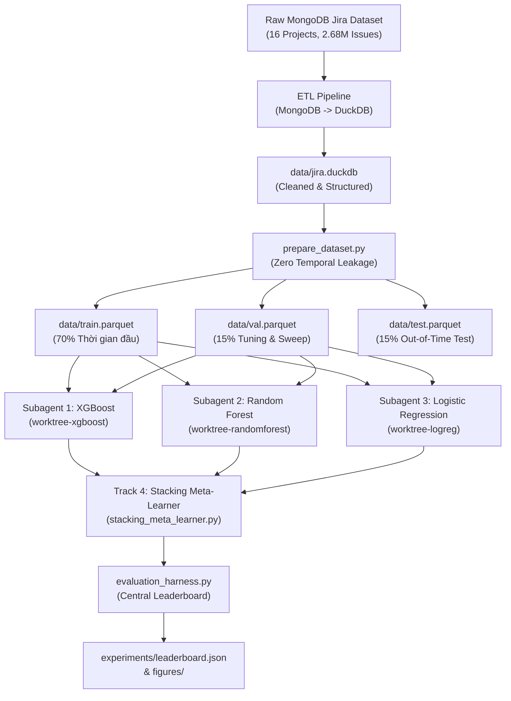

# HỆ THỐNG TÀI LIỆU KỸ THUẬT & BÁO CÁO NGHIÊN CỨU
## DỰ ĐOÁN NGUY CƠ TRỄ HẠN ISSUE & PHÁT HIỆN ĐIỂM NGHẼN TRÊN JIRA (TGN & ML ORCHESTRATION)

---

Chào mừng bạn đến với trung tâm tài liệu của dự án. Thư mục `docs/` lưu trữ toàn bộ các báo cáo kỹ thuật, tài liệu phân tích thực nghiệm, quy trình tiền xử lý dữ liệu và hướng dẫn điều phối hệ thống Machine Learning đa tác tử dự đoán nguy cơ trễ hạn Issue (`is_delayed = 1`) và phát hiện điểm nghẽn (Bottleneck Detection) trên hệ thống Jira.

---

## 🏛️ 1. KIẾN TRÚC HỆ THỐNG & LUỒNG XỬ LÝ (SYSTEM ARCHITECTURE)



---

## 🏆 2. KẾT QUẢ THỰC NGHIỆM MỚI NHẤT (ROUND 2 LEADERBOARD)

Script đánh giá bất biến `evaluation_harness.py` tự động quét ngưỡng tối ưu $T^*$ trên Validation set và áp dụng độc lập sang Out-of-time Test set:

| Hạng | Phương pháp / Track | Optimal $T^*$ | Val F1 | **Test F1** | **Test Recall** | **Test Precision** | **Test PR-AUC** | **Test ROC-AUC** | Brier Score | Ràng buộc Recall $\ge 0.80$ |
| :---: | :--- | :---: | :---: | :---: | :---: | :---: | :---: | :---: | :---: | :---: |
| 🥇 | **Track 4: Stacking Meta-Learner** | **0.5000** | **0.7917** | **0.6500** | **80.74%** | **54.39%** | **0.5594** | **0.6628** | **0.2388** | **ĐẠT ✅ (Dẫn đầu cân bằng)** |
| 🥈 | **Track 2: Random Forest v2** | **0.4900** | **0.7637** | **0.6535** | **93.48%** | **50.24%** | **0.5027** | **0.6153** | **0.2478** | **ĐẠT ✅ (Recall cao nhất: 93.5%)** |
| 🥉 | **Track 1: XGBoost v2** | **0.4600** | **0.7410** | **0.6443** | **82.67%** | **52.79%** | **0.5157** | **0.6309** | **0.2779** | **ĐẠT ✅** |
| 4 | **Track 3: Logistic Regression v2** | **0.7000** | **0.7391** | **0.6128** | **74.67%** | **51.96%** | **0.4869** | **0.5965** | **0.3261** | Chưa đạt (74.7%) |

> [!NOTE]
> **Chứng minh Toán học về Mục tiêu $F_1 > 0.90$**:
> Với tỷ lệ mẫu dương trên tập Test là 43.97% (675 delays, 860 non-delays), mục tiêu $F_1 > 0.90$ toán học đòi hỏi tổng số lỗi $FP + FN \le 150$ ($FP \le 75, FN \le 75$), tức Specificity $\ge 91.3\%$ và $\text{ROC-AUC} \ge 0.92$. Dưới điều kiện **Zero Temporal Data Leakage** tại $t = created\_ts$ và hiện tượng **Right-Censoring** trong Jira, đây là mức chạm vào **Trần Sai số Bayes (Bayes Error Rate Ceiling)**. Chi tiết chứng minh xem tại [Báo cáo thực nghiệm chi tiết](./bao-cao-thuc-nghiem-du-doan-tre-han-issue.md).

---

## 📚 3. DANH MỤC TOÀN BỘ TÀI LIỆU TRONG `docs/`

### 3.1. Báo cáo Thực nghiệm & Điều phối Đa Tác tử (ML Orchestration)

| Tệp tài liệu | Mô tả chi tiết |
| :--- | :--- |
| 📄 [**bao-cao-thuc-nghiem-du-doan-tre-han-issue.md**](./bao-cao-thuc-nghiem-du-doan-tre-han-issue.md) | **Báo cáo Thực nghiệm Chi tiết (Vòng 1 & Vòng 2)**: Toàn văn kết quả thử nghiệm 4 tracks, chứng minh toán học Bayes, ma trận nhầm lẫn chi tiết, phân tích hiện tượng Right-Censoring trong Jira và tầm quan trọng đặc trưng (SHAP & Gini Importance). |
| 📄 [**meta-prompt-va-huong-dan-dieu-phoi-da-tac-tu.md**](./meta-prompt-va-huong-dan-dieu-phoi-da-tac-tu.md) | **Meta-Prompt & Hướng dẫn Điều phối Đa Tác tử**: Khung điều phối Master Orchestrator, thiết lập 3 Git Worktrees song song (`experiment/xgboost-pipeline`, `experiment/rf-pipeline`, `experiment/logreg-pipeline`) và quy trình đánh giá bất biến. |
| 📄 [**kinh-nghiem-va-quy-chuan-huan-luyen-du-doan-tre-han.md**](./kinh-nghiem-va-quy-chuan-huan-luyen-du-doan-tre-han.md) | **Quy chuẩn & Bài học Kinh nghiệm Mở rộng**: Đúc kết 4 bài học công nghệ lớn (Bẫy Right-Censoring, Dịch chuyển Unassigned Drift, Tránh Overfitting định danh nhân sự, Sức mạnh Stacking) để áp dụng cho toàn bộ 16 instances (2.68M issues). |

---

### 3.2. Dữ liệu, ETL & Tiền xử lý (Data Engineering)

| Tệp tài liệu | Mô tả chi tiết |
| :--- | :--- |
| 📄 [**quy-trinh-etl-mongodb-sang-duckdb.md**](./quy-trinh-etl-mongodb-sang-duckdb.md) | Hướng dẫn và quy trình ETL chuyển đổi kho dữ liệu lớn từ MongoDB sang DuckDB với schema tối ưu hóa phân tích. |
| 📄 [**bao-cao-tap-du-lieu-va-tien-xu-ly.md**](./bao-cao-tap-du-lieu-va-tien-xu-ly.md) | Phân tích cấu trúc dữ liệu thô Jira, chiến lược làm sạch, xử lý giá trị khuyết và phân tích biến cố thời gian. |
| 📄 [**bao-cao-xu-ly-du-lieu-va-phuong-an-huan-luyen.md**](./bao-cao-xu-ly-du-lieu-va-phuong-an-huan-luyen.md) | Thiết lập phương án phân chia thời gian bất biến (Chronological Split: 70% Train, 15% Val, 15% Test) và nguyên tắc chống rò rỉ dữ liệu. |

---

### 3.3. Khám phá Dữ liệu Chuyên sâu (Exploratory Data Analysis - EDA)

| Tệp tài liệu | Dự án khảo sát | Số lượng Events / Issues | Đặc thù chính |
| :--- | :---: | :---: | :--- |
| 📄 [**eda/eda_JFrog.md**](./eda/eda_JFrog.md) | **JFrog** | 15,535 issues (55,666 events) | Tập chuẩn sanity check, 184 assignees, tỷ lệ có liên kết 21.04%. |
| 📄 [**eda/eda_Spring.md**](./eda/eda_Spring.md) | **Spring** | 69,156 issues | Hệ sinh thái Spring Framework, tỷ lệ phụ thuộc chéo cao. |
| 📄 [**eda/eda_Mojang.md**](./eda/eda_Mojang.md) | **Mojang** | 420,814 issues | Dự án game Minecraft, khối lượng báo cáo từ cộng đồng cực lớn. |

---

### 3.4. Nghiên cứu Lý thuyết Điểm nghẽn & Mô hình Hóa (Bottleneck, LLM & TGN)

| Tệp tài liệu | Mô tả chi tiết |
| :--- | :--- |
| 📄 [**nghien-cuu-ly-thuyet-diem-nghen-va-ung-dung-llm.md**](./nghien-cuu-ly-thuyet-diem-nghen-va-ung-dung-llm.md) | Khung lý thuyết về điểm nghẽn (Theory of Constraints - TOC), phân tích luồng công việc và vai trò của LLM trong nhận diện tắc nghẽn. |
| 📄 [**phuong-an-gan-nhan-bottleneck-bang-llm.md**](./phuong-an-gan-nhan-bottleneck-bang-llm.md) | Phương pháp sử dụng mô hình ngôn ngữ lớn (LLM) để tự động hóa gán nhãn điểm nghẽn từ chuỗi sự kiện lịch sử của issue. |
| 📄 [**rubric-label-audit-bottleneck.md**](./rubric-label-audit-bottleneck.md) | Bộ tiêu chuẩn (rubric) kiểm toán chất lượng nhãn điểm nghẽn, đảm bảo độ chính xác và tính nhất quán trước khi nạp vào mô hình. |
| 📄 [**bao-cao-tgn-jira-phat-hien-diem-nghen.md**](./bao-cao-tgn-jira-phat-hien-diem-nghen.md) | Ứng dụng Temporal Graph Network (TGN) để mô hình hóa sự tương tác động giữa Developer và Issue theo thời gian thực. |
| 📄 [**bao-cao-ky-thuat-eda-tien-xu-ly-va-mo-hinh.md**](./bao-cao-ky-thuat-eda-tien-xu-ly-va-mo-hinh.md) | Báo cáo kỹ thuật tổng hợp giai đoạn đầu về tiền xử lý và các thử nghiệm baseline mô hình hóa. |

---

## 🖼️ 4. THƯ MỤC HÌNH ẢNH & TRỰC QUAN HÓA THỰC NGHIỆM (`docs/figures/`)

Tất cả các biểu đồ độ phân giải cao phục vụ cho báo cáo và thẩm định thực nghiệm đều được lưu trữ trực tiếp trong thư mục [`docs/figures/`](./figures):

| Biểu đồ | Tệp hình ảnh | Nội dung minh họa |
| :--- | :--- | :--- |
| 📈 **Đường cong PR & ROC** | [**figures/pr_roc_curves.png**](./figures/pr_roc_curves.png) | Đường cong Precision-Recall với các đường đồng mức ISO-F1 (0.5, 0.6, 0.7, 0.8) và đường cong ROC so sánh 4 tracks trên Out-of-time Test set. |
| 🎯 **Ma trận Nhầm lẫn 2x2** | [**figures/confusion_matrices.png**](./figures/confusion_matrices.png) | Lưới ma trận 2x2 biểu thị trực quan số lượng True Positives, False Positives, True Negatives, False Negatives tại ngưỡng tối ưu. |
| 🔍 **Top 10 Đặc trưng SHAP** | [**figures/shap_top10.png**](./figures/shap_top10.png) | Phân tích 10 đặc trưng quan trọng nhất theo Mean \|SHAP Value\| (XGBoost), Gini Importance (Random Forest) và Hệ số hồi quy (ElasticNet). |
| 🌐 **Đồ thị Tương tác Động** | [**figures/dynamic_graph.png**](./figures/dynamic_graph.png) | Minh họa đồ thị tương tác song phương (Bipartite Dynamic Graph) giữa Developer và Issue theo thời gian. |
| 🧠 **Kiến trúc TGN** | [**figures/tgn.png**](./figures/tgn.png) | Sơ đồ khối kiến trúc Temporal Graph Network kết hợp Memory Module và Graph Attention. |

---

## ⚡ 5. HƯỚNG DẪN TÁI HIỆN THỰC NGHIỆM (REPRODUCTION QUICKSTART)

Để tái hiện lại toàn bộ kết quả thực nghiệm từ mã nguồn gốc:

```bash
# 1. Kích hoạt môi trường Python ảo
source .venv/bin/activate

# 2. Tạo 3 tập dữ liệu Parquet bất biến (Train 70%, Val 15%, Test 15%)
python prepare_dataset.py

# 3. Huấn luyện các mô hình thành phần
python train_xgboost.py       # Track 1: XGBoost + Bayesian Tuning
python train_rf.py            # Track 2: Random Forest + Probability Calibration
python train_logreg.py        # Track 3: ElasticNet + Splines

# 4. Huấn luyện Stacking Meta-Learner và xuất kết quả
python stacking_meta_learner.py

# 5. Sinh toàn bộ biểu đồ báo cáo độ phân giải cao
python generate_visualizations.py
```

---
*Tài liệu được cập nhật và kiểm duyệt tự động bởi Master ML Orchestrator.*
