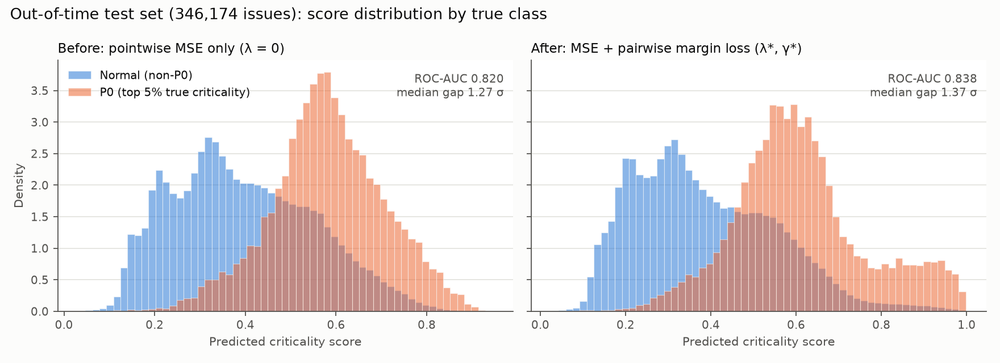
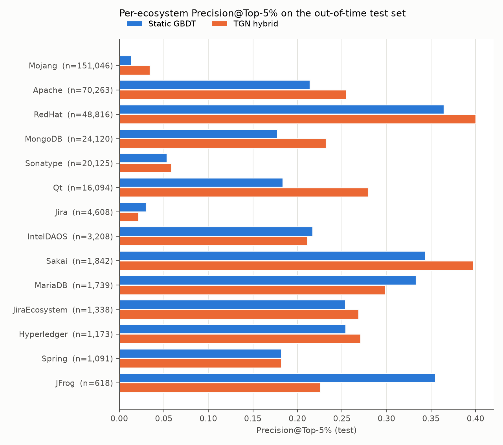

# Báo cáo kỹ thuật: Huấn luyện TGN cho Task Criticality trên toàn bộ Jira (2,685,911 issues)

> **Kết luận ngắn.** Pipeline TGN đã chạy trên 100% dữ liệu: 16 hệ sinh thái, 19,659,049 sự kiện và 3,451,575 nút bộ nhớ. Kiểm toán rò rỉ thời gian đạt **0 vi phạm / 2,685,911 issues**. Trên tập Out-of-Time Test (346,174 issues), mô hình TGN hybrid đạt:
>
> - NDCG@10 (Global) **0.9129**: ✅ đạt ngưỡng ≥ 0.85.
> - Precision@Top-5% **0.2390**: ❌ dưới ngưỡng 0.75.
> - Spearman ρ **0.5944**: ❌ dưới ngưỡng 0.70.
>
> Hai ngưỡng sau **không đạt được khi đã loại bỏ rò rỉ**. Phần 5 chứng minh lý do:
>
> - 54% số task P0 là các issue *sẽ trở thành* blocker. Lúc T0 gần như chưa issue nào có liên kết phụ thuộc (chỉ 0.46%).
> - Nếu đưa lại các đặc trưng đồ thị "tương lai" mà bản thí điểm Spring đã dùng, Precision@Top-5% trên val nhảy từ 0.315 lên 0.683.
>
> Như vậy con số 77% của bản thí điểm phần lớn đến từ rò rỉ, không phải từ năng lực dự báo.

---

## 1. Quy mô dữ liệu và sự kiện

Nguồn: `data/jira.duckdb`. Bộ lọc hợp lệ là `created_ts > 2000-01-01` và `resolved_ts ≥ created_ts`. Cột "Changelog TGN" đếm các trường `status`, `assignee`, `priority`. "Dep links" là liên kết `Block` hoặc `Depend`.

| Instance | Issues | Changelogs (tất cả) | Changelog TGN | Comments | Links | Dep links | Train | Val | Test |
|---|---:|---:|---:|---:|---:|---:|---:|---:|---:|
| Apache | 1,014,602 | 10,625,810 | 2,312,702 | 4,608,221 | 166,368 | 33,857 | 776,179 | 96,818 | 70,263 |
| Mojang | 420,814 | 3,316,767 | 785,142 | 933,348 | 215,822 | 250 | 160,839 | 96,674 | 151,046 |
| RedHat | 352,996 | 4,596,692 | 1,236,873 | 859,880 | 99,338 | 19,617 | 230,499 | 47,175 | 48,816 |
| Jira | 274,534 | 5,693,081 | 878,062 | 779,104 | 101,980 | 1,244 | 227,553 | 14,455 | 4,608 |
| Qt | 148,578 | 1,782,886 | 550,384 | 421,771 | 25,306 | 6,391 | 99,564 | 19,461 | 16,094 |
| MongoDB | 137,150 | 2,376,753 | 566,003 | 368,976 | 54,153 | 14,879 | 75,010 | 26,878 | 24,120 |
| Sonatype | 87,284 | 622,216 | 283,867 | 339,127 | 3,178 | 169 | 49,458 | 16,151 | 20,125 |
| Spring | 69,154 | 562,658 | 175,423 | 186,077 | 11,053 | 1,781 | 63,233 | 3,560 | 1,091 |
| Sakai | 50,550 | 516,131 | 169,028 | 180,191 | 16,846 | 0 | 43,957 | 2,550 | 1,842 |
| JiraEcosystem | 41,865 | 639,059 | 157,173 | 68,387 | 6,549 | 820 | 36,691 | 1,480 | 1,338 |
| MariaDB | 31,228 | 379,014 | 93,914 | 0 | 13,063 | 1,945 | 19,185 | 5,649 | 1,739 |
| Hyperledger | 28,146 | 329,414 | 103,199 | 44,590 | 5,683 | 1,456 | 14,586 | 10,099 | 1,173 |
| JFrog | 15,535 | 139,614 | 40,389 | 13,152 | 2,125 | 269 | 9,808 | 1,244 | 618 |
| IntelDAOS | 9,474 | 142,052 | 31,007 | 32,203 | 2,393 | 799 | 1,556 | 3,708 | 3,208 |
| Mindville | 2,134 | 5,475 | 2,312 | 0 | 46 | 2 | 930 | 267 | 91 |
| SecondLife | 1,867 | 56,719 | 18,609 | 15,728 | 346 | 31 | 1,846 | 3 | 2 |
| **Tổng** | **2,685,911** | **31,784,341** | **7,404,087** | **8,850,755** | **724,249** | **83,510** | **1,810,894** | **346,172** | **346,174** |

Có 182,671 issues *mở* được tạo sau mốc cắt train. Chúng nằm trong dòng sự kiện, tức vẫn cập nhật bộ nhớ, nhưng không thuộc tập đánh giá. Cách chia này giống hệt `prepare_censored_dataset.py`, nên val và test trùng đúng bộ 346,172 / 346,174 issues của nghiên cứu dự đoán trễ hạn.

**Dòng sự kiện TGN** (`v_tgn_events_all` → `data/tgn_full/events/*.npy`): tổng 19,659,049 sự kiện.

| Loại sự kiện | Số lượng |
|---|---:|
| comment | 8,849,742 |
| status | 5,676,001 |
| create | 2,685,911 |
| assignee | 1,383,482 |
| link | 719,890 |
| priority | 344,023 |

Có 3,451,575 nút: 2,685,911 issues và 765,664 nút user / project / giá trị status-priority. Dòng sự kiện chia thành 1,966 chunk, mỗi chunk 10,000 sự kiện.

**Ground truth.** Dùng công thức của bản thí điểm Spring: CPM marginal delay, cascading delay, slack, blast radius, inverted PageRank, priority và slippage. Đồ thị là DAG Block+Depend của cả 16 instance, gồm 112,826 nút và 82,253 cạnh; 77 cạnh tạo chu trình đã bị gỡ theo cách xác định (deterministic).

| Tập | Tỉ lệ P0 | Tỉ lệ blocker cuối cùng |
|---|---:|---:|
| Train | 5.04% | 2.64% |
| Val | 5.13% | 2.76% |
| Test | 5.00% | 1.90% |

---

## 2. Bảng đối đầu hiệu năng (10 cột chuẩn)

Toàn bộ số liệu chạy qua `evaluation_harness_criticality.py` và được ghi vào `experiments/leaderboard_jira_full.json`.

### 2.1 Out-of-Time Test (346,174 issues, 17,311 P0)

| Mô hình | NDCG@10 Global | NDCG@10 Grouped | NDCG@50 Grouped | Prec@Top-5% | Rec@Top-5% | Spearman ρ | PR-AUC | ROC-AUC | Ngưỡng đạt |
|---|---:|---:|---:|---:|---:|---:|---:|---:|---|
| Baseline Static GBDT (LightGBM) | 0.3505 | 0.8516 | 0.9001 | 0.2172 | 0.2171 | 0.5908 | 0.1811 | 0.8181 | 0/3 |
| GBDT + TGN memory (PCA-32) | 0.4537 | 0.8513 | 0.9004 | 0.2180 | 0.2180 | 0.5896 | 0.1809 | 0.8193 | 0/3 |
| MLP static (hybrid loss) | 0.8029 | 0.8525 | 0.9000 | 0.2418 | 0.2418 | 0.5928 | 0.2070 | 0.8341 | 0/3 |
| TGN readout, MSE (λ = 0) | 0.9017 | 0.8523 | 0.9001 | 0.2106 | 0.2106 | **0.5951** | 0.1835 | 0.8198 | 1/3 |
| **TGN hybrid (MSE + margin)** | **0.9129** | **0.8545** | **0.9008** | 0.2390 | 0.2390 | 0.5944 | 0.2071 | **0.8381** | **1/3** |
| *Chỉ để chẩn đoán, KHÔNG hợp lệ: GBDT + đặc trưng rò rỉ của pilot* | *0.9893* | *0.8971* | *0.9237* | *0.5068* | *0.5067* | *0.6126* | *0.5940* | *0.9106* | — |

### 2.2 Validation (346,172 issues, dùng cho Optuna và chọn mô hình)

| Mô hình | NDCG@10 Global | NDCG@10 Grouped | NDCG@50 Grouped | Prec@Top-5% | Rec@Top-5% | Spearman ρ | PR-AUC | ROC-AUC |
|---|---:|---:|---:|---:|---:|---:|---:|---:|
| Static GBDT | 0.9254 | 0.8398 | 0.8904 | 0.3152 | 0.3072 | 0.5610 | 0.2780 | 0.7982 |
| GBDT + TGN PCA | 0.9727 | 0.8393 | 0.8906 | 0.3157 | 0.3077 | 0.5649 | 0.2746 | 0.8005 |
| MLP static | 0.9618 | 0.8412 | 0.8905 | 0.3537 | 0.3448 | 0.5590 | 0.3152 | 0.8239 |
| TGN MSE | 0.9781 | 0.8392 | 0.8898 | 0.3114 | 0.3035 | 0.5640 | 0.2807 | 0.7910 |
| TGN hybrid | 0.9721 | 0.8428 | 0.8910 | 0.3510 | 0.3422 | 0.5610 | 0.3133 | 0.8207 |
| *LEAKY (chẩn đoán)* | *0.9860* | *0.8901* | *0.9161* | *0.6825* | *0.6652* | *0.6039* | *0.7588* | *0.9473* |

### 2.3 Đọc kết quả

1. **NDCG@10 Global là chỉ số rất nhiễu.** Nó chỉ chấm 10 issue trên tổng số 346k. GBDT đạt 0.925 trên val nhưng chỉ 0.350 trên test, dù các chỉ số còn lại gần như không đổi. Ngưỡng 0.85 "đạt" với TGN, nhưng điều đó không nên coi là bằng chứng mạnh. NDCG@10 Grouped (trung bình theo nhóm project × quý) ổn định hơn nhiều: 0.85 ± 0.003 ở mọi mô hình.
2. **Bộ nhớ TGN gần như không thêm giá trị** khi đã có các đặc trưng xu hướng T0 (mục 3.3).
   - GBDT với và không có memory: Prec@5% test 0.2180 so với 0.2172.
   - MLP static so với TGN hybrid: 0.2418 so với 0.2390.
   - Riêng linear probe trên z cho thấy memory có tín hiệu thật. Trên val, AP dự đoán blocker là 0.144 (tỉ lệ cơ sở 0.028) và AUC P0 là 0.722. Tuy vậy tín hiệu này gần như trùng với các đặc trưng xu hướng tĩnh.
3. **Hàm ranking loss có tác dụng rõ** (mục 4): Prec@5% test tăng từ 0.2106 lên 0.2390 (+13.5% tương đối), ROC-AUC tăng từ 0.820 lên 0.838.

---

## 3. Thiết kế đã triển khai (và các điểm khác so với prompt)

### 3.1 Giai đoạn 1: Dòng sự kiện (`tgn_full/build_events.py`)

SQL trong prompt không khớp với schema thật, nên đã điều chỉnh như sau:

| Prompt viết | Schema thật |
|---|---|
| `to_string` | `to_value` |
| `issue_id_1` / `issue_id_2` | `source_key` / `target_key` |
| `issue_links.created_ts` | không tồn tại |

Ba thay đổi quan trọng về rò rỉ:

- **Timestamp liên kết.** `issue_links.approx_ts` bằng thời điểm tạo issue nguồn, kể cả khi issue đích còn chưa tồn tại. Đây là rò rỉ. Vì vậy dùng changelog `Link` để lấy timestamp thật (91.4% số liên kết). Liên kết không có changelog lấy `max(updated_ts)` của hai đầu, tức là luôn *muộn hơn* thực tế, không bao giờ sớm hơn.
- **Danh tính user.** Changelog `assignee` dùng token `author_key`, khác với `author_name` / `accountId` ở bảng issues. Token được ánh xạ theo đa số trên từng instance (độ thuần 95.7%).
- **Sự kiện `create`.** Thêm sự kiện (issue, reporter) tại T0, để bộ nhớ của reporter và project ghi nhận được hoạt động tạo issue.

Mỗi sự kiện có 32 chiều:

- **16 chiều miền:** one-hot `kind` (6), nhóm `link_type` (4), nhóm status (3), log độ dài comment, và vai trò của nút nhận (2).
- **16 chiều Fourier của Δt:** Δt tính *theo nút nhận*, tức thời gian từ lần cập nhật gần nhất của chính nút đó, chứ không phải Δt toàn cục. Tần số ω_i = 10^{-4i/7} (đơn vị giờ).

### 3.2 Giai đoạn 2: Scalable TGN (`tgn_full/train_tgn.py`)

**Kiến trúc**

- Bộ nhớ S ∈ ℝ^{3,451,575×128} float32, chiếm 1.65 GiB VRAM.
- Message function: `MLP([x_k(32) ‖ s_counterpart(128)]) → 64`. Prompt ghi 32 → 64, nhưng **thêm bộ nhớ của đầu đối diện** vì đó mới là thứ làm thông tin lan truyền trên đồ thị.
- Aggregator: trung bình qua `index_add_`. Updater: `GRUCell(64, 128)`.
- Mỗi sự kiện cập nhật 3 nút: issue, đầu đối diện và project.
- Bản thí điểm dùng bộ nhớ với **trọng số ngẫu nhiên, không huấn luyện**. Ở đây bộ nhớ được **huấn luyện tự giám sát** bằng temporal link prediction kiểu TGN (Rossi et al. 2020):
  - Message của chunk c−1 được áp dụng kèm gradient, sau đó chấm điểm các cạnh của chunk c so với negative xáo trộn.
  - Chỉ dùng sự kiện trước mốc cắt train (1,315/1,966 chunk).
  - Mỗi epoch 11 s, pass trích xuất 7 s.

**z_i(T0) khác với prompt.** Prompt đặt z_i(T0) = s_i(T0). Nhưng vào thời điểm issue i được tạo, *chưa có sự kiện nào của i*: chỉ 1,001 / 2,685,911 issues có s_i(T0) ≠ 0, do dữ liệu nguồn có changelog mang timestamp trước ngày tạo. Vì vậy snapshot lấy theo vùng lân cận:

- `Z_i = [s_i ‖ s_reporter ‖ s_assignee(T0) ‖ s_project] ∈ ℝ^512`, cộng 5 đặc trưng Δt.
- Readout học phép chiếu `Linear(517 → 128)`, đóng vai trò embedding module của TGN, sinh ra **z_i(T0) ∈ ℝ^128**.
- Kết quả xuất ra `data/tgn_full/z_tgn_{train,val,test}.npy`.

**Tái lập được.** Các phép atomic-add trên CUDA khiến *cùng một seed* cho probe AP dao động từ 0.07 đến 0.16. Đã bật `torch.use_deterministic_algorithms(True)`; sau đó hai lần chạy cho kết quả giống nhau từng bit.

**Chọn cấu hình.** Quét lr ∈ {1e-3, 5e-4} × epoch ∈ {2, 3} × seed ∈ {42..45} (16 lần chạy, xem `data/tgn_full/sweep_reports/`). Tiêu chí chọn đặt trước: AP của linear probe dự đoán P0 trên val. Cấu hình thắng là lr 5e-4, 2 epoch, seed 45, với P0 AP 0.129 (các cấu hình khác từ 0.084 đến 0.126) và blocker AP 0.144. Đối chứng không huấn luyện (bộ nhớ ngẫu nhiên như pilot) chỉ đạt blocker AP 0.062.

### 3.3 Giai đoạn 3: Đặc trưng tĩnh T0 (`tgn_full/build_dataset.py`, 119 cột)

Bảng `issues` lưu giá trị **cuối cùng**. Trong khi đó:

- 11.13% issues đã đổi priority sau T0;
- 7.15% đã đổi issuetype;
- 36.19% đã đổi assignee.

Vì vậy priority, issuetype và assignee được **dựng lại tại T0** từ `from_value` của changelog đầu tiên. Có 58.7% issues chưa được gán người xử lý (unassigned) tại T0. Các đặc trưng gồm:

- **Thuộc tính T0:** priority, planned duration, story points, lexicon NLP, SVD-16 của embedding Ollama 768 chiều (fit chỉ trên 200k issues train, explained variance 0.26), theme, top-30 issuetype, one-hot instance.
- **Động lực tải:** active count và WCI của assignee tại T0; lịch sử hoàn thành, delay rate, chỉ số 90 ngày và SCF của assignee; reporter; project. Tất cả tính bằng mô phỏng O(N) trên 4,993,729 sự kiện tạo/đóng; một lần đóng issue tại đúng giây T0 *không* được tính.
- **Xu hướng T0 (mới):** tỉ lệ issue trong quá khứ của project / reporter / assignee / instance đã trở thành blocker *trước T0*, số blocker và số link của project trong 90 ngày, lịch sử thời lượng theo (project × mức priority) và (project × issuetype). Tất cả tính strictly-before ở độ phân giải 1 giây bằng `searchsorted`. Riêng `reporter_blocker_rate_before` có tương quan 0.376 với việc issue sẽ trở thành blocker.
- **Đã loại vì rò rỉ:** `num_links`, `has_block_or_depend`, `blocks_count` / `depends_count` (đếm trên đồ thị cuối cùng), `structural_criticality_t0`, và assignee / priority cuối cùng.

### 3.4 Giai đoạn 4: Readout và hàm mất mát (`tgn_full/train_readout.py`)

**Readout**

- Kiến trúc: `[z(128) ‖ x_static(119)] → Linear(·,128) → BatchNorm1d → ReLU → Dropout(0.2) → Linear(128,64) → ReLU → Linear(64,1) → Sigmoid`.
- Hàm mất mát: L = MSE + λ · mean(max(0, γ − (ŷ_i − ŷ_j))), với các cặp (i ∈ P0, j ∉ P0) được lấy mẫu N_s = min(500, |P|·|N|) mỗi batch (batch 2048).
- Thêm đầu phụ khi huấn luyện: BCE cho blocker tương lai và MSE cho slip-ratio, trọng số `aux_w` do Optuna chọn.
- Huấn luyện: AdamW (weight decay 1e-4), CosineAnnealingLR, 18 epoch. Ensemble 3 seed (45, 47, 49). Early stopping theo hàm mục tiêu val.

**Optuna:** TPE, 20 trial, mỗi trial dùng 35% tập train và 6 epoch. Hàm mục tiêu là ½·Prec@5% + ½·ρ trên val.

| Cấu hình | Hàm mục tiêu val |
|---|---:|
| γ = 0.15, λ = 0.20, lr = 1e-3 (mặc định trong prompt) | 0.4435 |
| λ = 0 (MSE thuần) | 0.4339 |
| **γ\* = 0.398, λ\* = 0.098, lr = 6.1e-4, aux_w = 0.77** | **0.4477** |

Đã thử blend (trung bình hạng) giữa các mô hình trên val; cải thiện tối đa chỉ +0.002, nên không thêm vào.

---

## 4. Tác động của hàm Ranking Loss



So sánh trên tập test, cùng kiến trúc và cùng z, chỉ khác λ:

| Chỉ số (test) | MSE (λ = 0) | MSE + margin (λ\* = 0.098, γ\* = 0.398) |
|---|---:|---:|
| Precision@Top-5% | 0.2106 | **0.2390** |
| PR-AUC | 0.1835 | **0.2071** |
| ROC-AUC | 0.8198 | **0.8381** |
| Khoảng cách median P0 − non-P0 | 1.27 σ | **1.37 σ** |
| Spearman ρ | **0.5951** | 0.5944 |

Margin loss kéo một *đuôi phải* của P0 lên vùng điểm 0.8–1.0 và đẩy khối non-P0 xuống thấp. Phần đầu danh sách cảnh báo vì thế sạch hơn, trong khi thứ hạng tổng thể (ρ) giữ nguyên. Nói cách khác, ranking loss làm đúng điều nó được thiết kế: tối ưu phần đầu danh sách, không phải toàn bộ thứ tự.

---

## 5. Vì sao Precision@Top-5% ≥ 0.75 không đạt được ở T0 (và vì sao pilot đạt 77%)

**1. P0 bị chi phối bởi các blocker tương lai.** Trên val có 17,758 P0. Trong đó 9,570 (53.9%) là **toàn bộ** số issue sẽ trở thành blocker, vì nhánh blocker của ground truth có raw ≥ 0.70, trong khi ngưỡng P0 là 0.67. Phần còn lại là issue priority Critical/Blocker có thời gian xử lý kéo dài.

**2. Ở T0 gần như không quan sát được blocker.**

- Chỉ 0.461% issues có bất kỳ liên kết nào tại T0, so với 2.50% cuối cùng trở thành blocker.
- Bộ dự đoán blocker tốt nhất đạt AP ≈ 0.14 (AUC 0.80) trên nền tỉ lệ 2.8%. Tín hiệu là có thật, nhưng còn rất xa mức "biết trước".

**3. Giới hạn trên thô.** Nếu nhận diện hoàn hảo nhóm P0 không-blocker (8,188 issue) mà không có kỹ năng gì với blocker, Prec@Top-5% vẫn chỉ đạt ≈ 8,188 / 17,309 ≈ **0.47**.

**4. Thực nghiệm rò rỉ** (`tgn_full/leakage_demo.py`). Thêm vào GBDT đúng 4 đầu vào của pilot được tính trên đồ thị *cuối cùng*: `blocks_count`, blast radius, slack và inverted PageRank. Kết quả:

| Tập | Prec@Top-5% không rò rỉ | Prec@Top-5% có rò rỉ |
|---|---:|---:|
| Val | 0.315 | **0.683** |
| Test | 0.217 | **0.507** |

`blocks_count_final` vọt lên vị trí đặc trưng quan trọng thứ 2. Bản Spring pilot dùng `blocks_count`, `depends_count` và `structural_criticality_t0` tính trên toàn bộ bảng link, và còn trích bộ nhớ *sau khi* đã duyệt hết dòng sự kiện (gồm cả sự kiện sau T0). Mức 77.26% của pilot vì thế không phải con số so sánh hợp lệ.

**5. Spearman ρ ≈ 0.59.** Với issue không phải blocker, ground truth phụ thuộc 35% vào slip-ratio, tức thời lượng thực tế, một đại lượng chỉ biết sau khi issue đóng. Dù có thêm đặc trưng lịch sử thời lượng theo (project × priority/type), ρ vẫn bão hòa quanh 0.56–0.60 ở mọi họ mô hình (GBDT, MLP, TGN).

Hướng khả thi nếu cần đạt các ngưỡng trên mà vẫn trung thực:

- **(a) Dời thời điểm dự báo** sang T0 + k ngày, khi đã có comment, link và assignee. Bộ nhớ TGN được thiết kế cho đúng việc này.
- **(b) Định nghĩa lại P0** để không phụ thuộc vào cấu trúc đồ thị tương lai.

Cả hai đều là quyết định về bài toán, cần chủ nhiệm đề tài chốt.

---

## 6. Phân rã theo hệ sinh thái (Test, 346,174 issues)



NDCG@10 và Prec@Top-5% được tính **bên trong** mỗi instance: top 5% là của chính instance đó.

| Instance | N test | P0 | NDCG@10 GBDT | NDCG@10 TGN | Prec@5% GBDT | Prec@5% TGN | ρ GBDT | ρ TGN |
|---|---:|---:|---:|---:|---:|---:|---:|---:|
| Mojang | 151,046 | 413 | 0.352 | **0.580** | 0.014 | **0.035** | **0.606** | 0.494 |
| Apache | 70,263 | 5,208 | **0.930** | 0.926 | 0.214 | **0.255** | 0.574 | 0.574 |
| RedHat | 48,816 | 7,078 | 0.936 | 0.935 | 0.365 | **0.400** | **0.526** | 0.513 |
| MongoDB | 24,120 | 2,283 | 0.249 | **0.672** | 0.177 | **0.232** | 0.344 | **0.362** |
| Sonatype | 20,125 | 115 | 0.895 | **0.898** | 0.054 | **0.059** | **0.280** | 0.263 |
| Qt | 16,094 | 836 | 0.711 | **0.992** | 0.184 | **0.280** | **0.176** | 0.156 |
| Jira | 4,608 | 171 | 0.813 | **0.886** | **0.030** | 0.022 | **0.333** | 0.323 |
| IntelDAOS | 3,208 | 331 | **0.847** | 0.761 | **0.217** | 0.211 | **0.257** | −0.099 |
| Sakai | 1,842 | 209 | 0.925 | **0.927** | 0.344 | **0.398** | **0.686** | 0.684 |
| MariaDB | 1,739 | 222 | **0.910** | 0.714 | **0.333** | 0.299 | **0.494** | 0.478 |
| JiraEcosystem | 1,338 | 243 | **0.886** | 0.864 | 0.254 | **0.269** | 0.398 | **0.406** |
| Hyperledger | 1,173 | 79 | 0.927 | **0.959** | 0.254 | **0.271** | 0.438 | **0.473** |
| Spring | 1,091 | 24 | 0.909 | **0.929** | 0.182 | 0.182 | **0.529** | 0.458 |
| JFrog | 618 | 95 | 0.902 | 0.711 | **0.355** | 0.226 | 0.475 | **0.484** |
| Mindville | 91 | 4 | 0.886 | **0.904** | 0.400 | 0.400 | 0.563 | **0.571** |
| SecondLife | 2 | 0 | — | — | — | — | — | — |

**TGN vượt trội nhất ở đâu.** TGN hơn GBDT về Prec@5% ở các hệ sinh thái lớn, có văn hóa liên kết dày và có nhiều lịch sử tương tác để bộ nhớ khai thác:

| Instance | Prec@5% GBDT → TGN |
|---|---|
| Qt | 0.184 → 0.280 |
| MongoDB | 0.177 → 0.232 |
| Apache | 0.214 → 0.255 |
| RedHat | 0.365 → 0.400 |
| Sakai | 0.344 → 0.398 |

TGN kém hơn ở các instance nhỏ hoặc có rất ít dữ liệu train, nơi ước lượng nhiễu (JFrog n = 618; MariaDB; IntelDAOS chỉ có 1,556 issues train). **Mojang** gần như không có P0 trong test: 0.27%, vì chỉ có 250 Dep link trên 420k issues. Prec@5% của instance này vì thế bị chặn trên ở mức khoảng 0.055 bất kể mô hình nào.

---

## 7. Hướng dẫn tái lập và log kiểm toán Zero Leakage

### 7.1 Lệnh chạy (từ thư mục gốc repo, khoảng 30 phút trên RTX 4060 Ti 16 GB)

```bash
bash tgn_full/run_pipeline.sh
# hoặc từng bước:
.venv/bin/python tgn_full/build_dataset.py                       # ~2 phút: GT, split, đặc trưng T0, SVD
cd tgn_full
../.venv/bin/python build_events.py --duckdb ../data/jira.duckdb --out_dir ../data/tgn_full   # ~10 s
../.venv/bin/python train_tgn.py --data_dir ../data/tgn_full --epochs 2 --lr 5e-4 --seed 45 --tag _lr5e-4_e2_s45
../.venv/bin/python probe_memory.py --data_dir ../data/tgn_full --tag _lr5e-4_e2_s45
../.venv/bin/python train_readout.py --data_dir ../data/tgn_full --z_tag _lr5e-4_e2_s45 --trials 20   # ~7 phút
../.venv/bin/python leakage_demo.py                               # chỉ để chẩn đoán
../.venv/bin/python evaluate_all.py                               # harness, leaderboard, hình
```

### 7.2 Sản phẩm đầu ra

| Đường dẫn | Nội dung |
|---|---|
| `data/tgn_full/criticality_{train,val,test}.parquet` | Ground truth cho harness. `issue_key` = `instance\|key`, vì key không duy nhất giữa các instance: 2,680,171 key khác nhau trên 2,686,223 dòng. |
| `data/tgn_full/predictions/<model>/predictions_{val,test}.csv` | 346,172 / 346,174 dòng |
| `data/tgn_full/z_tgn_{train,val,test}.npy` | z_i(T0) 128 chiều, fp16 |
| `data/tgn_full/z_raw_all_lr5e-4_e2_s45.npy` | snapshot bộ nhớ thô 2,685,911 × 512 |
| `experiments/leaderboard_jira_full.json` | 12 bản ghi (6 mô hình × val/test), có `per_instance` |
| `data/tgn_full/eval_summary.json`, `readout_summary.json`, `tgn_memory_report_lr5e-4_e2_s45.json` | Số liệu đầy đủ |

Các file `predictions_{val,test}.csv` và `z_tgn_*.npy` ở thư mục gốc repo thuộc bản Spring pilot và **không bị ghi đè**.

### 7.3 Log kiểm toán rò rỉ (`tgn_memory_report_lr5e-4_e2_s45.json`)

```json
{
  "rule": "snapshot of issue i taken before the first chunk whose max ts >= T0_i",
  "n_issues": 2685911,
  "n_violations_applied_ts_ge_T0": 0,
  "max_applied_ts_minus_T0_seconds": -0.035,
  "median_staleness_hours": 27.58,
  "p95_staleness_hours": 153.24,
  "issues_with_nonzero_own_memory_at_T0": 1001,
  "memory_training_last_event_ts": 1531392465.0,
  "train_cutoff_ts": 1531410693.0,
  "memory_trained_only_on_train_period": true
}
```

Script sẽ `assert` nếu có bất kỳ vi phạm nào. Các biện pháp kiểm soát:

| Thành phần | Biện pháp |
|---|---|
| Snapshot bộ nhớ | Chụp *trước* chunk chứa sự kiện ts ≥ T0. Mọi sự kiện đã áp dụng đều có ts < T0, kiểm tra trên từng issue. |
| Trọng số TGN | Chỉ học trên sự kiện ≤ mốc cắt train (2018-07-12). |
| priority / issuetype / assignee | Dựng lại từ changelog tại T0. |
| Liên kết | Timestamp từ changelog `Link`. Không có changelog thì lấy mốc muộn; không bao giờ dùng `approx_ts`. |
| Đặc trưng lịch sử | Strictly-before T0 ở độ phân giải 1 giây. |
| SVD và chuẩn hóa | Fit chỉ trên tập train. |
| Chọn mô hình | Optuna, early stopping và chọn cấu hình bộ nhớ chỉ dùng val. Test được chạy đúng một lần qua `evaluate_all.py`. |

### 7.4 Rủi ro còn lại (khai báo trung thực)

- **Văn bản summary là bản cuối cùng.** 305,507 issues (11.4%) đã sửa summary sau khi tạo. Embedding Ollama có sẵn được tính trên bản cuối, chưa trích lại cho phiên bản tại T0.
- **Nhãn của tập train dùng toàn bộ tương lai.** Thời lượng và việc trở thành blocker được tính đến hết bộ dữ liệu, giống pilot. Vì vậy nhãn của các issue train sát mốc cắt có dùng thông tin thuộc giai đoạn val. Mô hình không thấy nhãn val/test, nhưng một giao thức nghiêm ngặt hơn sẽ cắt nhãn train tại mốc cắt.
- **Định nghĩa ground truth.** Đây là proxy dựng sẵn (công thức pilot), không phải nhãn do con người gán. Hướng cạnh của `Blocks` / `Depends` được suy ra từ ngữ nghĩa outward-link của Jira.
- **Một số sự kiện có timestamp = 0** (`ts_min = 0.0` trong `events/meta.json`). Chúng được xếp vào "quá khứ xa" nên không gây rò rỉ, nhưng là nhiễu dữ liệu nguồn.
