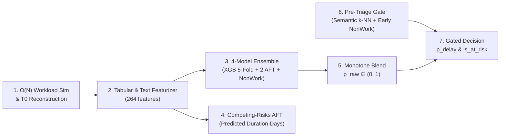

# BÁO CÁO KHÓA LUẬN TỐT NGHIỆP
## NGHIÊN CỨU VÀ THỰC NGHIỆM HỆ THỐNG DỰ ĐOÁN RỦI RO TRỄ HẠN ISSUE (DELAY RISK PREDICTION) TẠI THỜI ĐIỂM TẠO ($T_0$)

---

## LỜI MỞ ĐẦU (ĐẶT VẤN ĐỀ NGHIÊN CỨU)

Trong quá trình thực hiện khóa luận tốt nghiệp với đề tài **"Phát hiện sớm rủi ro trễ hạn và đánh giá mức độ quan trọng của issue trên tập dữ liệu Jira quy mô lớn"**, bài toán trọng tâm đầu tiên là **Delay Risk Prediction** ngay tại thời điểm khởi tạo issue ($T_0$). Mục tiêu của mô hình là trả lời câu hỏi: *"Issue vừa mới được tạo có nguy cơ bị trễ hạn so với cam kết SLA (`is_delayed = 1`) hay không, và dự kiến mất bao nhiêu ngày để hoàn thành (`predicted_duration_days`)?"*

Khi triển khai trên toàn bộ tập dữ liệu **The Public Jira Dataset** ($2,685,911$ issues thuộc 16 hệ sinh thái phần mềm), bài toán dự báo tại mốc $T_0$ đối mặt với 3 thách thức thực tế:
1. **Dữ liệu kiểm duyệt phải (Right-Censored Issues)**: Tại thời điểm cắt dữ liệu huấn luyện, có $195,422$ issues vẫn đang mở (`is_resolved = 0`). Nếu loại bỏ hoàn toàn các issues này, mô hình sẽ mắc sai lệch sống sót (*Survivorship Bias*) vì bỏ sót các task kéo dài nhiều tháng/năm.
2. **Tỷ lệ lớn các tác vụ ảo (Non-Work / Invalid Tasks)**: Khoảng $31.6\%$ đến hơn $40\%$ issues bị đóng nhanh không phải do hoàn thành lập trình mà do trùng lặp (`Duplicate`), không tái hiện được lỗi (`Cannot Reproduce`), hoặc từ chối xử lý (`Won't Fix`).
3. **Dịch chuyển phân phối theo thời gian (Temporal Prior Shift)**: Tỷ lệ trễ hạn giảm từ $39.68\%$ trong giai đoạn Train (2001–2018) xuống còn $21.68\%$ trong giai đoạn Out-of-Time Test (2020–2022).

Để giải quyết trọn vẹn 3 thách thức trên mà tuyệt đối không để rò rỉ dữ liệu tương lai (*Zero Temporal Data Leakage*), em đã nghiên cứu và xây dựng mô hình tổ hợp **`DelayRiskScorer`** (`delay_official_t0`, đóng gói tại [`bundles/delay`](file:///home/jiooum/0.Workspace/0.SourceCode/tgn/bundles/delay/manifest.json)), kết hợp phân loại nhị phân (`XGBoost 5-Fold`), phân tích sinh tồn (`XGBoost AFT` & `CatBoost SurvivalAft`) và cổng lọc sơ tuyển tác vụ ảo (`Pre-Triage Gate`).

---

## PHẦN 1: KIẾN TRÚC TỔNG THỂ VÀ CÁC MODULE CỦA `DelayRiskScorer`

Kiến trúc mô hình được cài đặt tại [`src/early_risk_detection/delay/`](file:///home/jiooum/0.Workspace/0.SourceCode/tgn/src/early_risk_detection/delay/scorer.py) gồm 7 module hoạt động tuần tự:

### 1.1. Module 1: $O(N)$ Workload Simulation & $T_0$ Reconstruction ([`features.py`](file:///home/jiooum/0.Workspace/0.SourceCode/tgn/src/early_risk_detection/delay/features.py#L78-L266))
- **Module này dùng để làm gì?**: Khôi phục đúng trạng thái ban đầu của issue lúc mới tạo ($T_0$) và mô phỏng chính xác tải công việc tức thời của từng developer (`assignee`), người tạo (`reporter`) và dự án (`project`) tại đúng giây $T_0$.
- **Cơ chế hoạt động**:
  - **Khôi phục thuộc tính tại $T_0$ ([`load_issues_t0`](file:///home/jiooum/0.Workspace/0.SourceCode/tgn/src/early_risk_detection/features/t0.py#L32-L102))**: Truy vấn ngược giá trị `from_value` của bản ghi `issue_changelogs` đầu tiên để lấy đúng `priority_t0`, `issuetype_t0`, `assignee_t0` lúc khởi tạo. Các đặc trưng liên kết (`num_links`, `blocks_count`, `depends_count`) chỉ đếm những liên kết có `link_ts <= T0`.
  - **Mô phỏng dòng sự kiện $O(N)$ (`chronological_features`)**: Sắp xếp toàn bộ $4,993,729$ sự kiện tạo (`CREATE`) và đóng (`RESOLVE`) theo thời gian thực để cập nhật cuốn chiếu:
    - **Chỉ số tắc nghẽn tải làm việc (`assignee_wci`)** trên các task đang mở $\text{Active}(t)$ của developer:

$$\text{WCI}(t) = \sum_{j \in \text{Active}(t)} \frac{\text{SP}_j}{\max\left(1.0, \frac{t_{\text{due}, j} - t}{86400}\right)}$$

    - **Hệ số nén thời gian (`scf`)** giữa thời hạn kế hoạch $t_{\text{planned}}$ và thời gian xử lý trung bình trong quá khứ của developer:

$$\text{SCF} = \frac{t_{\text{planned}}}{\max\left(1.0, \text{HistoricalCycleTime}_{\text{assignee}}\right)}$$

### 1.2. Module 2: Tabular & Text Featurizer ([`DelayFeaturizer`](file:///home/jiooum/0.Workspace/0.SourceCode/tgn/src/early_risk_detection/delay/features.py#L444-L550) — $264$ features)
- **Module này dùng để làm gì?**: Chuyển đổi thuộc tính thô, chỉ số tải công việc và văn bản tiêu đề `summary` thành ma trận **$264$ đặc trưng số học (`float32`)** nhất quán giữa huấn luyện và suy luận.
- **Cơ chế hoạt động**:
  - **Text Embedding Features ([`TextRiskFeatures`](file:///home/jiooum/0.Workspace/0.SourceCode/tgn/src/early_risk_detection/delay/features.py#L270-L306))**: Giảm chiều vector nhúng 768 chiều (`nomic-embed-text`) xuống 16 chiều bằng `TruncatedSVD(16)` (`text_svd_0..15`) và trích xuất xác suất rủi ro ngữ nghĩa `semantic_delay_risk` bằng `SGDClassifier(loss="log_loss")`.
  - **TF-IDF + SVD Summary**: Trích xuất 40 đặc trưng `TF-IDF (1,2)-grams` kết hợp 8 chiều `TruncatedSVD(8)` trên văn bản `summary`.
  - **Kỹ nghệ đặc trưng bảng (`row_features` + Encodings)**: Tạo các tỷ số quá tải (`active_per_completed`), thời gian dự kiến giải phóng hàng đợi (`queue_clearing_estimate`), tương tác phi tuyến (`wci_x_scf`, `pressure_index`), vận tốc trễ hạn 90 ngày (`delay_velocity`), `One-Hot Encoding` (top-16) và `Out-of-Fold Smoothed Target Encoding` ($\text{smoothing} = 20.0$) cho 7 trường phân loại.

### 1.3. Module 3: Tổ hợp 4 Mô hình Dự báo (`4-Model Ensemble`)
- **Module này dùng để làm gì?**: Kết hợp mô hình phân loại nhị phân, hai mô hình phân tích sinh tồn có kiểm duyệt phải (*Right-Censored Survival Analysis*) và mô hình nhận diện tác vụ ảo để dự đoán xác suất trễ hạn chính xác và ổn định hơn từng mô hình đơn lẻ.
- **Cơ chế hoạt động**:
  1. **`XGBoost 5-Fold Classifier` ($p_{\text{xgb}}$)**: Tổ hợp 5 mô hình XGBoost phân tầng huấn luyện trên $1,615,472$ issues đã đóng thuộc tập Train, có đánh trọng số mẫu theo độ mới thời gian:

$$w_i = \exp(\alpha_{\text{recency}} \cdot \hat{t}_i), \quad \alpha_{\text{recency}} = 1.2852$$

  2. **`XGBoost Survival AFT` ($p_{\text{aft}}$)**: Huấn luyện trên toàn bộ $1,810,894$ issues tập Train (gồm cả $195,422$ issues đang mở với khoảng thời gian sống $[y_{\text{lower}}, +\infty)$) theo mô hình **Accelerated Failure Time (AFT)**:

$$\ln(T_i) = \mu(x_i) + \sigma \cdot \epsilon_i, \quad \epsilon_i \sim \mathcal{N}(0, 1), \quad \sigma = 0.80$$

     Từ giá trị dự đoán $\mu(x_i) = \ln(\hat{T}_i)$, xác suất issue vượt quá thời hạn kế hoạch $t_{\text{planned}, i}$ được tính qua hàm phân phối tích lũy chuẩn $\Phi$ trong [`survival_delay_prob`](file:///home/jiooum/0.Workspace/0.SourceCode/tgn/src/early_risk_detection/delay/survival.py#L9-L25):

$$p_{\text{aft}, i} = P(T_i > t_{\text{planned}, i}) = \Phi\left(-\frac{\ln(t_{\text{planned}, i}) - \ln(\hat{T}_i)}{\sigma}\right)$$

  3. **`CatBoost Survival AFT` ($p_{\text{cbs}}$)**: Huấn luyện mô hình `CatBoostRegressor` với hàm mất mát `SurvivalAft:dist=Normal;scale=2.6` trên tập dữ liệu kiểm duyệt phải ($1,810,894$ mẫu), cung cấp ước lượng xác suất sinh tồn thứ hai độc lập.
  4. **`Non-Work Classifier` ($p_{\text{non\_work}}$)**: Mô hình XGBoost dự đoán xác suất một issue sẽ kết thúc với trạng thái tác vụ ảo (`Duplicate`, `Not a Bug`, `Cannot Reproduce`, `Won't Fix`, `Invalid`). Đại lượng $(1 - p_{\text{non\_work}})$ phản ánh xác suất đây là một công việc kỹ thuật thực sự cần thời gian lập trình.

### 1.4. Module 4: Competing-Risks CatBoost AFT (`cbs_cr` — Dự báo thời lượng hoàn thành)
- **Module này dùng để làm gì?**: Dự đoán trực tiếp **số ngày thực tế cần để hoàn thành issue (`predicted_duration_days`)** mà không bị làm sai lệch bởi các issue đóng nhanh do trùng lặp hoặc hủy bỏ.
- **Cơ chế hoạt động**: Huấn luyện mô hình `CatBoost SurvivalAft` (`dist=Logistic, scale=0.6`) theo cơ chế **Cause-Specific Competing Risks** ([`build_catboost_target`](file:///home/jiooum/0.Workspace/0.SourceCode/tgn/training/delay/train_catboost_survival.py#L40-L59)): toàn bộ $654,084$ issues thuộc nhóm đang mở hoặc đóng do `Duplicate`/`Invalid`/`Won't Fix` được đặt trạng thái kiểm duyệt phải ($y_{\text{upper}} = -1$), giúp mô hình ước lượng chính xác thời gian xử lý kỹ thuật thuần túy $\hat{T}_{\text{delivery}} = \exp(\hat{\mu}_{\text{cr}}(x_i))$.

### 1.5. Module 5: Monotone Piecewise-Linear Blend ([`blend`](file:///home/jiooum/0.Workspace/0.SourceCode/tgn/src/early_risk_detection/delay/survival.py#L28-L34))
- **Module này dùng để làm gì?**: Pha trộn 4 đầu ra xác suất từ Module 3 và hiệu chuẩn (calibrate) về thang xác suất thực tế $p_{\text{raw}} \in (0, 1)$.
- **Cơ chế hoạt động**: Tính tổ hợp tuyến tính có trọng số:

$$s_i = 0.45\,p_{\text{xgb}, i} + 0.30\,p_{\text{aft}, i} + 0.15\,p_{\text{cbs}, i} + 0.10\,(1 - p_{\text{nw}, i})$$

Sau đó ánh xạ đơn điệu $s_i \mapsto p_{\text{raw}, i}$ qua hàm nội suy tuyến tính từng khúc với các điểm nút `knots_x = [0.0, 0.325, 0.435, 1.0]` và `knots_y = [0.0, 0.46, 0.4699, 0.95]`.

### 1.6. Module 6: Pre-Triage Gate ([`gate.py`](file:///home/jiooum/0.Workspace/0.SourceCode/tgn/src/early_risk_detection/delay/gate.py))
- **Module này dùng để làm gì?**: Nhận diện ngay tại $T_0$ những issue có khả năng rất cao là **báo cáo trùng lặp ngữ nghĩa (`Duplicate`) hoặc tác vụ ảo bị đóng sớm trong 7 ngày đầu** (`early_non_work`), nhằm ngăn chặn cảnh báo giả (*False Positives*).
- **Cơ chế hoạt động**: Trích xuất thêm 10 đặc trưng nhân quả tại $T_0$:
  - **6 đặc trưng `Causal Non-Work Rates` ([`causal_nonwork_features`](file:///home/jiooum/0.Workspace/0.SourceCode/tgn/src/early_risk_detection/delay/gate.py#L49-L68))**: Tỷ lệ đóng non-work trong 90 ngày trước $T_0$ (có làm trơn Laplace $\text{smoothing} = 5.0$) của `project`, `(project, issuetype_t0)`, `reporter`, `assignee_t0`, `instance`, và logarit tổng số lượng issues đã đóng của project trong 90 ngày.
  - **4 đặc trưng `Semantic k-NN` trên GPU ([`semantic_knn_features`](file:///home/jiooum/0.Workspace/0.SourceCode/tgn/src/early_risk_detection/delay/gate.py#L72-L165))**: Tính độ tương đồng cosine giữa vector embedding 768 chiều của issue mới với:
    1. Tối đa $256$ issues cùng project được tạo trước $T_0$ và vẫn đang mở tại $T_0$ (`max_sim_active`, `n_similar_active` với ngưỡng $\ge 0.90$);
    2. Tối đa $4,096$ issues cùng project vừa đóng trước $T_0$ (`max_sim_resolved` và tỷ lệ non-work trung bình có trọng số của $k = 10$ láng giềng gần nhất `knn_nonwork_rate`).
  - Mô hình `early_nonwork.ubj` (XGBoost trên $264 + 10 = 274$ đặc trưng) dự đoán xác suất $p_{\text{early}, i}$.

### 1.7. Module 7: Gated Decision & Alerting ([`DelayRiskScorer.score`](file:///home/jiooum/0.Workspace/0.SourceCode/tgn/src/early_risk_detection/delay/scorer.py#L75-L136))
- **Module này dùng để làm gì?**: Giảm chấn xác suất của các tác vụ ảo bị cổng Pre-Triage phát hiện và so sánh với ngưỡng quyết định tối ưu để xuất cảnh báo `is_at_risk`.
- **Cơ chế hoạt động**: Nếu $p_{\text{early}, i} \ge 0.80$ (cờ `gated = True`), xác suất rủi ro được nhân hệ số giảm chấn $\text{damp} = 0.20$:

$$p_{\text{delay}, i} = 0.20 \cdot p_{\text{raw}, i} \quad (\text{khi } p_{\text{early}, i} \ge 0.80), \qquad p_{\text{delay}, i} = p_{\text{raw}, i} \quad (\text{khi } p_{\text{early}, i} < 0.80)$$

Cuối cùng, issue được gắn nhãn cảnh báo trễ hạn `is_at_risk = True` nếu $p_{\text{delay}, i} \ge 0.39$.

---

## PHẦN 2: QUY TRÌNH XỬ LÝ DỮ LIỆU VÀ ĐỊNH NGHĨA NHÃN

Quy trình chuẩn bị dữ liệu được thực thi trong [`training/delay/build_dataset.py`](file:///home/jiooum/0.Workspace/0.SourceCode/tgn/training/delay/build_dataset.py) trên toàn bộ $2,685,911$ issues của 16 Jira instances:

### 2.1. Định nghĩa Thời hạn Kế hoạch (SLA) và Nhãn Trễ hạn (`is_delayed`)
- **Thời hạn cam kết theo SLA ([`planned_duration`](file:///home/jiooum/0.Workspace/0.SourceCode/tgn/src/early_risk_detection/delay/features.py#L35-L44))**: Được xác định dựa trên mức độ ưu tiên chuẩn hóa (`priority_norm`), loại công việc (`issuetype`) và chủ đề (`theme`):
  - `priority_norm >= 0.8` (*Blocker / Critical*): **$14.0\text{ ngày}$**.
  - `0.6 <= priority_norm < 0.8` (*Major / High*): **$30.0\text{ ngày}$**.
  - Thuộc nhóm `Requirement / Feature` (với `priority_norm < 0.6`): **$90.0\text{ ngày}$**.
  - Thuộc nhóm `Task` thông thường (với `priority_norm < 0.6`): **$21.0\text{ ngày}$**.
  - Các trường hợp mặc định còn lại (*Bug / Maintenance / Other*): **$45.0\text{ ngày}$**.
- **Nhãn mục tiêu (`is_delayed`)**: Với thời lượng thực tế $d_i = (t_{\text{resolved}, i} - t_{\text{created}, i}) / 86400$, một issue bị tính là trễ hạn ($y_i = 1$) nếu $d_i > t_{\text{planned}, i}$.
- **Khoảng thời gian sống cho Phân tích Sinh tồn (`lower_bound`, `upper_bound`)**:
  - Với issue đã đóng (`is_resolved = 1`): $y_{\text{lower}, i} = y_{\text{upper}, i} = \max(0.01, d_i)$.
  - Với issue đang mở tại mốc cắt dữ liệu (`is_resolved = 0`, kiểm duyệt phải): $y_{\text{lower}, i} = \max(0.1, (t_{\text{max}} - t_{\text{created}, i}) / 86400)$ và $y_{\text{upper}, i} = +\infty$.

### 2.2. Phân chia Tập dữ liệu theo Thời gian (Strict Chronological Split)

| Tập dữ liệu (Split) | Số lượng Issues | Khoảng thời gian | Tỷ lệ Trễ (`is_delayed = 1`) | Tỷ lệ Non-Work | Vai trò trong huấn luyện |
| :--- | :---: | :---: | :---: | :---: | :--- |
| **Train (Resolved)** | $1,615,472$ | 2001 – `2018-07-12` | $39.68\%$ | $31.59\%$ | Fit `xgb_featurizer`, huấn luyện XGBoost 5-Fold và Non-Work models |
| **Train Censored** | $1,810,894$ | 2001 – `2018-07-12` | *(gồm $195,422$ mẫu mở)* | — | Fit `surv_featurizer`, huấn luyện XGBoost AFT và 2 mô hình CatBoost AFT |
| **Validation** | $346,172$ | `2018-07-12` – `2020-02-27` | $33.90\%$ | $38.50\%$ | Tinh chỉnh siêu tham số Optuna, chọn ngưỡng Gate và ngưỡng quyết định $T^*$ |
| **Out-of-Time Test** | $346,174$ | `2020-02-27` – `2022-01-03` | $21.68\%$ ($75,050$ mẫu) | $45.10\%$ | Đánh giá độc lập cuối cùng |

---

## PHẦN 3: CẤU HÌNH SIÊU THAM SỐ CHÍNH THỨC (`bundles/delay`)

Toàn bộ các mô hình thành phần được tối ưu hóa siêu tham số bằng **Optuna (TPE Sampler, 35 trials)** và đóng gói cố định trong [`bundles/delay/manifest.json`](file:///home/jiooum/0.Workspace/0.SourceCode/tgn/bundles/delay/manifest.json):

| Thành phần mô hình | Siêu tham số chính (Hyperparameters) | Giá trị tối ưu | Vai trò kỹ thuật |
| :--- | :--- | :---: | :--- |
| **1. `XGBoost 5-Fold Classifier`** (`xgb_fold0..4.ubj`) | `n_estimators`, `max_depth`, `learning_rate` | $260$, $7$, $0.0313$ | Phân loại nhị phân trên 264 đặc trưng (`tree_method="hist"`) |
| | `subsample`, `colsample_bytree`, `colsample_bylevel` | $0.738$, $0.567$, $0.664$ | Chống quá khớp (regularization) trên không gian đặc trưng lớn |
| | `min_child_weight`, `gamma`, `reg_alpha`, `reg_lambda` | $16$, $1.169$, $1.329$, $1.206$ | Kiểm soát độ phức tạp nhánh cây và phạt chuẩn $L_1 / L_2$ |
| | `scale_pos_weight`, `recency_alpha` | $1.8845$, $1.2852$ | Cân bằng lớp dương và tăng trọng số cho các issues gần mốc hiện tại |
| **2. `XGBoost Survival AFT`** (`aft.ubj`) | `aft_loss_distribution`, `scale` ($\sigma$) | `normal`, $0.80$ | Mô hình hóa phân phối log-thời gian sống có kiểm duyệt phải |
| | `max_depth`, `learning_rate`, `min_child_weight` | $8$, $0.0650$, $4.535$ | Tối đa $650$ vòng boosting (Early Stopping = 40 rounds trên Val) |
| | `half_life_days`, `censored_weight_boost` | $1342.6\text{ ngày}$, $1.082$ | Suy giảm trọng số mẫu cũ theo chu kỳ bán rã và nhấn mạnh mẫu kiểm duyệt |
| **3. `CatBoost Survival AFT`** (`cbs.cbm`) | `loss_function` (`distribution`, `scale`) | `Normal`, $2.60$ | Cây quyết định đối xứng (`Oblivious Trees`) cho phân tích sinh tồn |
| | `iterations`, `depth`, `learning_rate`, `l2_leaf_reg` | $650$, $8$, $0.0402$, $9.298$ | Mang lại xác suất hiệu chuẩn tốt nhất (`Brier Score = 0.1608`) |
| | `half_life_days`, `censored_weight_boost` | $3180.1\text{ ngày}$, $1.094$ | Trọng số thời gian và trọng số mẫu kiểm duyệt phải |
| **4. `CatBoost Competing-Risks`** (`cbs_cr.cbm`) | `loss_function` (`distribution`, `scale`) | `Logistic`, $0.60$ | Kiểm duyệt hóa các ca đóng ảo (`cause_specific`) để dự báo số ngày thực |
| | `depth`, `learning_rate`, `censored_weight_boost` | $7$, $0.0407$, $2.174$ | Ước lượng trực tiếp `predicted_duration_days` |
| **5. `Pre-Triage Non-Work Gate`** (`nonwork.ubj`, `early_nonwork.ubj`) | `n_estimators`, `max_depth`, `learning_rate` | $300$, $7$, $0.080$ | Dự đoán `p_non_work` (264 chiều) và `p_early_non_work` ($\le 7$ ngày, 274 chiều) |
| | `active_window`, `resolved_pool`, `k`, `dup_sim` | $256$, $4096$, $10$, $0.90$ | Cấu hình truy vấn láng giềng ngữ nghĩa `Semantic k-NN` trên GPU |
| **6. `Blend & Gate Calibration`** (`blend_gate.json`) | Trọng số Blend `[w_xgb, w_aft, w_cbs, w_nw]` | `[0.45, 0.30, 0.15, 0.10]` | Kết hợp 4 mô hình kèm nội suy đơn điệu `knots_x` $\to$ `knots_y` |
| | `gate_p_threshold`, `damp`, `threshold` ($T^*$) | $0.80$, $0.20$, **$0.39$** | Giảm chấn $80\%$ điểm rủi ro nếu $p_{\text{early}} \ge 0.80$; cảnh báo khi $p_{\text{delay}} \ge 0.39$ |

---

## PHẦN 4: KẾT QUẢ THỰC NGHIỆM CỦA MÔ HÌNH DỰ ĐOÁN TRỄ HẠN

### 4.1. Hiệu năng của Tổ hợp `delay_official_t0` và các Mô hình Thành phần trên Tập Out-of-Time Test

Toàn bộ kết quả kiểm thử độc lập trên tập **Out-of-Time Test ($346,174$ issues, trong đó có $75,050$ issues thực sự trễ hạn — tỷ lệ dương $21.68\%$)** được ghi nhận tại [`experiments/leaderboard_delay_t0.json`](file:///home/jiooum/0.Workspace/0.SourceCode/tgn/experiments/leaderboard_delay_t0.json) và [`bundles/delay/manifest.json`](file:///home/jiooum/0.Workspace/0.SourceCode/tgn/bundles/delay/manifest.json):

| Mô hình / Thành phần trong Bundle | Ngưỡng $T^*$ | Val F1 | **Test Recall** | **Test Precision** | **Test F1-Score** | **Test ROC-AUC** | **Test PR-AUC** | **Brier Score** | Ràng buộc Recall $\ge 0.80$ |
| :--- | :---: | :---: | :---: | :---: | :---: | :---: | :---: | :---: | :---: |
| ** Thành phần 1: `XGBoost 5-Fold` (`xgboost_t0`)** | $0.50$ | $0.6060$ | $0.7456$ | $0.3355$ | $0.4627$ | $0.7368$ | $0.4177$ | $0.2082$ | Chưa đạt ($0.7456$) |
| **Thành phần 2: `XGBoost Survival AFT` (`survival_aft_t0`)** | $0.05$ | $0.5805$ | $0.7405$ | $0.3141$ | $0.4411$ | $0.7129$ | $0.3948$ | $0.1762$ | Chưa đạt ($0.7405$) |
| **Thành phần 3: `CatBoost Survival AFT` (`catboost_survival_t0`)** | $0.19$ | $0.5750$ | $0.8225$ | $0.2887$ | $0.4274$ | $0.7039$ | $0.3798$ | **$0.1608$** | **Đạt ($0.8225$)** |
| **Thành phần 4: `CatBoost Competing-Risks` (`cbs_cr`)** | $0.67$ | $0.5628$ | $0.6158$ | $0.3115$ | $0.4137$ | $0.6512$ | $0.3482$ | $0.3233$ | *(Dùng dự báo số ngày)* |
| **Tổ hợp 4 mô hình chưa qua cổng (`delay_blend_t0`)** | $0.39$ | $0.5844$ | $0.8247$ | $0.3043$ | $0.4446$ | $0.7268$ | $0.4138$ | $0.1896$ | **Đạt ($0.8247$)** |
| **Mô hình Chính thức (`delay_official_t0` — Blend + Gate)** 🏆 | **$0.39$** | **$0.5846$** | **$0.8244$** | **$0.3046$** | **$0.4448$** | **$0.7268$** | **$0.4139$** | **$0.1880$** | **Đạt chuẩn ($\ge 0.80$)** |

### 4.2. Phân tích Ma trận Nhầm lẫn (Confusion Matrix) và Vai trò của từng Thành phần

Trên tập **Out-of-Time Test ($N = 346,174$ issues)**, mô hình chính thức **`delay_official_t0`** đạt được:
- **True Positives ($\text{TP} = 61,870$)**: Phát hiện sớm và chính xác **$82.44\%$** tổng số issues bị trễ hạn ngay từ thời điểm khởi tạo $T_0$ (tăng thêm **+$5,915$ ca trễ hạn** được bắt trúng so với việc chỉ dùng riêng `XGBoost 5-Fold` chỉ bắt được $55,955$ ca).
- **False Negatives ($\text{FN} = 13,180$)**: Giảm lượng bỏ sót task trễ hạn xuống chỉ còn $17.56\%$ (so với $25.44\%$ của riêng XGBoost).
- **True Negatives ($\text{TN} = 129,880$)** và **False Positives ($\text{FP} = 141,244$)**.
- **Sự bổ trợ giữa Phân loại Nhị phân và Phân tích Sinh tồn**:
  - Riêng `XGBoost 5-Fold` có `ROC-AUC` cao ($0.7368$) nhưng do chỉ học trên các issues đã đóng, mô hình bị thiếu hụt thông tin từ $195,422$ issues kéo dài chưa đóng (right-censored), dẫn đến `Recall` trên tập Test bị tụt xuống $0.7456$ và `Brier Score` kém hơn ($0.2082$).
  - Ngược lại, hai mô hình sinh tồn `XGBoost AFT` và `CatBoost Survival AFT` học trực tiếp trên toàn bộ $1,810,894$ issues (bao gồm các task mở kéo dài), nhờ đó giữ được `Recall` trên $82\%$ và kéo giảm sai số xác suất `Brier Score` từ $0.2082$ xuống **$0.1880$**.
  - Cổng `Pre-Triage Gate` loại bỏ thêm các báo cáo trùng lặp/tác vụ ảo bị đóng sớm ngay trong 7 ngày đầu mà hầu như không làm mất đi các task trễ hạn thực sự (chỉ giảm 23 ca TP nhưng loại bỏ được 236 cảnh báo giả FP so với bản blend chưa lọc).

---

## PHẦN 5: ĐÓNG GÓI MODEL BUNDLE VÀ ỨNG DỤNG THỰC TẾ

Toàn bộ pipeline dự báo trễ hạn đã được đóng gói thành bundle hoàn chỉnh tại [`bundles/delay`](file:///home/jiooum/0.Workspace/0.SourceCode/tgn/bundles/delay/manifest.json):

- **Thành phần đóng gói (18 files kiểm định SHA-256)**: Gồm 5 fold models `xgb_fold0..4.ubj`, mô hình `aft.ubj`, 2 mô hình CatBoost `cbs.cbm` và `cbs_cr.cbm`, 2 mô hình cổng lọc `nonwork.ubj` và `early_nonwork.ubj`, cùng đầy đủ trọng số `TF-IDF`, `SVD`, `Target Encoding` (`xgb_featurizer`, `surv_featurizer`, `text_features.npz`).
- **Đầu ra phục vụ vận hành**: Khi gọi qua [`DelayRiskScorer.score`](file:///home/jiooum/0.Workspace/0.SourceCode/tgn/src/early_risk_detection/delay/scorer.py#L75-L136) hoặc lệnh CLI `erd score delay`, hệ thống trả về bảng kết quả chi tiết cho từng issue đang mở gồm:
  - `p_delay`: Xác suất trễ hạn cuối cùng sau khi qua cổng lọc;
  - `is_at_risk`: Cờ cảnh báo sớm (`p_delay >= 0.39`);
  - `predicted_duration_days`: Số ngày dự kiến hoàn thành thực tế (từ mô hình `Competing-Risks CatBoost AFT`) để đối chiếu trực tiếp với `planned_duration_days`;
  - `p_non_work`, `p_early_non_work`, `max_sim_resolved`, `gated`: Các chỉ số chẩn đoán giúp quản lý dự án biết ngay issue mới có khả năng là bug trùng lặp hay không.
