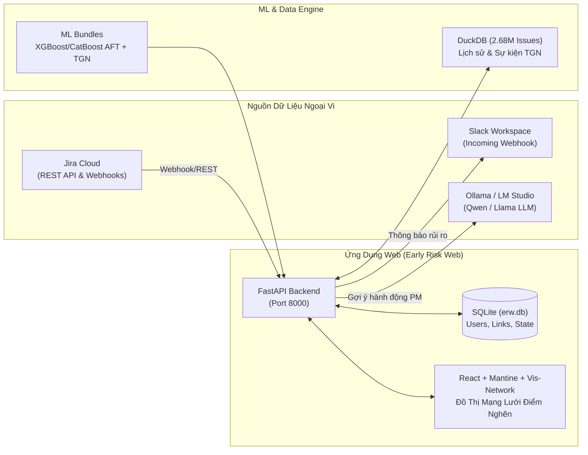

# HƯỚNG DẪN CÀI ĐẶT (SETUP) & QUẢN LÝ BIẾN MÔI TRƯỜNG (ENVIRONMENT VARIABLES)

Tài liệu này cung cấp hướng dẫn toàn diện từ việc thiết lập môi trường phát triển, khởi chạy hệ thống, giải thích chi tiết ý nghĩa và cách lấy từng biến môi trường (`.env`) phục vụ tích hợp với **Jira Cloud**, **Slack**, **Ollama / LM Studio**, và hệ cơ sở dữ liệu **DuckDB / SQLite**.

---

## 📑 MỤC LỤC
1. [Tổng quan Kiến trúc Hệ thống](#1-tổng-quan-kiến-trúc-hệ-thống)
2. [Yêu cầu Hệ thống (Prerequisites)](#2-yêu-cầu-hệ-thống-prerequisites)
3. [Quy trình Cài đặt & Khởi chạy Từng bước](#3-quy-trình-cài-đặt--khởi-chạy-từng-bước)
4. [Vị trí các File Cấu hình .env](#4-vị-trí-các-file-cấu-hình-env)
5. [Hướng dẫn Chi tiết Cách Lấy Từng Biến Môi Trường](#5-hướng-dẫn-chi-tiết-cách-lấy-từng-biến-môi-trường)
   - [5.1. Tích hợp Jira Cloud (REST API & Webhooks)](#51-tích-hợp-jira-cloud-rest-api--webhooks)
   - [5.2. Thông báo Cảnh báo qua Slack](#52-thông-báo-cảnh-báo-qua-slack)
   - [5.3. Mô hình Ngôn ngữ Lớn (LLM / Ollama / LM Studio)](#53-mô-hình-ngôn-ngữ-lớn-llm--ollama--lm-studio)
   - [5.4. Dữ liệu & Trọng số Mô hình ML (DuckDB, Bundles)](#54-dữ-liệu--trọng-số-mô-hình-ml-duckdb-bundles)
   - [5.5. Phiên đăng nhập & Bảo mật Webapp](#55-phiên-đăng-nhập--bảo-mật-webapp)
6. [Template Mẫu File .env Đầy Đủ](#6-template-mẫu-file-env-đầy-đủ)
7. [Kiểm thử & Khắc phục Sự cố (Troubleshooting)](#7-kiểm-thử--khắc-phục-sự-cố-troubleshooting)

---

## 1. TỔNG QUAN KIẾN TRÚC HỆ THỐNG

Hệ thống **Early Risk Detection & Management (ERW)** bao gồm 3 phân hệ chính:



1. **Thư viện AI/ML (`src/early_risk_detection`)**:
   - Mô hình dự đoán nguy cơ trễ hạn $T_0$ (XGBoost 5-fold, XGBoost AFT, CatBoost AFT, Cổng lọc Pre-Triage Non-work/Duplicate).
   - Mô hình xếp hạng tầm quan trọng và điểm nghẽn kiến trúc (Temporal Graph Network - TGN Ranking-Aware trên DuckDB).
2. **Backend API (`webapp/backend`)**:
   - Xây dựng bằng FastAPI, SQLAlchemy, kết nối đồng thời SQLite (`var/erw.db`) và DuckDB.
   - Quản lý đồng bộ Jira, lập lịch đánh giá rủi ro (scheduler), điều phối cảnh báo Slack và tạo đề xuất hành động qua LLM.
3. **Frontend UI (`webapp/frontend`)**:
   - Single Page Application xây dựng bằng React 18, Vite, Mantine UI v7 và thư viện đồ thị mạng lưới chuyên dụng `vis-network`.
   - Cung cấp Dashboard thống kê rủi ro thời gian thực, bảng phân loại task và đồ thị mạng lưới phụ thuộc trực quan hóa điểm nghẽn và task trễ hạn.

---

## 2. YÊU CẦU HỆ THỐNG (PREREQUISITES)

- **Hệ điều hành:** Linux (Ubuntu 20.04/22.04/24.04 được khuyến nghị) hoặc macOS.
- **Python:** Phiên bản $\ge$ 3.10 (khuyến nghị Python 3.11, 3.12 hoặc 3.13).
- **Node.js & Package Manager:** Node.js $\ge$ 18.x và npm $\ge$ 9.x.
- **Phần cứng:**
  - *Chạy Webapp & Suy luận nhẹ:* Tối thiểu 4GB RAM, 2 CPU cores.
  - *Huấn luyện lại TGN hoặc quét DuckDB toàn bộ (2.68M issues):* Khuyến nghị $\ge$ 32GB RAM và GPU NVIDIA (CUDA $\ge$ 11.8).

---

## 3. QUY TRÌNH CÀI ĐẶT & KHỞI CHẠY TỪNG BƯỚC

### Bước 1: Khởi tạo Virtual Environment Python
Từ thư mục gốc của repository:

```bash
# Tạo môi trường ảo .venv
python3 -m venv .venv

# Kích hoạt môi trường ảo
source .venv/bin/activate

# Nâng cấp pip và wheel
pip install --upgrade pip setuptools wheel
```

### Bước 2: Cài đặt Dependencies Python
```bash
# Cài đặt thư viện ở chế độ editable kèm các gói phát triển:
pip install -e ".[train,dev]"

# Hoặc cài đặt trực tiếp từ file khóa phiên bản:
pip install -r requirements-lock.txt
```

### Bước 3: Cài đặt Dependencies Frontend & Build Assets
```bash
cd webapp/frontend
npm install
npm run build
cd ../..
```
> [!NOTE]
> Lệnh `npm run build` sẽ đóng gói toàn bộ mã nguồn React vào thư mục `webapp/frontend/dist`. Backend FastAPI sẽ tự động phục vụ các static files này khi chạy ứng dụng.

### Bước 4: Cấu hình File Môi trường `.env`
Tạo file `.env` trong thư mục `webapp/backend/`:
```bash
cp webapp/backend/.env.example webapp/backend/.env
```
*(Chi tiết cách điền từng biến xem tại [Mục 5](#5-hướng-dẫn-chi-tiết-cách-lấy-từng-biến-môi-trường)).*

### Bước 5: Khởi tạo Database & Nạp Dữ Liệu Demo
Hệ thống đi kèm công cụ CLI để khởi tạo bảng và kịch bản mạng lưới thực tế:

```bash
# 1. Khởi tạo schema cơ sở dữ liệu SQLite:
.venv/bin/python -m erw.cli init-db

# 2. Nạp dữ liệu kịch bản Demo hoàn chỉnh (kèm mạng lưới điểm nghẽn & task trễ hạn):
.venv/bin/python -m erw.cli seed-demo --reset --rich-network
```

Hoặc sử dụng shortcut qua `Makefile`:
```bash
make reset-demo
```

### Bước 6: Khởi chạy Ứng Dụng

#### Cách A: Chạy Trọn Gói Production/Standalone (Khuyến nghị)
Backend FastAPI phục vụ cả REST API và giao diện Web trên cùng một cổng:
```bash
make run
```
Truy cập trình duyệt tại: **http://localhost:8000**

#### Cách B: Chạy Chế độ Phát triển (Dev Mode với Hot-Reload)
Mở 2 cửa sổ terminal độc lập:
- **Terminal 1 (Backend FastAPI auto-reload):**
  ```bash
  make run-dev
  # API Swagger Docs tại: http://localhost:8000/docs
  ```
- **Terminal 2 (Frontend Vite HMR dev server):**
  ```bash
  make dev-frontend
  # Web UI tại: http://localhost:5173
  ```

---

## 4. VỊ TRÍ CÁC FILE CẤU HÌNH .ENV

Dự án sử dụng các file `.env` tại 2 vị trí tùy thuộc vào tác vụ:

| Đường dẫn file | Phạm vi áp dụng | Mô tả chức năng |
| :--- | :--- | :--- |
| **`webapp/backend/.env`** | **Ứng dụng Web ERW & Backend** | Cấu hình kết nối Jira Cloud, Webhooks, Slack, Database SQLite/DuckDB, ngưỡng rủi ro, và bảo mật session. |
| **`.env`** (ở thư mục gốc) | **Pipeline ETL & Gán nhãn ML** | Dùng cho module `llm_label.py` khi kết nối tới OpenAI-compatible API / LM Studio để gán nhãn dữ liệu nghiên cứu. |

---

## 5. HƯỚNG DẪN CHI TIẾT CÁCH LẤY TỪNG BIẾN MÔI TRƯỜNG

### 5.1. Tích hợp Jira Cloud (REST API & Webhooks)

Để hệ thống tự động đồng bộ danh sách issue, sprint, quan hệ link, và ghi ngược đề xuất hành động lên Jira:

```ini
JIRA_BASE_URL=https://your-domain.atlassian.net/
JIRA_EMAIL=your-email@example.com
JIRA_API_TOKEN=ATATT3xFf...
JIRA_PROJECTS=DEMO,PAY
JIRA_WEBHOOK_SECRET=your_random_secret_hex
JIRA_SPRINT_FIELD=customfield_10020
JIRA_STORY_POINTS_FIELD=customfield_10016
PUBLIC_BASE_URL=https://your-tunnel.ngrok-free.app
```

#### Chi tiết cách lấy từng tham số:

1. **`JIRA_BASE_URL`**:
   - Địa chỉ URL trang Jira Cloud của bạn.
   - *Ví dụ:* `https://mycompany.atlassian.net/`

2. **`JIRA_EMAIL`**:
   - Địa chỉ email của tài khoản Atlassian dùng để quản trị hoặc tài khoản Service Account.

3. **`JIRA_API_TOKEN`**:
   - **Bước 1:** Đăng nhập vào trang quản lý Atlassian: [https://id.atlassian.com/manage-profile/security/api-tokens](https://id.atlassian.com/manage-profile/security/api-tokens).
   - **Bước 2:** Nhấn nút **Create API token**.
   - **Bước 3:** Nhập nhãn (Label) dễ nhớ, ví dụ: `early-risk-web-integration`.
   - **Bước 4:** Nhấn **Create**, sau đó nhấn **Copy** và dán vào biến `JIRA_API_TOKEN` trong `.env`.
   > [!WARNING]
   > Token chỉ hiển thị một lần duy nhất khi tạo. Chuỗi token thường bắt đầu bằng tiền tố `ATATT3...`.

4. **`JIRA_PROJECTS`**:
   - Danh sách mã Key của các dự án Jira bạn muốn theo dõi rủi ro, cách nhau bằng dấu phẩy.
   - *Ví dụ:* `DEMO,CORE,PAY`

5. **`JIRA_WEBHOOK_SECRET`**:
   - Chuỗi bí mật dùng để xác thực các request Webhook gửi từ Jira Cloud tới endpoint `/webhooks/jira/<secret>`.
   - *Cách tạo:* Chạy lệnh bash sinh chuỗi ngẫu nhiên:
     ```bash
     openssl rand -hex 16
     ```
   - *Đăng ký tự động:* Sau khi cấu hình `PUBLIC_BASE_URL`, bạn có thể chạy lệnh tự động đăng ký webhook lên Jira:
     ```bash
     .venv/bin/python -m erw.cli register-webhook
     ```

6. **`PUBLIC_BASE_URL`**:
   - Địa chỉ URL công khai (HTTPS) của server để Jira Cloud có thể gửi webhook về.
   - Khi phát triển cục bộ, sử dụng **Ngrok** hoặc **Cloudflare Tunnel**:
     ```bash
     ngrok http 8000
     # Lấy URL dạng: https://abc-123.ngrok-free.app điền vào PUBLIC_BASE_URL
     ```

7. **`JIRA_SPRINT_FIELD` & `JIRA_STORY_POINTS_FIELD`**:
   - Jira Cloud lưu thông tin Sprint và Story Points trong các Custom Field có ID riêng biệt theo từng Workspace.
   - Mặc định chuẩn của Atlassian:
     - Sprint: `customfield_10020`
     - Story Points: `customfield_10016` (hoặc `customfield_10028`)
   - *Cách kiểm tra chính xác ID trên Jira của bạn:*
     1. Vào **Jira Settings** (biểu tượng bánh răng) $\to$ **Issues** $\to$ **Custom fields**.
     2. Tìm trường `Sprint` hoặc `Story Points`, bấm vào dấu ba chấm $\to$ **View field details**.
     3. Nhìn trên thanh địa chỉ URL của trình duyệt, số cuối cùng chính là ID (ví dụ: `id=10020` $\to$ `customfield_10020`).

---

### 5.2. Thông báo Cảnh báo qua Slack

Hệ thống tự động bắn thông báo khi phát hiện issue có nguy cơ trễ hạn cao, task bị chặn lâu ngày, hoặc gửi báo cáo tổng kết buổi sáng (Morning Digest).

```ini
SLACK_WEBHOOK_URL=https://hooks.slack.com/services/XXX/YYY/ZZZ
SLACK_MAX_PER_HOUR=20
```

#### Chi tiết cách lấy:

1. **`SLACK_WEBHOOK_URL`**:
   - **Bước 1:** Truy cập trang quản trị ứng dụng Slack: [https://api.slack.com/apps](https://api.slack.com/apps).
   - **Bước 2:** Nhấn **Create New App** $\to$ Chọn **From scratch**.
   - **Bước 3:** Đặt tên ứng dụng (ví dụ: `Early Risk Bot`) và chọn Workspace muốn tích hợp.
   - **Bước 4:** Ở menu bên trái, chọn **Incoming Webhooks**, gạt công tắc sang **On**.
   - **Bước 5:** Cuộn xuống dưới, nhấn **Add New Webhook to Workspace**, chọn kênh Slack (channel) muốn nhận thông báo (ví dụ `#jira-risks` hoặc `#general`) $\to$ nhấn **Allow**.
   - **Bước 6:** Copy URL vừa được tạo (dạng `https://hooks.slack.com/services/...`) và gán vào `SLACK_WEBHOOK_URL`.

2. **`SLACK_MAX_PER_HOUR`**:
   - Giới hạn số lượng tin nhắn cảnh báo tối đa được gửi lên Slack trong một giờ (mặc định là `20`) để tránh gây nghẽn thông tin (spam alerts) cho nhóm phát triển.

---

### 5.3. Mô hình Ngôn ngữ Lớn (LLM / Ollama / LM Studio)

Hệ thống sử dụng LLM để giải thích nguyên nhân rủi ro và đề xuất phương án xử lý công việc cho Project Manager (PM).

#### Tùy chọn A: Sử dụng Ollama (Cục bộ, Miễn phí, Nhanh)
Cấu hình trong `webapp/backend/.env`:
```ini
OLLAMA_URL=http://localhost:11434
LLM_MODEL=qwen3:1.7b
```
- **Cài đặt Ollama:**
  ```bash
  curl -fsSL https://ollama.com/install.sh | sh
  ```
- **Tải model khuyến nghị:**
  ```bash
  # Model nhỏ gọn (1.7B tham số, chạy cực nhẹ trên RAM/CPU):
  ollama run qwen2.5:1.5b
  # hoặc:
  ollama pull qwen2.5-coder:1.5b
  ```

#### Tùy chọn B: Sử dụng LM Studio hoặc OpenAI API
Cấu hình trong file `.env` ở thư mục gốc:
```ini
LLM_BASE_URL=http://localhost:1234/v1
LLM_API_KEY=sk-lm-your-token
LLM_MODEL=qwen/qwen3.8-27b
LLM_TEMPERATURE=0.7
LLM_MAX_TOKENS=16384
```
- Mở LM Studio $\to$ Tab **Developer** $\to$ Bật **Local Server** tại cổng `1234`.
- Bật tùy chọn **Require Authentication** để lấy API Token hoặc để trống nếu chạy nội bộ.

---

### 5.4. Dữ liệu & Trọng số Mô hình ML (DuckDB, Bundles)

```ini
DB_URL=sqlite:///var/erw.db
BASE_DUCKDB=data/jira.duckdb
WORK_DUCKDB=var/erw_scoring.duckdb
BUNDLES_DIR=bundles
DEFAULT_BUNDLE=tgn_dual_head
EMB_DIR=data
STREAM_DIR=var/stream
DELAY_THRESHOLD=0.39
CRITICALITY_TOP_PCT=0.05
```

- **`DB_URL`**: Đường dẫn tới SQLite database lưu trạng thái hoạt động của webapp. Mặc định: `sqlite:///var/erw.db`.
- **`BASE_DUCKDB`**: Đường dẫn DuckDB chứa 2.68 triệu issues lịch sử (chỉ đọc - Read-Only). Mặc định: `data/jira.duckdb`.
- **`WORK_DUCKDB`**: Bản sao DuckDB làm việc tạm thời khi tính toán suy luận lô (Batch scoring). Mặc định: `var/erw_scoring.duckdb`.
- **`BUNDLES_DIR`**: Thư mục lưu các mô hình ML đã huấn luyện. Mặc định: `bundles/`.
- **`DELAY_THRESHOLD`**: Ngưỡng xác suất $P(\text{delay})$ để kích hoạt cờ rủi ro. Giá trị tối ưu F1/F2 theo thực nghiệm nghiên cứu là **`0.39`**.
- **`CRITICALITY_TOP_PCT`**: Tỷ lệ top phần trăm các issue trọng yếu theo mô hình TGN Memory. Mặc định là **`0.05`** (Top 5%).

---

### 5.5. Phiên đăng nhập & Bảo mật Webapp

```ini
SESSION_SECRET=erw-secret-key-change-in-production-random-hash
SESSION_COOKIE_NAME=erw_session
SESSION_MAX_AGE_SECONDS=604800
TZ=Asia/Ho_Chi_Minh
BATCH_TIME=06:45
DIGEST_TIME=08:00
WEB_BASE_URL=http://localhost:8000
```

- **`SESSION_SECRET`**: Khóa bí mật dùng để ký chữ ký số HMAC-SHA256 trên Cookie phiên đăng nhập. Khi triển khai Production, bắt buộc thay đổi bằng một chuỗi ngẫu nhiên an toàn:
  ```bash
  python3 -c "import secrets; print(secrets.token_hex(32))"
  ```
- **`SESSION_COOKIE_NAME`**: Tên cookie lưu token session (mặc định: `erw_session`).
- **`SESSION_MAX_AGE_SECONDS`**: Thời gian tồn tại của phiên đăng nhập (mặc định: `604800` giây = 7 ngày).
- **`TZ`**: Múi giờ hệ thống (mặc định: `Asia/Ho_Chi_Minh`).
- **`BATCH_TIME`**: Thời điểm chạy batch tính điểm tự động hàng ngày (mặc định: `06:45` sáng).
- **`DIGEST_TIME`**: Thời điểm gửi bản tin tổng kết buổi sáng lên Slack (mặc định: `08:00` sáng).

---

## 6. TEMPLATE MẪU FILE .ENV ĐẦY ĐỦ

Dưới đây là nội dung mẫu hoàn chỉnh cho file `webapp/backend/.env`:

```ini
# ==============================================================================
# EARLY RISK WEB (ERW) — PRODUCTION CONFIGURATION
# ==============================================================================

# --- Cơ sở dữ liệu ứng dụng Web ---
DB_URL=sqlite:///var/erw.db
WEB_BASE_URL=http://localhost:8000
SESSION_SECRET=<random-secret-string>
SESSION_COOKIE_NAME=erw_session
SESSION_MAX_AGE_SECONDS=604800

# --- Tích hợp Atlassian Jira Cloud ---
JIRA_BASE_URL=https://your-team.atlassian.net/
JIRA_EMAIL=you@example.com
JIRA_API_TOKEN=<your-jira-api-token>
JIRA_PROJECTS=DEMO,PAY
JIRA_WEBHOOK_SECRET=<random-64-hex-string>
JIRA_SPRINT_FIELD=customfield_10020
JIRA_STORY_POINTS_FIELD=customfield_10016
PUBLIC_BASE_URL=https://example.ngrok-free.app

# --- Tích hợp Slack Thông Báo ---
SLACK_WEBHOOK_URL=
SLACK_MAX_PER_HOUR=20

# --- Mô hình Ngôn ngữ Lớn (LLM / GenAI) ---
OLLAMA_URL=http://localhost:11434
LLM_MODEL=qwen3:1.7b

# --- Mô hình Học Máy Dự Đoán Rủi Ro (DuckDB & Weights) ---
BASE_DUCKDB=data/jira.duckdb
WORK_DUCKDB=var/erw_scoring.duckdb
BUNDLES_DIR=bundles
DEFAULT_BUNDLE=tgn_dual_head
EMB_DIR=data
STREAM_DIR=var/stream
ERW_INSTANCE=ERW
DELAY_THRESHOLD=0.39
CRITICALITY_TOP_PCT=0.05
MODEL_MODE=shadow

# --- Lập lịch & Thời gian hoạt động ---
TZ=Asia/Ho_Chi_Minh
BATCH_TIME=06:45
DIGEST_TIME=08:00

# --- Cấu hình PM & Trạng thái ---
PM_NAME_BY_PROJECT={"DEMO":"Trần Bình"}
STATUS_CATEGORY_OVERRIDES={}
```

---

## 7. KIỂM THỬ & KHẮC PHỤC SỰ CỐ (TROUBLESHOOTING)

### 1. Kiểm tra kết nối Jira Cloud REST API
Chạy lệnh kiểm tra kết nối nhanh bằng Python:
```bash
.venv/bin/python -c "
from erw.settings import Settings
from erw.integrations.jira import JiraClient
s = Settings()
client = JiraClient(s.jira_base_url, s.jira_email, s.jira_api_token)
print('Connecting to Jira:', s.jira_base_url)
print('Projects tracked:', s.jira_projects)
"
```

### 2. Kiểm tra bắn thử thông báo Slack
Nếu đã điền `SLACK_WEBHOOK_URL`:
```bash
.venv/bin/python -c "
import httpx
from erw.settings import Settings
s = Settings()
if s.slack_webhook_url:
    resp = httpx.post(s.slack_webhook_url, json={'text': '🚀 Test kết nối Early Risk Bot thành công!'})
    print('Slack status:', resp.status_code)
else:
    print('SLACK_WEBHOOK_URL chưa được cấu hình.')
"
```

### 3. Kiểm tra kiểm thử tự động toàn diện (Test Suite)
Xác nhận tính toàn vẹn của mã nguồn và các API:
```bash
.venv/bin/pytest webapp/backend/tests
# Toàn bộ 312 tests phải đạt trạng thái PASSED (100%)
```

### 4. Đặt lại toàn bộ dữ liệu Demo nếu gặp lỗi
Nếu dữ liệu SQLite bị phân mảnh hoặc lỗi liên kết, chỉ cần chạy lệnh sau để đặt lại nguyên bản:
```bash
make reset-demo
```
Các tài khoản demo sẵn có:
- **Admin:** `admin@earlyrisk.local` / `Admin@123456`
- **PM:** `pm@earlyrisk.local` / `Pm@123456`
- **Viewer:** `viewer@earlyrisk.local` / `Viewer@123456`
