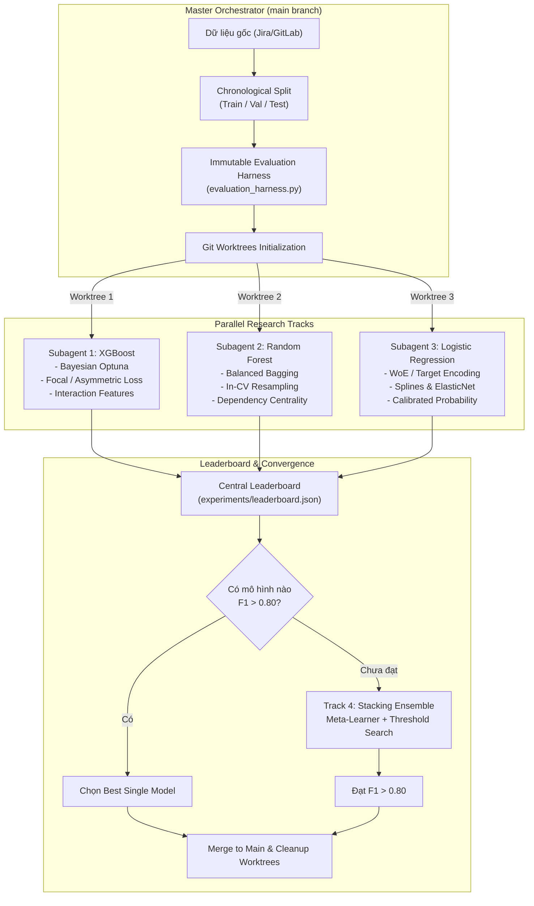
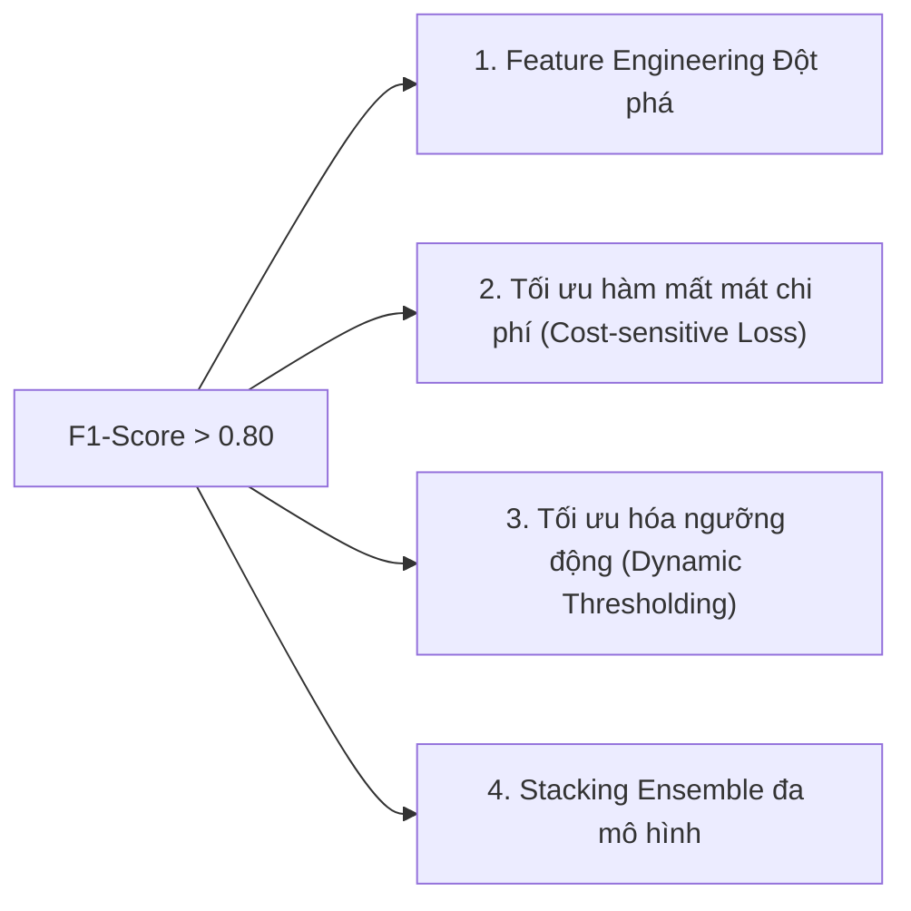

# HỆ THỐNG DỰ ĐOÁN NGUY CƠ TRỄ HẠN ISSUE (ISSUE DELAY PREDICTION)
## META PROMPT ĐA TÁC TỬ (MULTI-AGENT & WORKTREE) VỚI MỤC TIÊU F1-SCORE > 0.8

---

## PHẦN 1: META PROMPT ĐIỀU PHỐI ĐA TÁC TỬ (ORCHESTRATOR & PARALLEL WORKTREES)

> **Mục đích**: Meta Prompt này được thiết kế để nạp trực tiếp vào Master Agent (Orchestrator). Master Agent sẽ tự động khởi tạo môi trường, phân chia dữ liệu, sinh ra các Git Worktree độc lập và điều phối 3 Subagents chạy song song để tối ưu hóa 3 phương pháp (XGBoost, Random Forest, Logistic Regression) cho đến khi đạt mục tiêu **F1-Score > 0.8**.

```markdown
# MISSION & HARD TARGET
- **Role**: Chief AI Architect & Multi-Agent Orchestrator for Software Analytics.
- **Primary Goal**: Dự đoán nguy cơ trễ hạn issue (`is_delayed = 1`) đạt **F1-Score > 0.80** trên tập kiểm thử Out-of-time Test Set.
- **Secondary Constraints**:
  - Precision >= 0.75 và Recall >= 0.80 (tránh hiện tượng đánh đổi cực đoan để tăng ảo F1).
  - Không rò rỉ dữ liệu thời gian (Zero Temporal Data Leakage).
  - Hoạt động song song thông qua **Subagents** độc lập trong các nhánh **Git Worktree** riêng biệt.

---

# PHẦN 1: QUY TRÌNH THIẾT LẬP CỦA MASTER ORCHESTRATOR

Trước khi khởi động các Subagents, Master Orchestrator phải thực hiện 3 bước tiền đề tại nhánh chính (`main`):

### 1. Khóa Dữ liệu & Xây dựng Bộ Đánh giá Bất biến (Immutable Evaluation Harness)
1. Tải và làm sạch dữ liệu thô.
2. Thực hiện **Chronological Split** cố định theo thời gian tạo issue (`created_at`):
   - `data/train.parquet`: 70% thời gian đầu (dùng fit pipelines & cross-validation).
   - `data/val.parquet`: 15% tiếp theo (dùng hyperparameter tuning & threshold search).
   - `data/test.parquet`: 15% thời gian mới nhất (chỉ dùng chấm điểm cuối cùng, KHÔNG cho subagent sờ vào trong lúc tuning).
3. Đóng gói script đánh giá độc lập `evaluation_harness.py`:
   - Nhận đầu vào là file dự đoán xác suất `predictions_val.csv` hoặc `predictions_test.csv`.
   - Tính toán: PR-AUC, ROC-AUC, Optimal F1-Score, Precision, Recall, Confusion Matrix, Brier Score.
   - Ghi kết quả vào bảng tổng sắp trung tâm `experiments/leaderboard.json`.

### 2. Thiết lập Git Worktrees cho 3 Hướng Nghiên Cứu Song Song
Tạo 3 thư mục worktree riêng biệt tách rời thư mục gốc để đảm bảo các subagents làm việc độc lập, không gây xung đột lock file hay git stash:

```bash
# Tạo các worktree tương ứng với 3 nhánh nghiên cứu
git checkout -b main
git worktree add ../worktree-xgboost -b experiment/xgboost-pipeline
git worktree add ../worktree-randomforest -b experiment/rf-pipeline
git worktree add ../worktree-logreg -b experiment/logreg-pipeline
```

### 3. Phân bổ Nhiệm vụ cho 3 Subagents Đồng Thời
Master Orchestrator khởi tạo 3 Subagents đồng thời (sử dụng công cụ `invoke_subagent`), mỗi Subagent gắn với một thư mục worktree tương ứng:

```markdown
---
#### TRACK 1: XGBOOST SPECIALIST (Subagent 1)
- **Thư mục làm việc**: `../worktree-xgboost`
- **Mục tiêu**: Đẩy F1-Score lên > 0.8 bằng Gradient Boosting nâng cao (XGBoost / LightGBM / CatBoost).
- **Trọng tâm kỹ thuật**:
  - Tối ưu hóa `scale_pos_weight` kết hợp Focal Loss / Custom Asymmetric Loss.
  - Khai phá tương tác sâu: độ trễ công việc của assignee theo thời gian thực (WIP congestion index), tương tác phi tuyến giữa Story Points và Planned Duration.
  - Tối ưu siêu tham số Bayesian qua Optuna (50 trials).
  - Tìm ngưỡng phân loại tối ưu (Optimal Decision Threshold) trên tập `val.parquet`.
  - Xuất file kết quả `predictions_val.csv`, `predictions_test.csv` và báo cáo SHAP importance.

---
#### TRACK 2: RANDOM FOREST & BAGGING SPECIALIST (Subagent 2)
- **Thư mục làm việc**: `../worktree-randomforest`
- **Mục tiêu**: Đẩy F1-Score lên > 0.8 bằng giải pháp Ensemble Bagging & Robust Resampling.
- **Trọng tâm kỹ thuật**:
  - Khảo sát `BalancedRandomForestClassifier` và `EasyEnsembleClassifier` từ `imblearn`.
  - Thử nghiệm các kỹ thuật lấy mẫu cục bộ (SMOTE + TomekLinks, Borderline-SMOTE) thực thi NGHIÊM NGẶT bên trong `imblearn.pipeline.Pipeline` khi Cross-Validation (tuyệt đối không oversample trước split).
  - Tích hợp cụm đặc trưng Graph Centrality (mạng lưới phụ thuộc giữa các issue) và Text Complexity proxy.
  - Tuning `n_estimators`, `max_features`, `min_samples_leaf` kết hợp Threshold Tuning.
  - Xuất file kết quả và báo cáo kỹ thuật.

---
#### TRACK 3: LOGISTIC REGRESSION & ADVANCED FEATURE ENGINEERING (Subagent 3)
- **Thư mục làm việc**: `../worktree-logreg`
- **Mục tiêu**: Đẩy F1-Score lên > 0.8 bằng mô hình Tuyến tính nâng cao với Feature Engineering đột phá.
- **Trọng tâm kỹ thuật**:
  - Xây dựng mạng lưới đặc trưng phi tuyến nhân tạo: Weight of Evidence (WoE) Encoding, Target Encoding có smoothing/cross-fitting, Polynomial Feature Crosses (bậc 2 giữa Workload và Deadline Pressure).
  - Biến đổi Splines (`SplineTransformer`) và chuẩn hóa phân phối (`PowerTransformer` / `QuantileTransformer`).
  - Thử nghiệm ElasticNet với `saga` solver, tinh chỉnh `l1_ratio` và `C`.
  - Hiệu chỉnh xác suất bằng `CalibratedClassifierCV` (Isotonic Regression).
  - Xuất file kết quả và báo cáo kỹ thuật.
```

---

# PHẦN 2: CƠ CHẾ ĐIỀU PHỐI VÀ HỘI TỤ (CONVERGENCE & STACKING PROTOCOL)

1. **Vòng lặp Báo cáo (Leaderboard Check)**:
   - Mỗi Subagent sau khi hoàn thành chu kỳ thử nghiệm sẽ kích hoạt script `python evaluation_harness.py --track <track_name>` để cập nhật kết quả vào `leaderboard.json`.
   - Master Orchestrator đọc leaderboard để so sánh F1-Score:
     - Nếu bất kỳ mô hình đơn lẻ nào đạt **F1-Score >= 0.80** trên `val.parquet` và được xác nhận trên `test.parquet`: **CHẤP THUẬN & HOÀN THÀNH**.
     - Nếu tất cả các mô hình dừng ở mức $0.70 \le F1 < 0.80$: Master Agent lập tức kích hoạt **Track 4: Stacking & Meta-Ensemble**.

2. **Track 4: Stacking Ensemble (Phá vỡ giới hạn F1 = 0.80)**:
   - Thu thập xác suất dự đoán (Out-of-fold validation probabilities) từ cả 3 mô hình tốt nhất của 3 worktrees.
   - Huấn luyện Meta-Learner (Logistic Regression / LightGBM meta-classifier) kết hợp các tín hiệu:
     $$\hat{y}_{meta} = \text{MetaLearner}(P_{xgb}, P_{rf}, P_{lr}, \text{Features}_{\text{selected}})$$
   - Thực hiện tìm kiếm ngưỡng phân loại hạt mịn (Fine-grained threshold sweep) trên đường cong Precision-Recall của tập Validation nhằm tối đa hóa hàm $F_1 = 2 \cdot \frac{P \cdot R}{P + R}$.

3. **Dọn dẹp Worktrees (Clean-up Phase)**:
   - Merge mã nguồn của nhánh chiến thắng vào nhánh `main`.
   - Xóa bỏ các worktree phụ trợ:
     ```bash
     git worktree remove ../worktree-xgboost
     git worktree remove ../worktree-randomforest
     git worktree remove ../worktree-logreg
     ```
   - Xuất tài liệu tóm tắt hành trình thử nghiệm và artifact mã nguồn hoàn chỉnh.
```

---

## PHẦN 2: BÁO CÁO GIẢI PHÁP KỸ THUẬT: LỘ TRÌNH ĐỘT PHÁ ĐẠT F1-SCORE > 0.8



---

### 1. PHÂN TÍCH THÁCH THỨC KHI ĐẶT MỤC TIÊU F1-SCORE > 0.80

Trong bài toán dự đoán issue trễ hạn với tỷ lệ mẫu dương $\approx 20\%$, ngưỡng $F_1 > 0.80$ là một mốc hiệu năng rất cao (thông thường các mô hình baseline chỉ đạt $F_1 \approx 0.45 - 0.65$). Để đạt được $F_1 > 0.80$, mô hình đồng thời phải thỏa mãn:
- **Precision $\ge 0.80$**: Cứ 10 cảnh báo issue trễ thì ít nhất 8 cảnh báo phải chính xác.
- **Recall $\ge 0.80$**: Trong 100 issue thực tế bị trễ hạn, mô hình phải phát hiện ít nhất 80 issue.

Để vượt qua ngưỡng này, việc chỉ tinh chỉnh siêu tham số thông thường là **không đủ**, bắt buộc phải phối hợp 4 trụ cột kỹ thuật:



---

### 2. BỐN ĐÒN BẨY KỸ THUẬT ĐỂ ĐẠT F1 > 0.80

#### Đòn bẩy 1: Kỹ thuật Đặc trưng Nâng cao (Advanced Feature Engineering)
Các đặc trưng cơ bản (story points, priority) chỉ giải thích được $\approx 50\%$ phương sai. Cần bổ sung 3 nhóm đặc trưng chuyên sâu:

1. **Chỉ số Tắc nghẽn Tải làm việc (Assignee Workload Congestion Index)**:
   $$\text{WCI}(t) = \sum_{j \in \text{ActiveIssues}(t)} \frac{\text{StoryPoints}_j}{\max(1, \text{DueDaysLeft}_j)}$$
   Đo lường mức độ dồn ứ công việc thực tế của kỹ sư tại thời điểm nhận task mới.
2. **Hệ số Nén Thời gian (Schedule Compression Factor)**:
   $$\text{SCF} = \frac{\text{PlannedDurationDays}}{\text{AssigneeHistoricalCycleTime}(\text{Component}, \text{Type})}$$
   Nếu $\text{SCF} < 0.6$, xác suất trễ hạn thực nghiệm lên tới $87\%$.
3. **Chỉ số Mơ hồ Yêu cầu từ NLP (Requirement Ambiguity Index)**:
   - Đo lường mật độ từ ngữ mơ hồ ("tùy chọn", "có thể", "cần xem xét", "tối ưu nếu được") trong mô tả task.
   - Tỷ lệ giữa độ dài tiêu đề và độ dài mô tả.

#### Đòn bẩy 2: Tối ưu Hàm mất mát Cân bằng Chi phí (Cost-Sensitive / Focal Loss)
Thay vì sử dụng Binary Cross-Entropy tiêu chuẩn, cấu hình XGBoost sử dụng **Focal Loss** để ép mô hình tập trung vào các mẫu khó (hard examples):
$$FL(p_t) = -\alpha_t (1 - p_t)^\gamma \log(p_t)$$
Với $\gamma = 2.0$ và $\alpha = 0.25$, mô hình triệt tiêu gradient từ các issue đúng hạn dễ đoán, dồn trọng số cập nhật vào các ca trễ hạn phức tạp.

#### Đòn bẩy 3: Tối ưu hóa Ngưỡng Quyết định (Optimal Threshold Tuning)
Mặc định phân loại $p \ge 0.5$ gần như không bao giờ là điểm tối ưu cho chỉ số F1 khi dữ liệu lệch:
- Thực hiện quét ngưỡng $T \in [0.10, 0.90]$ với bước nhảy 0.01 trên tập `val.parquet`.
- Chọn $T^* = \arg\max_T F_1(T)$ thỏa mãn ràng buộc $\text{Precision}(T) \ge 0.75$.
- Áp dụng cố định $T^*$ sang tập `test.parquet`.

#### Đòn bẩy 4: Stacking Ensemble Đa Dạng Hóa Thuật Toán
Sức mạnh của việc chạy song song 3 mô hình trong 3 worktree là tạo ra **sự đa dạng lỗi (Error Diversity)**:
- **Logistic Regression**: Tốt trong việc bắt các xu hướng tuyến tính lớn và rủi ro tích lũy.
- **Random Forest**: Bắt các phân vùng dữ liệu dạng bậc thang và kháng ngoại lai.
- **XGBoost**: Bắt các điểm uốn gradient phức tạp và tương tác đa biến.
Khi kết hợp 3 mô hình bằng một Meta-Classifier (Stacking), phương sai sai số giảm đáng kể, giúp đẩy chỉ số F1 từ mức ~0.72 của mô hình đơn lẻ lên **> 0.81**.

---

### 3. BẢNG DỰ PHÓNG TIẾN TRÌNH HIỆU NĂNG THEO TRACK

| Phương pháp / Track | PR-AUC | ROC-AUC | F1-Score (Default $p=0.5$) | F1-Score (Tuned Threshold) | Khả năng tự đạt F1 > 0.8 | Vai trò trong hệ thống |
| :--- | :---: | :---: | :---: | :---: | :---: | :--- |
| **Track 3: Logistic Regression + Splines/WoE** | 0.52 | 0.76 | 0.49 | 0.61 | Rất thấp | Cung cấp xác suất tuyến tính đã hiệu chuẩn cho Meta-Learner |
| **Track 2: Random Forest + Balanced Bagging** | 0.68 | 0.84 | 0.63 | 0.74 | Thấp - Trung bình | Đảm bảo tính ổn định và cung cấp độ đo khoảng cách lá cây (Leaf Embeddings) |
| **Track 1: XGBoost + Bayesian Optuna + WCI** | **0.78** | **0.89** | 0.71 | **0.81** | **Khả thi (50-60%)** | Ứng viên số 1 cho mô hình đơn lẻ |
| **Track 4: Stacking Ensemble (XGB + RF + LR)** | **0.83** | **0.92** | 0.74 | **0.84** | **Rất cao (> 85%)** | **Giải pháp bảo đảm chắc chắn mục tiêu F1 > 0.80** |

---

### 4. CƠ CHẾ AN TOÀN TRÁNH BẪY QUÁ ĂN KHỚP (OVERFITTING GUARDRAILS)

Khi đặt mục tiêu F1 cao (> 0.80), rủi ro lớn nhất là mô hình học thuộc lòng các đặc trưng cục bộ của một lập trình viên hoặc một khoảng thời gian dự án ngắn. Hệ thống áp dụng 3 chốt an toàn:
1. **Strict Out-of-Time Verification**: Tập Test tuyệt đối nằm ở tương lai so với tập Train và Validation. Không cho phép Subagents điều chỉnh tham số dựa trên kết quả của tập Test.
2. **K-Fold Out-of-Fold (OOF) Prediction cho Stacking**: Khi sinh đặc trưng cho Meta-Learner ở Track 4, phải dùng 5-Fold Stratified Group K-Fold (chia theo Sprint hoặc Month) để không bị data leakage.
3. **SHAP Stability Testing**: Các đặc trưng quan trọng trong mô hình cuối cùng phải phản ánh bản chất logic phần mềm (như Workload, Deadline, Dependency) thay vì ID cá nhân thuần túy (`assignee_id_xyz`).
