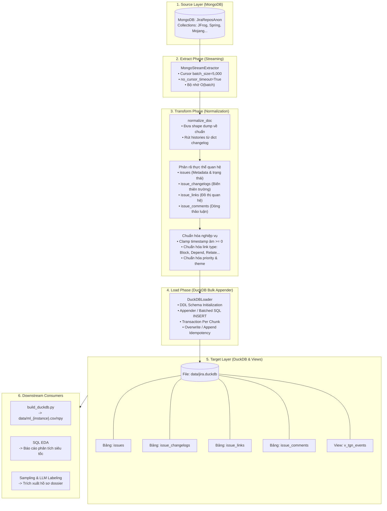

# Quy trình ETL: Trích xuất và Chuyển đổi Dữ liệu từ MongoDB sang DuckDB

**Tài liệu kỹ thuật kiến trúc & vận hành pipeline ETL**  
**Dự án:** Ứng dụng Mạng Đồ thị Thời gian (TGN) phát hiện điểm nghẽn quy trình từ The Public Jira Dataset  
**Tác giả:** Đội ngũ Kỹ thuật & Nghiên cứu  
**Ngày cập nhật:** 2026-10-13  
**Trạng thái:** Triển khai (Production-Ready)  

---

## 1. Bối cảnh & Lý do Chuyển dịch Kiến trúc

### 1.1. Hiện trạng với MongoDB
The Public Jira Dataset (Montgomery, Lüders & Maalej, MSR 2022) bao gồm 16 instance Jira công khai với khoảng 2,7 triệu issues, 32 triệu bản ghi changelog, 9 triệu comments và 1 triệu issue links. Ban đầu, toàn bộ dữ liệu này được lưu trữ dưới dạng BSON document trong MongoDB (`db: JiraReposAnon`, mỗi instance là một collection).

Ở phiên bản P0, module `jira_adapter/build_mongo.py` kết nối trực tiếp đến MongoDB local (`127.0.0.1:27017`) và thực hiện nạp toàn bộ document của từng instance vào bộ nhớ RAM qua hàm:
```python
docs = [_bson_to_plain(doc) for doc in cur]
```

### 1.2. Thách thức Kỹ thuật
1. **Quá tải bộ nhớ (Out-Of-Memory - OOM)**:  
   Với các instance vừa và lớn như `Mojang` (421.000 issues, ~20GB raw), `RedHat` (353.000 issues) hay `Apache` (>1.000.000 issues), việc chuyển đổi và lưu giữ toàn bộ danh sách Python dictionary trong RAM làm bùng nổ bộ nhớ (>30–50 GB), gây sập tiến trình hoặc buộc phải giới hạn số lượng mẫu (`--limit`).
2. **Chi phí vận hành tiến trình MongoDB daemon**:  
   Việc yêu cầu một tiến trình nền `mongod` liên tục chạy chiếm giữ cổng `27017` và duy trì ~60 GB dữ liệu thô WiredTiger là không cần thiết cho các tác vụ nghiên cứu / huấn luyện mô hình.
3. **Hiệu năng truy vấn phân tích (OLAP) và EDA thấp**:  
   MongoDB là hệ cơ sở dữ liệu hướng tài liệu (Document Store - OLTP), không tối ưu cho các phép tính tổng hợp cột (columnar aggregation), phân tích chuỗi thời gian (time-series windowing), tính toán dwell time và trích xuất đặc trưng đồ thị.

### 1.3. Lợi thế khi chuyển sang DuckDB
- **Serverless & Embedded (In-process OLAP)**: DuckDB chạy trực tiếp trong tiến trình Python mà không cần server hay daemon nền, lưu trữ toàn bộ dữ liệu trong một file duy nhất (`data/jira.duckdb`).
- **Xử lý Out-of-Core (Streaming to Disk)**: DuckDB tự động tối ưu bộ nhớ đệm và ghi tràn ra đĩa khi xử lý tập dữ liệu lớn hơn dung lượng RAM thực tế.
- **Tốc độ truy vấn cột siêu tốc (Vectorized Engine)**: Hỗ trợ SIMD và thực thi truy vấn cột theo lô, tăng tốc các phép phân tích EDA, đếm thống kê và nối quan hệ (JOIN) từ hàng chục lần đến hàng trăm lần so với Python vòng lặp thuần.
- **Tương thích hoàn hảo với hệ sinh thái AI/ML**: Hỗ trợ xuất trực tiếp ra PyArrow, Parquet, Pandas và NumPy tensors phục vụ nạp vào mô hình TGN.

---

## 2. Kiến trúc Tổng thể Pipeline ETL

Pipeline ETL được thiết kế theo mô hình **Streaming Chunk-based** đảm bảo lượng RAM tiêu thụ luôn là hằng số $O(\text{batch})$ bất kể kích thước của instance.



---

## 3. Thiết kế Lược đồ Quan hệ trong DuckDB (Schema)

Toàn bộ tài liệu JSON lồng nhau phức tạp của Jira được phân rã thành **4 bảng quan hệ chuẩn** và **1 view thống nhất**:

### 3.1. Bảng `issues`
Lưu trữ thông tin thuộc tính cốt lõi và trạng thái cuối của từng issue.

```sql
CREATE TABLE IF NOT EXISTS issues (
    instance            VARCHAR NOT NULL,
    issue_key           VARCHAR NOT NULL,
    project             VARCHAR NOT NULL,
    summary             VARCHAR,
    issuetype           VARCHAR,
    issuetype_theme     VARCHAR,          -- Requirements | Development | Maintenance | User Support | Other
    priority_raw        VARCHAR,
    priority_norm       DOUBLE,           -- 0.1 đến 1.0 (Blocker cao nhất)
    status              VARCHAR,
    resolution          VARCHAR,
    created_ts          DOUBLE,           -- Epoch giây (clamp >= 0)
    updated_ts          DOUBLE,
    resolved_ts         DOUBLE,
    assignee            VARCHAR,
    reporter            VARCHAR,
    num_changelogs      INTEGER DEFAULT 0,
    num_links           INTEGER DEFAULT 0,
    num_comments        INTEGER DEFAULT 0,
    has_block_or_depend BOOLEAN DEFAULT FALSE,
    PRIMARY KEY (instance, issue_key)
);
CREATE INDEX IF NOT EXISTS idx_issues_proj ON issues(instance, project);
CREATE INDEX IF NOT EXISTS idx_issues_created ON issues(instance, created_ts);
```

### 3.2. Bảng `issue_changelogs`
Lưu trữ toàn bộ dòng lịch sử biến thiên trạng thái, người phụ trách và mức độ ưu tiên theo dòng thời gian.

```sql
CREATE TABLE IF NOT EXISTS issue_changelogs (
    instance            VARCHAR NOT NULL,
    issue_key           VARCHAR NOT NULL,
    change_id           VARCHAR,
    author              VARCHAR,
    created_ts          DOUBLE NOT NULL,
    field               VARCHAR NOT NULL, -- status | assignee | priority | resolution ...
    from_value          VARCHAR,
    to_value            VARCHAR
);
CREATE INDEX IF NOT EXISTS idx_chg_key ON issue_changelogs(instance, issue_key);
CREATE INDEX IF NOT EXISTS idx_chg_ts ON issue_changelogs(instance, created_ts);
CREATE INDEX IF NOT EXISTS idx_chg_field ON issue_changelogs(instance, field);
```

### 3.3. Bảng `issue_links`
Lưu trữ mạng lưới liên kết giữa các issues, phục vụ bài toán phát hiện điểm nghẽn và dự đoán liên kết đồ thị.

```sql
CREATE TABLE IF NOT EXISTS issue_links (
    instance            VARCHAR NOT NULL,
    source_key          VARCHAR NOT NULL,
    target_key          VARCHAR NOT NULL,
    link_type_raw       VARCHAR,
    link_type_std       VARCHAR NOT NULL, -- Block | Depend | Epic | Parent-Child | Subtask | Fix | Duplicate | Relate | Other
    direction           INTEGER NOT NULL,  -- 1: Outward (chủ động), 0: Inward (bị động)
    is_block_or_depend  BOOLEAN NOT NULL,
    approx_ts           DOUBLE NOT NULL
);
CREATE INDEX IF NOT EXISTS idx_links_src ON issue_links(instance, source_key);
CREATE INDEX IF NOT EXISTS idx_links_tgt ON issue_links(instance, target_key);
CREATE INDEX IF NOT EXISTS idx_links_std ON issue_links(instance, link_type_std);
```

### 3.4. Bảng `issue_comments`
Lưu trữ thông tin các lượt thảo luận trên issue.

```sql
CREATE TABLE IF NOT EXISTS issue_comments (
    instance            VARCHAR NOT NULL,
    issue_key           VARCHAR NOT NULL,
    comment_id          VARCHAR,
    author              VARCHAR,
    created_ts          DOUBLE NOT NULL,
    body_len            INTEGER DEFAULT 0,
    body_preview        VARCHAR
);
CREATE INDEX IF NOT EXISTS idx_cmt_key ON issue_comments(instance, issue_key);
CREATE INDEX IF NOT EXISTS idx_cmt_ts ON issue_comments(instance, created_ts);
```

### 3.5. View Thống nhất Dòng Sự kiện `v_tgn_events`
View phục vụ việc trích xuất trực tiếp dòng sự kiện cho mô hình Temporal Graph Network:

```sql
CREATE OR REPLACE VIEW v_tgn_events AS
-- 1. Sự kiện thay đổi trạng thái (status)
SELECT 
    instance,
    issue_key AS u,
    issue_key AS v,
    created_ts AS ts,
    'status' AS kind,
    from_value AS detail_from,
    to_value AS detail_to,
    NULL AS link_type,
    0 AS direction
FROM issue_changelogs
WHERE field = 'status'

UNION ALL

-- 2. Sự kiện thay đổi người phụ trách (assignee)
SELECT 
    instance,
    issue_key AS u,
    COALESCE(NULLIF(to_value, ''), '(unassigned)') AS v,
    created_ts AS ts,
    'assignee' AS kind,
    from_value AS detail_from,
    to_value AS detail_to,
    NULL AS link_type,
    0 AS direction
FROM issue_changelogs
WHERE field = 'assignee'

UNION ALL

-- 3. Sự kiện thay đổi mức ưu tiên (priority)
SELECT 
    instance,
    issue_key AS u,
    issue_key AS v,
    created_ts AS ts,
    'priority' AS kind,
    from_value AS detail_from,
    to_value AS detail_to,
    NULL AS link_type,
    0 AS direction
FROM issue_changelogs
WHERE field = 'priority'

UNION ALL

-- 4. Sự kiện liên kết phụ thuộc (link)
SELECT 
    instance,
    source_key AS u,
    target_key AS v,
    approx_ts AS ts,
    'link' AS kind,
    NULL AS detail_from,
    NULL AS detail_to,
    link_type_std AS link_type,
    direction
FROM issue_links

UNION ALL

-- 5. Sự kiện bình luận (comment)
SELECT 
    instance,
    issue_key AS u,
    COALESCE(author, '(unknown)') AS v,
    created_ts AS ts,
    'comment' AS kind,
    NULL AS detail_from,
    NULL AS detail_to,
    NULL AS link_type,
    0 AS direction
FROM issue_comments;
```

---

## 4. Các Quy Tắc Nghiệp Vụ & Chuẩn Hóa (Transformation Rules)

Pipeline ETL kế thừa toàn bộ các phát hiện và bản sửa lỗi chất lượng dữ liệu của P0:
1. **Chuẩn hóa cấu trúc document dị dạng (`normalize_doc`)**:
   - `changelog`: Trong dump là dict chứa `{histories: [...]}` thay vì list thuần. Pipeline tự động trích xuất `histories`, ánh xạ `createdAt -> created`, `author -> user`.
   - `issueLinks` & `comments`: Nằm trong `fields.issuelinks` và `fields.comments` (chữ thường). Pipeline đưa về top-level.
2. **Kẹp mốc thời gian âm (Timestamp Clamp $\ge 0$)**:
   - Tránh lỗi mốc thời gian âm từ các issue cổ (vd: mốc `1969-12-31` ở dự án Spring) làm sập cơ chế kiểm tra `last_update <= ts` của TGN memory. Toàn bộ epoch giây âm được kẹp về `0.0`.
3. **Chuẩn hóa mức độ ưu tiên (`normalize_priority`)**:
   - Khử tiền tố số (vd `"4 - Normal"` -> `normal`), ánh xạ về dải số thực $[0.1, 1.0]$.
4. **Phân loại Issue Theme (`normalize_issue_theme`)**:
   - Phân nhóm hơn 70 loại issue thành 5 nhóm lớn: `Requirements`, `Development`, `Maintenance`, `User Support`, `Other`.
5. **Chuẩn hóa Link Type (`normalize_link_type`)**:
   - Ánh xạ ~75 tên liên kết Jira tùy biến về 8 nhóm chính: `Block`, `Depend`, `Epic`, `Parent-Child`, `Subtask`, `Fix`, `Duplicate`, `Relate`, và `Other`.
   - Đánh dấu chính xác cờ `has_block_or_depend` phục vụ gán nhãn điểm nghẽn.

---

## 5. Hướng Dẫn Vận Hành & Sử Dụng

### 5.1. Khởi động MongoDB (Nguồn dữ liệu)
```bash
# Khởi động dịch vụ MongoDB local
bash jira_adapter/download_dataset.sh start
```

### 5.2. Chạy Pipeline ETL sang DuckDB
Gói ETL hỗ trợ giao diện dòng lệnh mạnh mẽ (`python -m jira_adapter.etl`):

```bash
# 1. Chạy ETL cho 1 instance cụ thể (ghi đè dữ liệu cũ nếu có):
python -m jira_adapter.etl --instance JFrog --duckdb data/jira.duckdb --batch-size 5000 --overwrite

# 2. Chạy ETL cho instance Spring:
python -m jira_adapter.etl --instance Spring --duckdb data/jira.duckdb --batch-size 5000 --overwrite

# 3. Chạy ETL cho toàn bộ 16 instance:
python -m jira_adapter.etl --all --duckdb data/jira.duckdb --batch-size 5000
```

### 5.3. Sinh Dataset Huấn luyện TGN Trực tiếp từ DuckDB
Thay vì chạy `build_mongo.py`, sử dụng driver `build_duckdb.py`:

```bash
# Sinh data/ml_JFrog.{csv,npy,_node.npy} từ DuckDB trong vài giây:
python -m jira_adapter.build_duckdb --instance JFrog --duckdb data/jira.duckdb --out data

# Build với cờ an toàn chống rò rỉ nhãn (leak-safe):
python -m jira_adapter.build_duckdb --instance JFrog --duckdb data/jira.duckdb --out data --leak-safe --as-name JFrog_ls
```

### 5.4. Truy vấn Phân tích Nhanh bằng SQL (DuckDB CLI / Python)
```python
import duckdb

con = duckdb.connect("data/jira.duckdb")

# Đếm tổng số sự kiện theo từng loại:
df_events = con.execute("""
    SELECT kind, COUNT(*) AS n_events
    FROM v_tgn_events
    WHERE instance = 'JFrog'
    GROUP BY kind
    ORDER BY n_events DESC
""").df()
print(df_events)

# Đếm số lượng issue có liên kết chặn (Block / Depend):
n_blocked = con.execute("""
    SELECT COUNT(*) 
    FROM issues 
    WHERE instance = 'JFrog' AND has_block_or_depend = TRUE
""").fetchone()[0]
print(f"Số issue có block/depend: {n_blocked}")
```

---

## 6. Đối Soát Dữ Liệu & Kiểm Thử Chất Lượng (Reconciliation)

Để đảm bảo tính toàn vẹn 100% của dữ liệu sau khi ETL, số liệu trên instance mẫu `JFrog` cần đối soát với `data/build_mongo_summary.json`:

| Chỉ số | Giá trị Tham chiếu (MongoDB P0) | Giá trị Kì vọng DuckDB | Sai lệch cho phép |
|---|---|---|---|
| Số lượng issues | 15.535 | 15.535 | 0 |
| Số lượng links | 4.250 | 4.250 | 0 |
| Số lượng comments | 13.152 | 13.152 | 0 |
| Tổng số events | 55.666 | 55.666 | 0 |
| Trạng thái Done | 6.344 | 6.344 | 0 |
| Trạng thái Open | 4.997 | 4.997 | 0 |
| Tỷ lệ issue có link | 21,04% | 21,04% | 0 |
| Tỷ lệ Block/Depend | 3,01% | 3,01% | 0 |

---

## 7. Kết Luận & Hướng Phát Triển Tiếp Theo

Việc chuyển đổi sang DuckDB giải quyết dứt điểm nút thắt cổ chai về tài nguyên bộ nhớ và tốc độ xử lý dữ liệu của dự án. Với kiến trúc mới này:
1. Dự án có thể mở rộng xử lý toàn bộ các instance lớn như `Mojang` và `Apache` mà không lo ngại sự cố tràn RAM.
2. Quá trình tiền xử lý và sinh vector đặc trưng TGN tăng tốc đáng kể.
3. Tạo tiền đề vững chắc cho việc thực hiện các phân tích nâng cao (chẩn đoán điểm nghẽn, tính toán chu trình chặn, và tích hợp bộ gán nhãn LLM).
