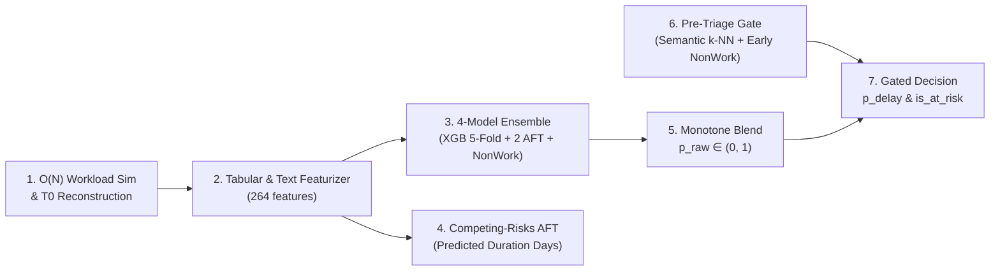

# TÓM TẮT MÔ HÌNH DỰ ĐOÁN RỦI RO TRỄ HẠN ISSUE (DELAY RISK PREDICTION) TẠI THỜI ĐIỂM TẠO ($T_0$)

Trong quản lý dự án phần mềm trên Jira, bài toán **Delay Risk Prediction** đặt mục tiêu dự đoán xem một issue vừa được khởi tạo tại thời điểm $T_0$ có nguy cơ vượt quá thời hạn SLA cam kết (`is_delayed = 1`) hay không, đồng thời ước lượng số ngày hoàn thành thực tế (`predicted_duration_days`).

Thách thức lớn nhất của bài toán trên tập dữ liệu **The Public Jira Dataset** ($2.68$ triệu issues) gồm 3 vấn đề:
1. **Dữ liệu kiểm duyệt phải (Right-Censored Data)**: Có $195,422$ issues đang mở tại mốc cắt tập Train chưa có ngày đóng.
2. **Nhiễu từ tác vụ ảo (Non-Work / Duplicate Issues)**: Khoảng $31.6\% - 45\%$ issues bị đóng nhanh do trùng lặp (`Duplicate`), không phải lỗi (`Not a Bug`), hoặc từ chối xử lý (`Won't Fix`).
3. **Dịch chuyển phân phối theo thời gian (Temporal Prior Shift)**: Tỷ lệ trễ giảm từ $39.68\%$ (Train) xuống $21.68\%$ (Test).

Để giải quyết đồng thời cả 3 thách thức mà không bị rò rỉ dữ liệu tương lai (*Zero Temporal Data Leakage*), khóa luận thiết kế kiến trúc **Tổ hợp Đa Mô hình kết hợp Phân tích Sinh tồn và Cổng lọc Pre-Triage (`DelayRiskScorer`)**.

---

## SƠ ĐỒ KIẾN TRÚC MÔ HÌNH DỰ ĐOÁN TRỄ HẠN (`DelayRiskScorer`)

---

## MÔ TẢ CHI TIẾT TỪNG MODULE

### 1. $O(N)$ Workload Simulation & $T_0$ Reconstruction (`load_issues_t0` & `chronological_features`)
- **Module này dùng để làm gì?**: Khôi phục đúng trạng thái của issue lúc mới tạo ($T_0$) và tái hiện chính xác tải công việc thực tế của từng developer, reporter, project tại đúng giây $T_0$ mà không nhìn trước tương lai.
- **Cơ chế hoạt động**:
  - **Khôi phục thuộc tính $T_0$**: Truy vấn ngược `from_value` của bản ghi changelog đầu tiên để lấy đúng `priority_t0`, `issuetype_t0`, `assignee_t0` (vì bảng `issues` chỉ lưu giá trị cuối cùng sau khi đóng). Chỉ đếm các liên kết phụ thuộc có `link_ts <= T0`.
  - **Mô phỏng hàng đợi sự kiện $O(N)$**: Sắp xếp toàn bộ $4.99$ triệu sự kiện `CREATE` và `RESOLVE` theo thời gian để cập nhật cuốn chiếu số task đang mở (`active_count`), chỉ số tắc nghẽn tải làm việc (`assignee_wci`), hệ số nén lịch trình (`scf`), cùng lịch sử `cycle_time` và `delay_rate` (toàn cục và trong cửa sổ trượt 90 ngày).

### 2. Tabular & Text Featurizer (`TextRiskFeatures` & `DelayFeaturizer` — $264$ features)
- **Module này dùng để làm gì?**: Biến đổi dữ liệu thô và văn bản mô tả thành ma trận **$264$ đặc trưng số học (`float32`)** đồng nhất giữa lúc huấn luyện và lúc suy luận.
- **Cơ chế hoạt động**:
  - **Text Features**: Nén vector embedding 768 chiều (`nomic-embed-text`) thành 16 chiều `TruncatedSVD(16)` và 1 điểm `semantic_delay_risk` (qua bộ phân loại tuyến tính `SGDClassifier`), kết hợp thêm `TF-IDF (1,2)-grams` (40 chiều) + `SVD(8)` trên tiêu đề `summary`.
  - **Tabular Encodings**: Tạo các tỷ số tải công việc, ước lượng thời gian giải phóng hàng đợi (`queue_clearing_estimate`), tương tác phi tuyến (`wci_x_scf`, `pressure_index`), `One-Hot Encoding` (top-16) và `Out-of-Fold Smoothed Target Encoding` ($\text{smoothing} = 20.0$). Bộ mã hóa được fit riêng thành 2 bản: `xgb_featurizer` (trên $1,615,472$ mẫu Train đã đóng) và `surv_featurizer` (trên $1,810,894$ mẫu gồm cả mẫu kiểm duyệt phải).

### 3. 4-Model Ensemble: Phân loại Nhị phân + Phân tích Sinh tồn (`train_xgboost`, `train_aft`, `train_catboost_survival`, `train_non_work`)
- **Module này dùng để làm gì?**: Kết hợp sức mạnh của bộ phân loại nhị phân, mô hình sinh tồn (tận dụng $195,422$ task đang mở chưa đóng để tránh *Survivorship Bias*) và bộ nhận diện task ảo để ước lượng xác suất trễ hạn từ nhiều góc nhìn độc lập.
- **Cơ chế hoạt động**: Gồm 4 nhánh mô hình chạy song song trên 264 đặc trưng:
  1. **`XGBoost 5-Fold Classifier` (`p_xgb`)**: Tổ hợp 5 folds phân tầng có trọng số ưu tiên dữ liệu gần (`recency_alpha = 1.285`), dự đoán trực tiếp xác suất `is_delayed = 1`.
  2. **`XGBoost Survival AFT` (`p_aft`)**: Huấn luyện với hàm mục tiêu `survival:aft` (phân phối `normal`, `scale = 0.8`) trên dữ liệu khoảng $[y_{\text{lower}}, y_{\text{upper}}]$, quy đổi thời gian dự đoán sang xác suất vượt hạn $P(T > t_{\text{planned}})$.
  3. **`CatBoost Survival AFT` (`p_cbs`)**: Huấn luyện với hàm mất mát `SurvivalAft` (`Normal`, `scale = 2.6`), cung cấp nguồn xác suất sinh tồn thứ hai có độ hiệu chuẩn (calibration) tốt.
  4. **`Non-Work Classifier` (`p_non_work`)**: Mô hình XGBoost dự đoán xác suất issue là tác vụ ảo (`Duplicate`, `Invalid`, `Won't Fix`...) để lấy phần bù $(1 - p_{\text{non\_work}})$ làm tín hiệu xác nhận "công việc kỹ thuật thực thụ".

### 4. Competing-Risks CatBoost AFT (`cbs_cr` — Dự báo số ngày hoàn thành)
- **Module này dùng để làm gì?**: Cung cấp con số ước lượng trực tiếp **số ngày cần thiết để hoàn thành công việc thực sự (`predicted_duration_days`)** cho nhà quản lý dự án.
- **Cơ chế hoạt động**: Huấn luyện mô hình `CatBoost SurvivalAft` (`Logistic`, `scale = 0.6`) theo cơ chế **Rủi ro Cạnh tranh (Cause-Specific Competing Risks)**: toàn bộ các issue bị đóng do `Duplicate` / `Invalid` / `Won't Fix` đều được xem là bị kiểm duyệt phải (*censored*) tại thời điểm đóng, giúp mô hình không bị kéo lệch thời gian dự đoán xuống thấp bởi các task ảo đóng nhanh.

### 5. Monotone Piecewise-Linear Blend (`blend` — $p_{\text{raw}}$)
- **Module này dùng để làm gì?**: Hợp nhất 4 nguồn xác suất ở Module 3 thành một xác suất rủi ro tổng hợp $p_{\text{raw}}$ đã được hiệu chuẩn đơn điệu theo phân phối thực tế.
- **Cơ chế hoạt động**: Tính tổng có trọng số:
  $$s = 0.45\,p_{\text{xgb}} + 0.30\,p_{\text{aft}} + 0.15\,p_{\text{cbs}} + 0.10\,(1 - p_{\text{nw}})$$
  Sau đó nội suy tuyến tính từng khúc (`np.interp`) qua các điểm nút chuẩn hóa `knots_x = [0.0, 0.325, 0.435, 1.0]` $\to$ `knots_y = [0.0, 0.46, 0.4699, 0.95]`.

### 6. Pre-Triage Gate (`causal_nonwork_features` & `semantic_knn_features`)
- **Module này dùng để làm gì?**: Phát hiện sớm các issue là **báo cáo trùng lặp (`Duplicate`) hoặc task rác sẽ bị đóng nhanh trong vòng 7 ngày đầu** để giảm thiểu cảnh báo giả (*False Positives*) ngay tại thời điểm $T_0$.
- **Cơ chế hoạt động**: Trích xuất 10 đặc trưng chuyên biệt tại $T_0$ gồm:
  - **6 đặc trưng `Causal Non-Work Rates`**: Tỷ lệ đóng ảo trong 90 ngày gần nhất trước $T_0$ của `project`, `(project, issuetype)`, `reporter`, `assignee_t0`, và `instance`.
  - **4 đặc trưng `Semantic k-NN` trên GPU**: Độ tương đồng cosine lớn nhất giữa vector embedding của issue mới với $256$ issues đang mở cùng project (`max_sim_active`) và $4,096$ issues vừa đóng gần nhất trước $T_0$ (`max_sim_resolved`), cùng tỷ lệ non-work có trọng số của $k = 10$ láng giềng gần nhất.
  - Mô hình `early_nonwork.ubj` (XGBoost trên $264 + 10 = 274$ đặc trưng) dự đoán xác suất $p_{\text{early\_non\_work}}$.

### 7. Gated Decision & Alerting (`DelayRiskScorer.score`)
- **Module này dùng để làm gì?**: Đưa ra quyết định cảnh báo cuối cùng (`p_delay` và cờ `is_at_risk`) đảm bảo bắt được trên $80\%$ số task trễ hạn thực tế (`Recall >= 0.80`).
- **Cơ chế hoạt động**:
  - Nếu một issue bị cổng Pre-Triage gắn cờ (`p_early_non_work >= 0.80`), xác suất rủi ro được giảm chấn: $p_{\text{delay}} = 0.20 \times p_{\text{raw}}$ (ngược lại giữ nguyên $p_{\text{delay}} = p_{\text{raw}}$).
  - So sánh với ngưỡng quyết định tối ưu `threshold = 0.39` để gắn nhãn `is_at_risk = True/False`.
  - **Kết quả trên tập Out-of-Time Test ($346,174$ issues)**: Đạt **`Recall = 0.8244`** (bắt trúng **$61,870 / 75,050$** task trễ hạn), **`ROC-AUC = 0.7268`**, **`PR-AUC = 0.4139`**, **`F1-Score = 0.4448`**, và **`Brier Score = 0.1880`**.
