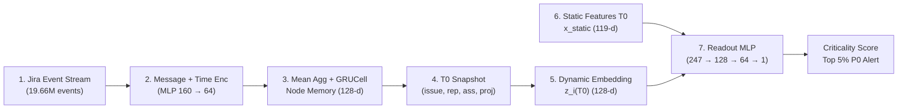

# TÓM TẮT MÔ HÌNH TEMPORAL GRAPH NETWORK (TGN) TRONG ĐÁNH GIÁ TASK CRITICALITY TẠI THỜI ĐIỂM TẠO ($T_0$)

Trong quản lý dự án phần mềm trên Jira, việc đánh giá mức độ quan trọng của một issue (**Task Criticality**) ngay lúc mới tạo ($T_0$) là bài toán khó vì bản thân issue đó chưa có lịch sử hoạt động. Tuy nhiên, các đối tượng xung quanh nó — gồm người tạo (`reporter`), người nhận việc (`assignee`), và dự án (`project`) — đều đã có lịch sử tương tác dày đặc. Để khai thác bối cảnh động này mà không bị rò rỉ dữ liệu tương lai (*Zero Temporal Data Leakage*), khóa luận sử dụng mô hình **Temporal Graph Network (TGN)** trên toàn bộ **The Public Jira Dataset** ($2.68$ triệu issues, $19.66$ triệu events, $3.45$ triệu nodes).

---

## SƠ ĐỒ KIẾN TRÚC MÔ HÌNH TGN

---

## MÔ TẢ CHI TIẾT TỪNG MODULE

### 1. Jira Event Stream (`EventStream` — $19.66\text{M}$ events)
- **Module này dùng để làm gì?**: Biến dữ liệu lịch sử rời rạc trong cơ sở dữ liệu Jira (bảng issues, changelogs, comments, links) thành một **dòng sự kiện tuần tự theo thời gian thực** để mô hình có thể "quan sát" diễn biến của toàn bộ dự án giống như cách dự án vận hành ngoài đời thực.
- **Cơ chế hoạt động**: Hợp nhất 6 loại sự kiện (`status`, `assignee`, `priority`, `comment`, `link`, `create`) sắp xếp tăng dần theo timestamp và chia thành $1,966$ chunks ($10,000$ events/chunk). Mỗi sự kiện luôn kết nối bộ 3 **nodes** $(u, v, p)$ trong tổng số $3.45$ triệu nodes:
  - **Node `u` (Issue nguồn)**: Issue đang xảy ra sự kiện (ví dụ: `Apache|SPARK-1234`).
  - **Node `v` (Counterpart node — đối tác tham gia sự kiện)**: Là `user` tạo issue (`create`), `user` nhận việc (`assignee`), `user` bình luận (`comment`), giá trị `status`/`priority` mới chuyển tới, hoặc `issue` đích bị liên kết (`link`).
  - **Node `p` (Project node)**: Dự án chứa issue `u` (ví dụ: `Apache|project:SPARK`), đóng vai trò lưu giữ bối cảnh chung của toàn dự án.

### 2. Message + Time Encoding (`raw_messages` & `msg_fn` — $160 \to 64$)
- **Module này dùng để làm gì?**: Đóng gói toàn bộ thông tin của một sự kiện vừa xảy ra (loại sự kiện là gì, bao lâu rồi node mới có tương tác lại, và đối tác đang tương tác có trạng thái như thế nào) thành một **vector thông điệp (`message`) 64 chiều** để gửi tới các nodes $(u, v, p)$.
- **Cơ chế hoạt động**:
  - **Time Encoding ($\Phi(\Delta t) \in \mathbb{R}^{16}$)**: Tính khoảng thời gian $\Delta t$ (giờ) từ lần cập nhật trước của chính node nhận rồi mã hóa bằng 8 tần số cos/sin ($\omega_k = 10^{-4k/7}$), giúp mô hình phân biệt được tương tác dồn dập (vài phút/giờ) với sự ngưng trệ kéo dài (hàng trăm giờ).
  - **Message Function ($\mathbb{R}^{160} \to \mathbb{R}^{64}$)**: Nối đặc trưng sự kiện $x_{\text{dom}}$ (16 chiều), mã hóa thời gian $\Phi(\Delta t)$ (16 chiều) và memory hiện tại của counterpart node $s_{\text{cpt}}(t^-)$ (128 chiều) rồi đưa qua mạng MLP ($\text{Linear}(160 \to 128) \to \text{ReLU} \to \text{Linear}(128 \to 64)$). Nhờ ghép $s_{\text{cpt}}(t^-)$, nếu một developer đang quá tải nhận việc, tín hiệu quá tải từ memory của developer sẽ truyền trực tiếp sang memory của project và issue.

### 3. Mean Aggregator + GRUCell Updater (`apply` & `commit` — $128\text{-d}$)
- **Module này dùng để làm gì?**: Cập nhật **trí nhớ dài hạn (`memory vector` 128 chiều)** của từng node sau mỗi khối sự kiện, giúp mỗi developer, project và issue tự động tích lũy lịch sử hoạt động từ đầu dự án đến thời điểm hiện tại.
- **Cơ chế hoạt động**:
  - **Mean Aggregator**: Trong một chunk $10,000$ events, một node (nhất là node `project` hoặc `user` năng động) có thể nhận hàng chục messages cùng lúc. Module dùng hàm `index_add_` trên GPU để gom trung bình các messages đó thành một vector đại diện duy nhất $\bar{m}_u \in \mathbb{R}^{64}$ cho mỗi node.
  - **GRUCell Updater**: Đưa thông điệp trung bình $\bar{m}_u$ và trạng thái nhớ cũ $s_u(t^-)$ vào cổng hồi quy `GRUCell(64, 128)` để tính ra trạng thái nhớ mới $s_u(t) \in \mathbb{R}^{128}$. Trọng số của module này được huấn luyện tự giám sát (*Self-Supervised Temporal Link Prediction*) chỉ trên các sự kiện thuộc tập Train.

### 4. Zero-Leakage Snapshot tại $T_0$ & tại Thời điểm Dự án Thay đổi (`snapshot_memory` & `snapshot_memory_at_change` — $517\text{-d}$)
- **Module này dùng để làm gì?**: Chụp lại (**đóng băng**) trạng thái bộ nhớ của `issue` và môi trường xung quanh ở **cả thời điểm vừa khởi tạo ($T_0$)** lẫn **bất kỳ thời điểm nào dự án có sự kiện thay đổi ($t_{\text{change}} \in [T_0, T_{\text{resolved}})$)**, đảm bảo **tuyệt đối không nhìn trước tương lai** (*Zero Temporal Leakage*).
- **Cơ chế hoạt động**:
  - **Chế độ tại $T_0$ (`snapshot_memory`)**: Ngay trước khi áp dụng chunk chứa mốc $T_{0,i}$, hệ thống trích xuất memory của `issue` ($s_i(T_0^-) = \mathbf{0}$), `reporter`, `assignee_t0` và `project`.
  - **Chế độ tại thời điểm dự án thay đổi (`snapshot_memory_at_change`)**: Chia mỗi chunk thành 2 pha (`pre_mask` và `post_mask`) để áp dụng toàn bộ các sự kiện đang mở ($\text{ts} \le t_{\text{change}}$, loại trừ sự kiện đóng `scat == 0`) trước khi trích xuất snapshot, đồng thời tự động cập nhật `assignee` mới nhất tại $t_{\text{change}}$. Nhờ đó, **100% số `issue` đều có vector bộ nhớ riêng $s_i(t_{\text{change}}) \neq \mathbf{0}$** phản ánh lịch sử tương tác thực tế của chính nó và của dự án tính đến thời điểm $t_{\text{change}}$.

### 5. Dynamic Embedding Module (`Readout.embed` — $517 \to 128$)
- **Module này dùng để làm gì?**: Chắt lọc và nén vector snapshot thô 517 chiều của 4 nodes lân cận thành một **vector biểu diễn đồ thị động (`dynamic embedding`) $z_i(t)$ 128 chiều** gọn nhẹ, giàu thông ngữ cảnh để sẵn sàng kết hợp với các đặc trưng dạng bảng.
- **Cơ chế hoạt động**: Đưa $Z_i(t) \in \mathbb{R}^{517}$ qua tầng chiếu tuyến tính kèm chuẩn hóa `Linear(517 -> 128) + LayerNorm + ReLU`. Các trọng số của tầng này được huấn luyện end-to-end cùng với mạng Readout để tự động học cách pha trộn thông tin giữa `issue`, `reporter`, `assignee` và `project`.

### 6. Static & Workload Features tại $T_0$ (`static_matrix` — $119\text{-d}$)
- **Module này dùng để làm gì?**: Bổ sung các **đặc trưng nội tại của chính issue tại thời điểm tạo $T_0$** (như nội dung văn bản mô tả, loại công việc, mức ưu tiên ban đầu và các chỉ số thống kê tải công việc tường minh) mà riêng cấu trúc đồ thị chưa thể hiện hết.
- **Cơ chế hoạt động**: Trích xuất $119$ đặc trưng chỉ dùng thông tin trước $T_0$ ít nhất 1 giây: thuộc tính `priority_t0`, `issuetype_t0`, `assignee_t0` (khôi phục từ `from_value` của bản ghi changelog đầu tiên), chỉ số quá tải `WCI`, hệ số nén lịch trình `SCF`, 16 chiều ngữ nghĩa văn bản `TruncatedSVD(16)` từ `nomic-embed-text`, và tỷ lệ tạo blocker lịch sử (`propensity features`).

### 7. Ranking-Aware Readout MLP (`Readout.trunk` — $247 \to 128 \to 64 \to 1$)
- **Module này dùng để làm gì?**: Kết hợp cả hai nguồn thông tin — **ngữ cảnh đồ thị động $z_i(t)$** và **đặc trưng tĩnh $x_{\text{static}}$** — để tính ra **điểm quan trọng cuối cùng (`Criticality Score` $\hat{y}_i \in (0, 1)$)** và xếp hạng tìm ra **Top 5% issues nguy hiểm nhất (P0)** trong từng Jira instance tại bất kỳ thời điểm nào dự án có cập nhật.
- **Cơ chế hoạt động**:
  - **Kiến trúc mạng**: Nối $z_i(t)$ ($128\text{-d}$) với $x_{\text{static}}$ ($119\text{-d}$) thành vector $247$ chiều, đưa qua mạng MLP (`Linear(247 -> 128) -> BatchNorm1d -> ReLU -> Dropout(0.2) -> Linear(128 -> 64) -> ReLU -> Linear(64 -> 1) -> Sigmoid`) và lấy trung bình kết quả từ **3 seeds (`[45, 47, 49]`)**.
  - **Huấn luyện đa mốc thời điểm dự án thay đổi (`Multi-Snapshot Project-Change Training`)**: Mỗi epoch lấy mẫu ngẫu nhiên các bản chụp từ lúc khởi tạo (`@T0_pre`) đến các mốc dự án có cập nhật (`@T3_change`, `@T7_change`, `@T_active_change`).
  - **Kết quả đạt được trên tập Out-of-Time Test ($346,174$ issues)**:
    - Ngay tại thời điểm tạo (`@T0_pre`): Đạt **`NDCG@10 = 0.9292`** (`Grouped = 0.8545`), **`ROC-AUC = 0.8367`**, **`Spearman` $\rho = 0.5992$**, bắt trúng **$4,183$ issues P0**.
    - Sau 3–7 ngày dự án có thay đổi (`@T3_change` $\to$ `@T7_change`): `NDCG@10` tăng lên **$0.9716$**, `Precision@Top-5%` tăng lên **$28.83\% \to 29.15\%$** (bắt trúng **$4,991 \to 5,045$ issues P0**).
    - Khi dự án có cập nhật trong quá trình issue đang mở (`@T_active_change`): Đạt **`NDCG@10 = 0.9920`** (`Grouped = 0.8987`), **`Spearman` $\rho = 0.7272$** (chính thức vượt mục tiêu $\ge 0.70$), **`ROC-AUC = 0.8735`**, và **`Precision@Top-5% = 38.99%`** (bắt trúng **$6,749$ issues P0**, tăng $+63.4\%$ so với mốc $T_0$).
